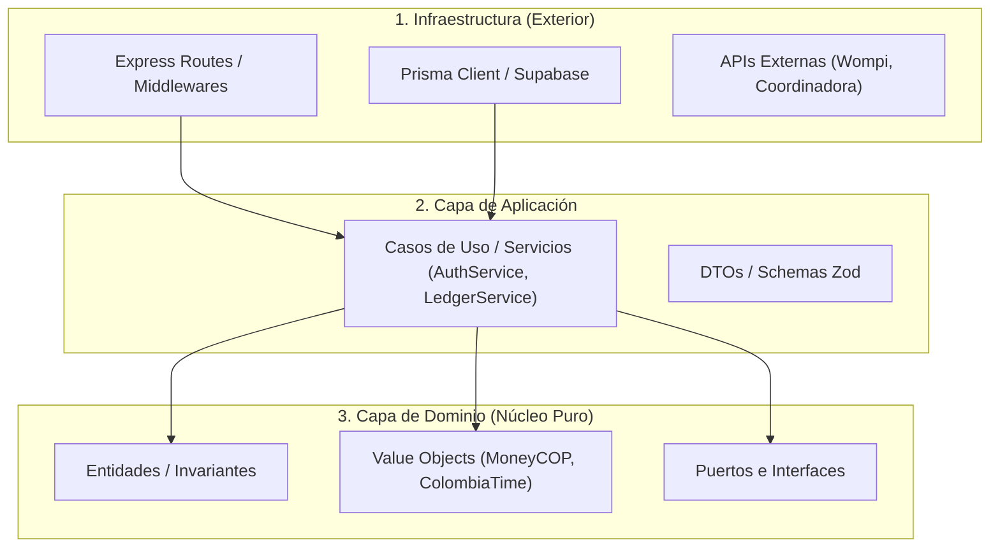

# Arquitectura Limpia y Aislamiento del Dominio (`@Arquitecto-Dominio`)

Esta skill aplica los principios de **Clean Architecture** y **Diseño Guiado por el Dominio (DDD)** al backend del Sistema POS y Tienda Web, garantizando que las reglas de negocio sobrevivan a cambios de librerías, ORMs o frameworks.

---

## Cuándo Activar Esta Skill
- Al crear nuevos módulos en `backend/src/modules/`.
- Al definir contratos con servicios externos (pasarelas de pago, facturación electrónica, operadores logísticos).
- Al auditar que los controladores no contengan lógica financiera ni consultas SQL/Prisma directas.
- Al verificar que los modelos de dominio no dependan de `req`/`res` de Express ni de detalles de Supabase.

---

## Las 4 Capas y la Regla de Dependencia

### 1. Núcleo de Dominio Puro (`src/shared/domain/` y `src/shared/ports/`)
- **Cero Dependencias Externas:** Esta capa no importa `express`, `@prisma/client`, ni librerías de red.
- **Value Objects Inmutables:** Clases puras como `MoneyCOP.ts` y `ColombiaTime.ts` encapsulan la aritmética entera y el huso horario oficial de Colombia (`America/Bogota`).
- **Puertos (Interfaces):** Define contratos en `src/shared/ports/` (ej. `PagoPort`, `FacturacionPort`, `DespachoTransportadoraPort`) sin saber qué librería o proveedor los implementará.

### 2. Capa de Aplicación (`src/modules/*/service.ts`)
- Orquesta el flujo de negocio: valida DTOs de entrada con Zod, invoca entidades de dominio y coordina transacciones de base de datos.
- Prohibido recibir el objeto `req` o `res` de Express; los servicios solo reciben objetos de datos planos tipados (`DTO`).

### 3. Capa de Infraestructura y Controladores (`src/modules/*/controller.ts` y `routes.ts`)
- Traduce peticiones HTTP (headers, body, params) a DTOs.
- Ejecuta los middlewares de validación Zod (`validateBody`, `validateQuery`), autenticación (`requireAuth`) y permisos (`requirePermiso`).
- Devuelve respuestas JSON normalizadas con formato estándar `{ ok: true, datos }` o delega errores a `errorHandler`.
