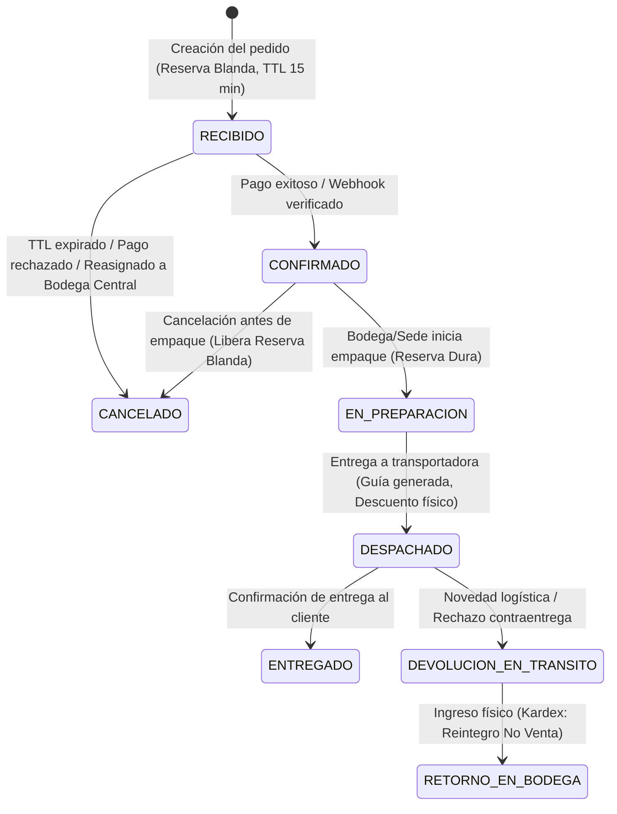

# Máquina de Estados de Pedidos Web y Checkout Idempotente

Esta skill traslada los patrones de producción de comercio electrónico y pasarelas de pago (`finsilabs/awesome-ecommerce-skills`) al módulo de pedidos web del Sistema POS y Tienda Web.

---

## Cuándo Activar Esta Skill
- Al diseñar o refactorizar endpoints del carrito de compras (`/api/carrito`) y checkout (`/api/pedidos-web`).
- Al procesar webhooks asíncronos de pasarelas de pago (Wompi, PayU, Bold).
- Al gestionar las transiciones de estado de un pedido (`RECIBIDO` $\rightarrow$ `CONFIRMADO` $\rightarrow$ `EN_PREPARACION` $\rightarrow$ `DESPACHADO` $\rightarrow$ `ENTREGADO`).
- Al coordinar la reserva de inventario web contra el mostrador físico del POS.

---

## 1. La Máquina de Estados Finita (FSM) de Pedidos Web

### Reglas Inquebrantables de Transición:
1. **Transiciones Prohibidas:**
   - Un pedido en estado `DESPACHADO` o `ENTREGADO` **jamás** puede pasar directamente a `CANCELADO`; debe pasar por el flujo de logística inversa / devolución (`RN-DEV-01`).
   - Un pedido `EN_PREPARACION` (reserva dura) **no puede** ser expropiado por el POS (`RN-VTA-03`).
2. **Doble Nivel de Reserva en Inventario (`RN-INV-01`, `RN-WEB-15`, `RN-WEB-18`):**
   - **`RECIBIDO` / `CONFIRMADO`:** Genera `reservadoBlando`. El POS de mostrador puede expropiar este stock si no hay otra unidad física; en ese caso, el pedido web se reasigna a otra sede o pasa a custodia en Bodega Central.
   - **`EN_PREPARACION`:** Ejecuta `ENDURECIMIENTO_RESERVA_WEB` en `InventoryLedgerService`. Se convierte en `reservadoDuro` y queda blindado contra el POS.
   - **`DESPACHADO`:** Ejecuta `DESPACHO_WEB`, descontando atómicamente el `fisico` y el `reservadoDuro` en un solo paso.

---

## 2. Idempotencia y Blindaje de Webhooks de Pago

1. **Firma Criptográfica Obligatoria:**
   - Todo webhook entrante debe validar su firma HMAC (`X-Signature` o similar) con el secreto de la pasarela antes de leer el cuerpo.
2. **Clave de Idempotencia por Transacción:**
   - El `idTransaccionPasarela` debe almacenarse con restricción `UNIQUE` en la tabla de pagos/pedidos.
   - Si la pasarela reintenta el webhook para una transacción ya procesada, el backend responde de inmediato `200 OK` con `{ ok: true, mensaje: 'Transacción ya procesada previamente' }` sin duplicar movimientos ni inventario.
3. **Manejo de Tiempos y TTL:**
   - Si el webhook de pago llega después de que el worker TTL (`reservaExpirationWorker.ts`) canceló el pedido por inactividad:
     - El pedido **no se reactiva automáticamente** si el stock ya fue consumido.
     - Se registra como `PAGO_EXTEMPORANEO_REQUIERE_REVISION` y se emite alerta al administrador para reembolso o reasignación manual (`CA-39`).
