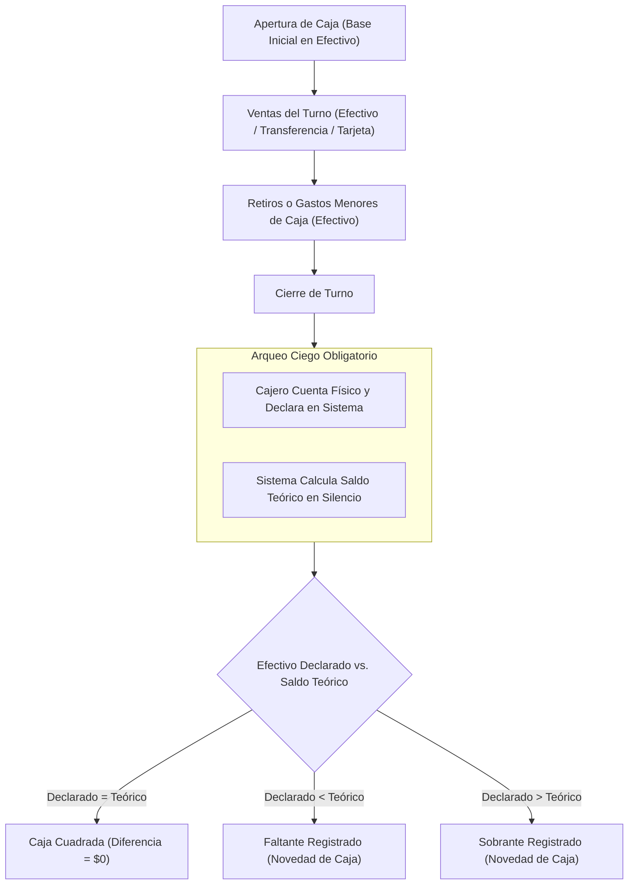

# Auditoría Financiera, Arqueos de Caja y Cuadre de Ventas Netas

Esta skill condensa los principios contables de doble partida y auditoría financiera de `openaccountant/skills` adaptados al Sistema POS Multisede y la normativa comercial colombiana.

---

## Cuándo Activar Esta Skill
- Al programar apertura, arqueo y cierre de sesiones de caja (`MOD-07`).
- Al diseñar o auditar endpoints de ventas físicas y pagos mixtos (efectivo, datáfono, transferencia).
- Al liquidar devoluciones, cambios y saldos a favor del cliente (`MOD-10`).
- Al generar reportes de cierre de turno y métricas de Ventas Netas (`CA-64`, `CA-65`).

---

## 1. Reglas de Oro de Aritmética Financiera

1. **Dinero Entero en Pesos Colombianos (`RN-GEN-04`):**
   - Todos los importes monetarios se manejan como enteros (`INT`).
   - Queda prohibido el uso de tipos de coma flotante (`FLOAT`, `DOUBLE`) para dinero.
2. **Algoritmo de Prorrateo sin Pérdida de Residuo (`RN-DES-09`):**
   - Cuando un descuento global o cupón se distribuye entre $N$ líneas de detalle:
     $$\text{DescuentoLínea}_i = \left\lfloor \frac{\text{SubtotalLínea}_i \times \text{DescuentoTotal}}{\text{SubtotalTotal}} \right\rfloor$$
   - La suma de los descuentos prorrateados puede dejar un residuo de unos pocos pesos por el redondeo hacia abajo.
   - **Regla:** El residuo exacto ($\text{DescuentoTotal} - \sum \text{DescuentoLínea}_i$) se suma obligatoriamente a la última línea elegible. La suma de las partes debe igualar exactamente al total.

---

## 2. Arqueo Ciego y Cuadre de Caja (`RN-CAJ-04`, `CA-54`)

### Fórmula de Cuadre de Efectivo Teórico:
$$\text{EfectivoTeórico} = \text{BaseInicial} + \text{VentasEfectivo} + \text{IngresosManuales} - \text{RetirosEfectivo} - \text{DevolucionesEfectivo}$$

- **Principio de Caja Ciega:** El cajero **nunca** ve el saldo teórico en pantalla antes de ingresar su conteo. Debe contar los billetes/monedas y escribir el valor. Solo tras guardar el conteo, el sistema revela la diferencia.
- **Medios Electrónicos Separados:** Los pagos con datáfono o transferencia no suman al efectivo de caja; se concilian contra el lote del datáfono y el comprobante bancario (`CA-54`).

---

## 3. Integridad Contable en Devoluciones y Cambios (`CA-64`, `CA-65`)

1. **Impacto en Ventas Netas:**
   - Una devolución en dinero o saldo a favor **descuenta** de las Ventas Netas del día en que se procesa la devolución, **no** modifica retroactivamente la factura original.
2. **Retornos Logísticos de Contraentrega:**
   - Si un pedido web contraentrega es rechazado por el cliente en destino y devuelto por la transportadora:
     - El reingreso del producto al inventario (`RETORNO_LOGISTICO_NO_VENTA`) **no** debe registrarse como devolución de venta, porque la venta nunca ocurrió ni se recaudó dinero (`CA-64`).
3. **Saldo a Favor del Cliente:**
   - La emisión de un saldo a favor no genera movimiento de efectivo en caja.
   - El saldo a favor se considera un pasivo con el cliente; solo se reconoce como venta cuando el cliente lo redime en una nueva compra.
