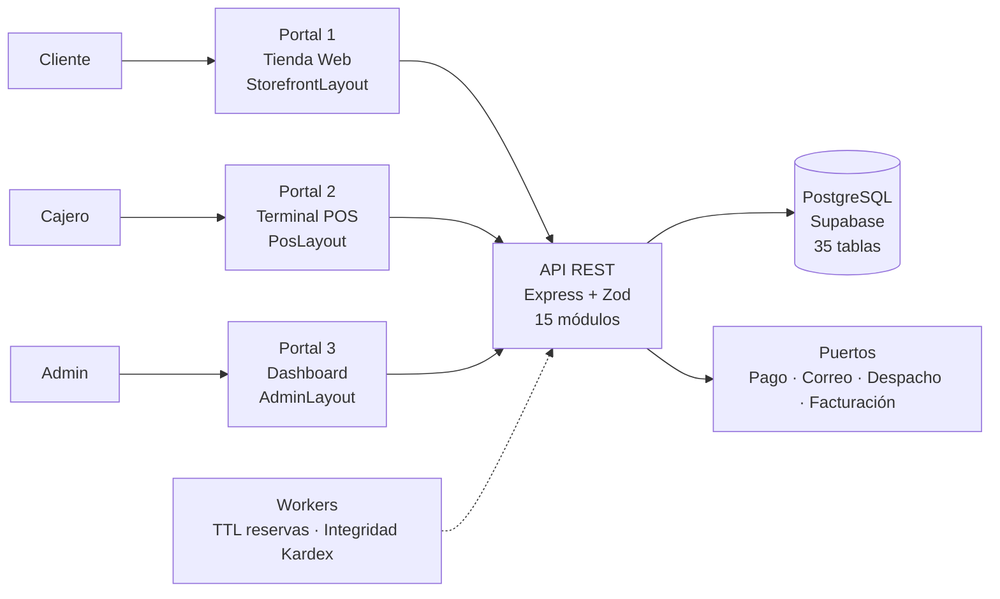
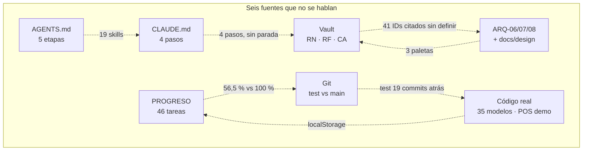
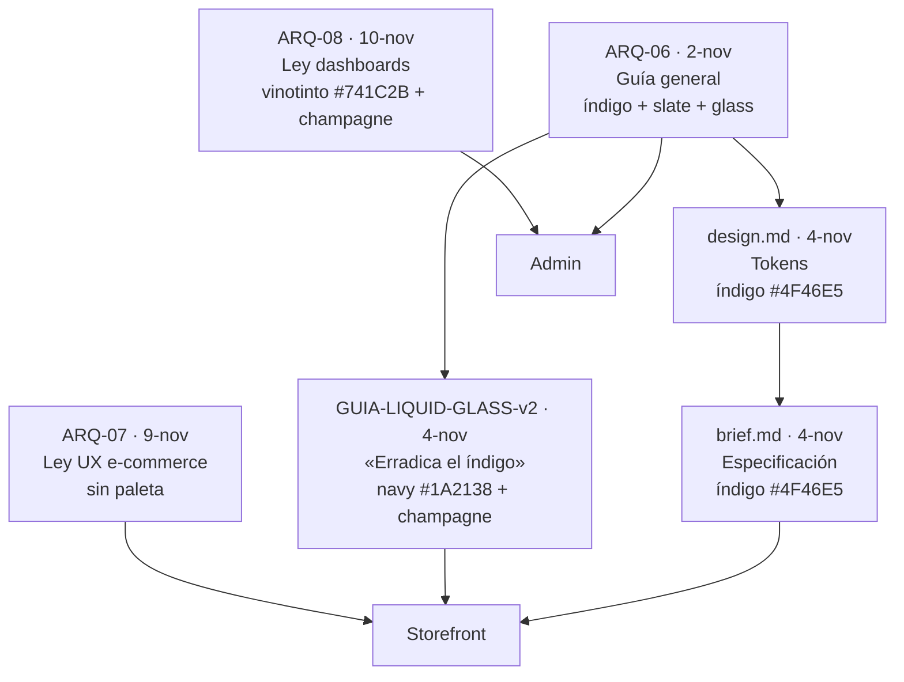
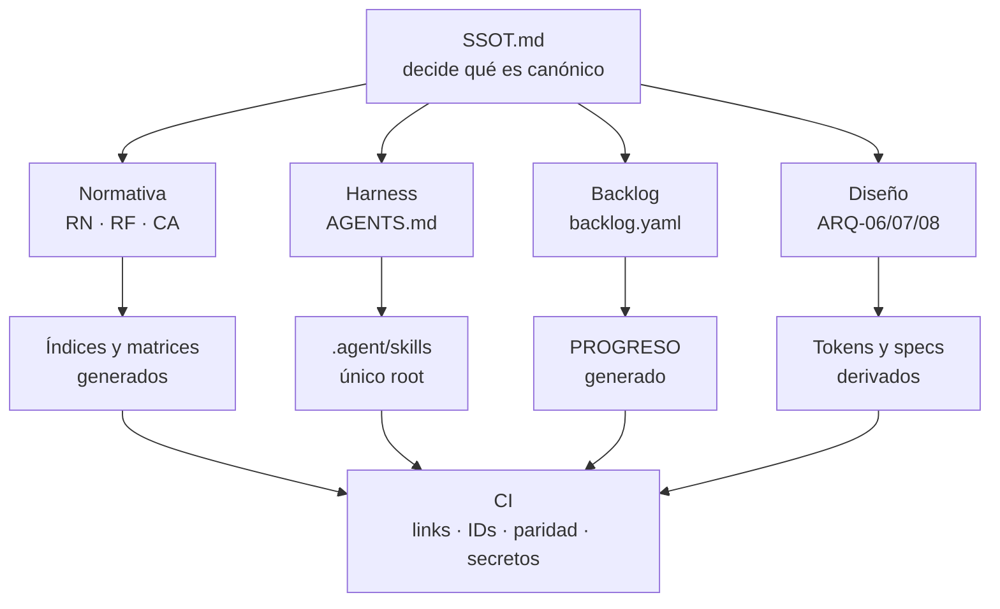
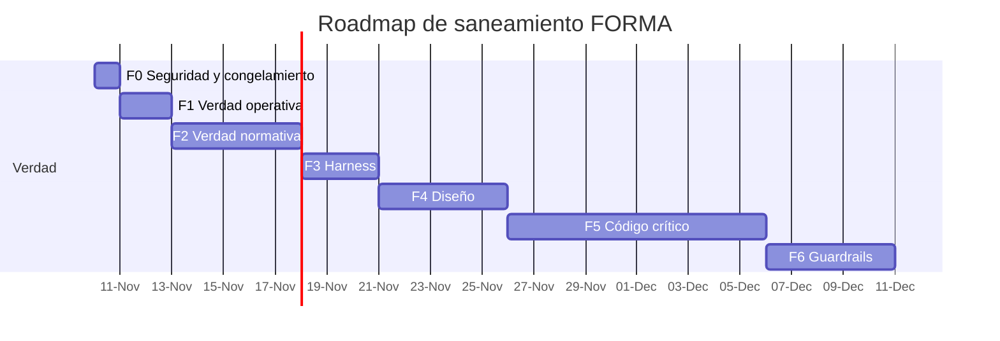

# Plan de Saneamiento Documental y QA Integral — FORMA SPOS

> **Veredicto en una frase:** el producto existe y corre, pero la documentación que dice *qué es* y *en qué estado está* no es confiable. Hay al menos **seis fuentes de verdad que se contradicen** y tres de ellas tocan dinero, inventario o seguridad.
>
> **No voy a darte un porcentaje global.** El propio tablero declara tres cifras incompatibles (56,5 %, 73,9 % y 100 %). Dar otra sería sumarme al problema. Lo que sí puedo darte es qué está verificado, qué no, y cómo cerrar la brecha.

> **Corrección de contexto confirmada por el usuario (10-nov-2026, 16:23).** El proyecto **ya no se trabaja en equipo**. Una sola persona desarrolla en `test/sandbox-testeo` y publica en `main`. Esto **corrige el hallazgo P0-02**: no hay un «GitFlow invertido» por incumplimiento, sino una documentación que sigue describiendo 6 personas, PRs y una rama `develop` que ya no se usan. Dato adicional verificado: `test/sandbox-testeo` es local, su último commit es del **5-nov** y está **19 commits por detrás de `main`**; es ancestro de `main`, así que hoy no aporta cambios nuevos. Antes de retomarla hay que actualizarla.

**Cómo leer este documento**

| Si tienes… | Lee… |
| :--- | :--- |
| 2 minutos | §0 Resumen ejecutivo y §3 Veredicto |
| 10 minutos | §1 Qué es FORMA, §4 Los 7 síndromes y §5 Hallazgos P0 |
| Necesitas decidir | §6 Diseño (ARQ-07/08) y §9 Qué necesito de ti |
| Vas a ejecutar | §7 Solución, §8 Roadmap y Anexo D |

---

## 0. Resumen ejecutivo

### Lo que encontré

1. **El estado del proyecto se contradice dentro del mismo archivo.** `PROGRESO-ACTUAL.md` declara el Sprint 5 en 0 % planificado (línea 18) y, 90 líneas después, en 100 % certificado (líneas 107-112). El consolidado dice 46/46 = 100 % (línea 118) mientras la tabla dice 26/46 = 56,5 % (línea 19). Y el denominador 46 no existe: las filas suman 40, el detalle 38 y el Plan Maestro 45.
2. **El proceso documentado ya no existe.** El tablero, la matriz de roles y el Plan Maestro describen 6 personas, PRs, QA Gates y una rama `develop`; tú trabajas solo, en `test/sandbox-testeo` y publicas en `main`. Además, `test/sandbox-testeo` está **19 commits por detrás de `main`** (último commit 5-nov) y es local: retomarla sin actualizar es programar sobre código viejo.
3. **El POS no asienta ventas en el backend.** `PosTerminalPage` calcula IVA y descuenta stock en el navegador y guarda la venta en `localStorage` (`posLedgerSync.ts:152`, `cajaStore.ts:2`). El endpoint canónico `POST /api/ventas-pos` existe pero la UI **nunca lo invoca**. No hay Kardex, caja, consecutivo ni idempotencia reales en el flujo principal.
4. **El cobro por QR es un bypass de pago.** `POST /api/qr-pago/aprobar` no exige autenticación, crea la sesión como `PAGADA` si no existe y el POS confirma la venta al leerla (`qrPago.router.ts:83-104`, `PagoQrClientePage.tsx:45-59`).
5. **Hay credenciales de producción en el repositorio y en el bundle.** El `TELEGRAM_BOT_TOKEN` está en claro en `render.yaml:25` y **duplicado** en `backend/.env.example:23`; y `apiClient.ts:66-80` hace auto-login con un correo y una contraseña de administrador escritos en el código cuando una ruta admin devuelve 401. Además conviven tres proveedores de despliegue (Vercel, Render y Railway) y `app.use(cors())` está abierto a cualquier origen.
6. **La «ley» de e-commerce no contiene su articulado.** ARQ-07 tiene 34 secciones y 13 figuras, pero **no enumera los 14 mandamientos** que MOC, AGE-09 y la skill citan. La skill y el agente dan **dos listas distintas** de esos 14 mandamientos.
7. **El harness tiene dos linajes.** `AGENTS.md` impone 5 etapas (0-4); `CLAUDE.md` impone 4 pasos y pierde la parada obligatoria y la matriz de skills. Las 6 skills duplicadas en `.claude/skills` **divergen en 4 casos** y en ellas desaparece la regla «prohibido suponer».
8. **El diseño tiene seis documentos y tres paletas.** ARQ-06, `design.md` y `brief.md` mandan índigo `#4F46E5`; la guía Liquid Glass v2 dice que «erradica por completo» ese índigo y usa *Obsidian Navy* `#1A2138`; ARQ-08 manda vinotinto `#741C2B` y champagne `#C49A68` para el admin. Ningún documento dice cuál gana.

### Lo que está bien (y no hay que tocar)

- **El modelo de datos es sólido:** 35 modelos, 16 enums, 2 migraciones que crean **35 tablas** y `constraints_post_migrate.sql` con CHECKs. La cifra «33/15» es solo documentación vieja.
- **Las 7 invariantes están implementadas donde importa:** `MoneyCOP.ts`, `ColombiaTime.ts`, `InventoryLedgerService.ts` y `DiscountEngine.ts` existen y se usan.
- **El dashboard admin es el portal más alineado:** 4 KPIs de 95 px, línea 65 % / dona 35 %, histograma 50 % y monitores con `max-h-[220px]`. Cumple el layout de ARQ-08 casi al detalle.
- **Las 13 figuras de ARQ-07 existen** en `docs/vault/assets/ecommerce-design-law/` y las rutas coinciden.
- **Hay 53 archivos de test** (25 backend, 28 frontend) y 422 bloques `it(` estáticos. No están ejecutados en esta auditoría, pero existen.

### Los tres movimientos

1. **Declarar una sola fuente de verdad** (`SSOT.md`) y convertir todo lo demás en derivado o anexo. Sin esto, cada corrección vuelve a divergir.
2. **Separar «documentación» de «evidencia».** Un estado no es válido por estar escrito: exige PR, SHA, fecha y salida de test. El tablero debe generarse desde un backlog, no escribirse a mano.
3. **Cerrar primero lo que toca dinero o seguridad** (Fase 0): rotar el token, eliminar el backdoor admin, cerrar el QR, congelar el repo y arreglar la fórmula de arqueo. La documentación puede esperar 48 horas; un cobro falso o un login admin filtrado, no.

### La decisión que necesito de ti

**¿Apruebas que el vault (`docs/vault/`) sea la única fuente de verdad, con `AGENTS.md` como único harness y `.agent/skills/` como único root de skills, archivando los duplicados? ¿Y que el flujo oficial sea `test/sandbox-testeo` → `main`, archivando `develop`?** De esa respuesta depende todo el plan. Al final (§9) están las decisiones de producto y los accesos que necesito.

---

## 1. Qué es FORMA

### 1.1 El negocio

FORMA es una empresa colombiana que comercializa **ropa, accesorios, cosméticos y artesanías** con:

- **una Bodega Central en Cúcuta** (compras, custodia y despacho),
- **varios puntos de venta físicos** (POS de mostrador),
- **una tienda web** con envío nacional por **zonas DANE 1-4**,
- **devoluciones de 5 días** (calendario en POS, hábiles en web),
- **caja física** con base contada, arqueo ciego y sesión diaria.

**Operación real (confirmada el 10-nov-2026):** una sola persona; rama de trabajo `test/sandbox-testeo`; publicación en `main`; sin equipo, sin PRs obligatorios y sin `develop`. La documentación de equipo se conserva como **histórico**, no como norma vigente.

El catálogo es **mercancía terminada y estándar**: talla + color, presentación + tono, material. No hay personalización, producción por encargo ni lotes/vencimientos. Los cosméticos **no son reintegrables** a la venta (`reintegrableEnDevolucion = false`).

### 1.2 El sistema



**Un solo backend, una sola base de datos, tres clientes.** Los portales no se hablan entre sí: todos consumen la misma API (`ARQ-02:18`). El frontend es **un único proyecto React + Vite** con tres layouts cargados por `React.lazy()` (`ARQ-05:9-15`).

### 1.3 Las reglas que no se negocian

| # | Invariante | Qué significa en la práctica |
| :-: | :--- | :--- |
| 1 | **Dinero entero COP** | Todo importe es `INT`. Nada de flotantes. Prorrateo con `Math.floor()` y residuo a la última línea elegible. |
| 2 | **Hora de Colombia** | Se guarda en UTC, pero se evalúa en `America/Bogota`: días, meses, caja vencida y plazos. |
| 3 | **Kardex único** | Solo `InventoryLedgerService.ts` puede tocar `SaldoStock`. Cada cambio deja un movimiento inmutable. |
| 4 | **Orden anti-deadlock** | Antes de bloquear varias variantes, se ordenan por `varianteId ASC`. |
| 5 | **Dos niveles de reserva** | POS puede preemptar la reserva **blanda** (`RECIBIDO`/`CONFIRMADO`), nunca la **dura** (`EN_PREPARACION`). |
| 6 | **Idempotencia y consecutivos** | `Idempotency-Key` en `POST` transaccionales; el consecutivo se calcula justo antes del `COMMIT`. |
| 7 | **Inmutabilidad** | No se borra lo que tiene historial. Cambios de schema o migraciones destructivas requieren confirmación humana. |

### 1.4 Un día en FORMA (flujo que el sistema debe garantizar)

**Venta POS:** abrir caja con base contada → buscar por SKU/nombre → aplicar descuento → cobrar → descontar stock con movimiento de Kardex → generar consecutivo → imprimir ticket → cerrar con arqueo ciego.

**Pedido web:** ver semáforo de stock → calcular flete DANE → reservar 24 h → asignar sede determinista → preparar → despachar o «no puedo despachar» → custodia en Central o retorno logístico → devolución comercial si aplica.

**Lo que ambos comparten:** el precio y el stock **los decide el backend**, nunca el navegador (`RN-GEN-01`); y toda mutación de stock o dinero ocurre en **una sola transacción**.

---

## 2. Qué tenemos (inventario verificado)

| Dimensión | Cantidad | Fuente | Estado |
| :--- | ---: | :--- | :--- |
| Notas en el vault | **68** | `docs/vault/**/*.md` | 🟡 4 sin frontmatter, 2 huérfanas |
| Documentos `.md` en `docs/` | **76** | `docs/**/*.md` | 🟡 dispersos en 5 carpetas |
| Agentes documentados | **11** (AGE-00…AGE-10) | `docs/vault/07-Agentes/` | 🔴 solo notas: no hay `.agent/agents` ni `.claude/agents` |
| Skills documentadas | **16** notas `SKI-*` | `docs/vault/08-Skills/` | 🟡 17 de 33 carpetas sin nota |
| Carpetas de skills | **33** en `.agent/skills` + **6** en `.claude/skills` | filesystem | 🔴 4 duplicadas divergen |
| Modelos / enums | **35 / 16** | `schema.prisma` | 🟢 35 tablas creadas por migraciones |
| Migraciones | **2** | `backend/prisma/migrations/` | 🟢 cubren las 35 tablas |
| Módulos backend | **15** (16 routers) | `backend/src/modules/` | 🟢 |
| Features frontend | **4** (`admin`, `auth`, `pos`, `storefront`) | `frontend/src/features/` | 🟢 3 layouts |
| Archivos de test | **53** (25 backend + 28 frontend) | `*.test.ts(x)` | 🟡 no ejecutados aquí |
| Bloques `it(` estáticos | **422** (268 backend + 154 frontend) | conteo estático | 🟡 no es una salida de test |
| Configuraciones de deploy | **4 archivos / 3 proveedores** (Vercel raíz + `frontend/vercel.json`, Render, Railway) | raíz y `frontend/` | 🔴 solo una puede ser la real |
| Figuras de diseño | **13** e-commerce + **20** dashboards | `docs/vault/assets/` | 🟢 existen; las 20 del dashboard sin nombre normativo |
| Personas / sprints | **6 documentadas / 1 real**; 6 sprints | `PLAN-MAESTRO-SPRINTS.md`; confirmación del usuario | 🔴 roles y tablero describen un equipo inexistente |
| Ramas locales | **20** (15 fusionadas en `main`, 5 sin fusionar) + 52 remotas | `git branch` | 🔴 `develop` y las feature branches son legado |
| Hallazgos QA previos | **30 CLI + 5 DEF** | `Plan-de-pruebas-FORMA.md` | 🟡 informe huérfano, declara 100 % resuelto |

**Lectura del inventario:** el problema no es la cantidad de documentación. Es que **cada capa cuenta una versión distinta del mismo proyecto**. El vault dice 33 modelos; la base tiene 35. El tablero dice 46 tareas; el plan dice 45; las casillas dicen 38. Los tests son 263, 370, 126, 50 o 150 según el párrafo.

---

## 3. Veredicto QA

| Dimensión | Semáforo | Diagnóstico en una línea |
| :--- | :---: | :--- |
| **Negocio y alcance** | 🟢 | El modelo de negocio está claro y es coherente; el problema es de alcance, no de concepto. |
| **Reglas de dominio** | 🟠 | 98 reglas `RN`, 65 `CA` y 44 `RF` existen, pero **41 IDs citados no están definidos** y hay dos fórmulas de arqueo. |
| **Base de datos** | 🟢 | 35 modelos, 35 tablas, constraints e índices. La documentación está desactualizada, no el esquema. |
| **Backend** | 🟡 | Servicios y transacciones existen; fallan idempotencia atómica, workers y RBAC en 3 módulos. |
| **Frontend / POS** | 🔴 | El POS es una simulación local; el QR permite aprobar pagos sin autenticación; las reseñas son semilla. |
| **Diseño (ARQ-07/08)** | 🟡 | La UI cumple bastante, pero hay 6 documentos y 3 paletas sin regla de precedencia. |
| **Harness (agentes/skills)** | 🔴 | Dos linajes (5 vs 4 etapas), skills duplicadas divergentes y herramienta de parada inexistente. |
| **Gestión y trazabilidad** | 🔴 | El estado no cuadra, el proceso documentado es de 6 personas y la operación es de 1, QA Gates sin evidencia y conteos irreproducibles. |
| **Infraestructura y seguridad** | 🔴 | Token duplicado, credenciales admin en el bundle, CORS abierto, 4 configs de deploy y workers que no arrancan. |

**Concepto de QA:** *No apto para un release declarado «100 %»*. Sí apto para seguir construyendo si se congela la verdad y se cierran los P0. El proyecto no está en crisis de código; está en **crisis de verdad**.

---

## 4. Los 7 síndromes (causa raíz)

No son 40 problemas sueltos. Son **7 patrones** que producen los 40.

### S1. Doble (o triple) contabilidad del estado

El mismo hecho se cuenta en cuatro sitios: el Plan Maestro, el tablero, el informe de QA y git. Nadie los reconcilia.

- `PROGRESO-ACTUAL.md:18` → Sprint 5: 0 %, 0 fusionadas, «Planificado».
- `PROGRESO-ACTUAL.md:107-112` → Sprint 5: 4/4 `[x]`, «CERTIFICADO», 100 %.
- `PROGRESO-ACTUAL.md:19` → 26/46 = 56,5 %; `:118` → 46/46 = 100 %.
- `PLAN-MAESTRO-SPRINTS.md:22-111` → 45 tareas, con Sprint 0 que el tablero no reporta.
- `Plan-de-pruebas-FORMA.md:47` → 30/30 resuelto; `:1385` → «150/150 pruebas».

**Consecuencia:** no se puede decidir si el MVP está cerrado, en qué sprint va el proyecto ni qué se puede mostrar a un cliente.

**Agravante de contexto:** las asignaciones por persona (Julio 15, Yeimer 6, Exneider 8…) y los «PR #n» describen un equipo que ya no existe. Hoy son ficción documental, no carga de trabajo.

### S2. La ley sin articulado

Se invoca una norma que no contiene lo que se le atribuye.

- `MOC:76`, `AGE-09:12-25`, `SKI-pos-ecommerce-ux-law:10-24` y `TELEMETRIA:25` hablan de **«14 mandamientos»**.
- ARQ-07 tiene 34 secciones y una matriz de 13 figuras (`:455-471`), pero **no enumera los 14 mandamientos**.
- Peor: la lista de la skill y la del agente **no coinciden** (la skill pone ergonomía móvil/personalización en el 14; el agente pone CTAs).
- `AGE-09:7` cita un «artefacto vivo» `LEY_CANONICA_DISENO_ECOMMERCE_NAVEGACION.md` **que no existe**.

**Consecuencia:** dos agentes pueden cumplir «la misma ley» haciendo cosas distintas, y ninguno puede auditarse contra el texto.

### S3. Dos linajes del harness

Conviven una versión 2.1 y una 2.0 del mismo sistema de agentes.

| Fuente | Etapas | Parada obligatoria | Matriz de skills |
| :--- | :---: | :---: | :---: |
| `AGENTS.md` | **5** (0-4) | Sí | 19 skills |
| `CLAUDE.md` | **4** (1-4) | **No** | **No** |
| `.agent/skills/` | 5 | Sí | — |
| `.claude/skills/` | 4 | **No** | — |
| MOC / Canvas | 5 | Sí | 28-31 skills |

Además, `ask_question` (el nombre que usa el protocolo) **no existe**; la herramienta real es `ask_user_question`. Y 4 de las 6 skills duplicadas en `.claude/skills` tienen menos contenido: en `pos-kardex-transaction` desaparece la regla 7 («cero suposición»), justo en la skill de inventario.

**Consecuencia:** según por qué archivo entre el agente, la tarea pasa por 4 o 5 puertas, o por ninguna.

### S4. Tres constituciones visuales

| Documento | Fecha | Paleta | Ámbito |
| :--- | :---: | :--- | :--- |
| `ARQ-06` | 2-nov | Slate + **índigo `#4F46E5`** + glass | General |
| `design.md` | 4-nov | **Índigo `#4F46E5`** + glass | Storefront |
| `brief.md` | 4-nov | **Índigo `#4F46E5`** + glass | Storefront |
| `GUIA-LIQUID-GLASS-v2.md` | 4-nov | **«Erradica» el índigo**; usa *Obsidian Navy* `#1A2138` + champagne | Storefront/POS/auth |
| `ARQ-07` | 9-nov | No define paleta (solo UX) | Storefront |
| `ARQ-08` | 10-nov | **Vinotinto `#741C2B` + champagne `#C49A68` + `#151210`**, cero transparencias | Admin |

**Consecuencia:** el admin ya mezcla tokens de ARQ-06 y ARQ-08 (`AdminDashboardPage.tsx:410`), y el storefront no tiene una decisión única de color. «Ajustar el diseño según la ley» hoy es ambiguo: hay tres leyes.

### S5. El código que simula

La documentación describe un sistema transaccional; una parte del frontend ejecuta una demo y la presenta como real.

- **POS:** `PosTerminalPage.tsx:405-406` calcula base e IVA en el cliente; `:680` descuenta stock local; `:726-754` guarda la venta en `localStorage`; `posLedgerSync.ts:152` la persiste localmente; `cajaStore.ts:2` dice literalmente «MVP sin backend». El endpoint `POST /api/ventas-pos` existe (`app.ts:53`) pero **no se invoca desde `frontend/src`**.
- **QR:** `qrPago.router.ts:15` usa un `Map` en memoria; `:83-104` aprueba sin JWT; `PagoQrClientePage.tsx:45-59` auto-aprueba a los 2 s; `PosTerminalPage.tsx:512-517` confirma la venta al leer `PAGADO`.
- **Reseñas:** `ProductReviews.tsx:21-54` tiene 3 reseñas semilla con `verificado: true`; `:103-112` marca como verificada cualquier reseña enviada sin compra.
- **360°:** `ProductDetailModal.tsx:187-193` muestra un badge «360° Multi-Ángulo» pero no hay giro 360; el zoom es `scale-150` (`:173`).

**Consecuencia:** los reportes, arqueos y el Kardex del backend quedan vacíos porque las ventas del POS nunca llegan; y la UI afirma capacidades que no existen.

### S6. Seguridad de demostración

- `render.yaml:22-25` versiona `TELEGRAM_BOT_TOKEN` y `GOOGLE_CLIENT_ID` en claro; el token se **duplica** en `backend/.env.example:23`.
- `frontend/src/api/apiClient.ts:66-80` hace auto-login con credenciales de administrador embebidas en el bundle.
- `app.ts:31` → `app.use(cors())` sin allowlist.
- `13-notificaciones/index.ts:12-28` y `14-telegram/index.ts:8-23` no tienen `authenticateJWT` ni `requireRole`: cualquiera puede enviar correo desde el SMTP de la marca o mensajes del bot a cualquier chat.
- `15-qr-pago` monta rutas públicas (`app.ts:60`).

**Consecuencia:** no es un riesgo teórico; son endpoints abiertos en producción.

### S7. Trazabilidad rota

- **Plan → tarea:** el mismo ID designa entregables distintos (`SP1-01` es «esquema» en el tablero y «middleware JWT» en el plan; `SP5-02` cambia de dueño y de contenido).
- **Tarea → rama:** el tablero cita PRs de un flujo de equipo que ya no se usa; las PR #2 y #4 no tienen rastro en `git log` y hoy no hay PRs en el flujo `test` → `main`.
- **Rama → test:** hay 5-6 conteos de tests incompatibles; «50 tests POS» no existen en el archivo citado (tiene 9 `it(`).
- **Test → certificación:** el QA Gate del Sprint 2 deja la columna «Obtenido» vacía y marca 7 casos como bloqueados, pero el tablero lo da por certificado.
- **Documento → documento:** `AGE-09` cita un artefacto inexistente; el informe de QA de 42 páginas está **huérfano** (sin backlinks).

**Consecuencia:** cualquier afirmación de «hecho» o «certificado» es indemostrable.

**Agravante de contexto:** en solitario no hay aprobación de PR que sirva de evidencia. La trazabilidad tiene que apoyarse en el commit, la salida de `vitest` y una checklist de auto-revisión, no en «PR #n fusionado».



---

## 5. Hallazgos priorizados

**Escala:** P0 = bloquea release o toca dinero/seguridad; P1 = desalineación grave que produce decisiones incorrectas; P2 = higiene que erosiona confianza.

### 5.1 P0 — Cerrar antes de cualquier release (9)

#### P0-01 · El estado del proyecto es imposible

- **Qué pasa:** el Sprint 5 está en 0 % y en 100 % en el mismo documento; el global está en 56,5 % y en 100 %; el total de 46 tareas no coincide con ninguna suma.
- **Evidencia:** `PROGRESO-ACTUAL.md:18`, `:19`, `:107-112`, `:118`; `PLAN-MAESTRO-SPRINTS.md:22-111`.
- **Por qué importa:** no se puede decidir qué cerrar, qué demostrar ni qué cobrar.
- **Fix:** un solo backlog con IDs inmutables; el tablero se genera; se elimina toda cifra escrita a mano.

#### P0-02 · El proceso documentado ya no existe y la rama de trabajo está 19 commits atrás

- **Qué pasa:** el tablero, `MATRIZ-ROLES-Y-TAREAS.md` y `PLAN-MAESTRO-SPRINTS.md` describen 6 personas, PRs, QA Gates y una rama `develop` de integración. La operación real es una persona: se trabaja en `test/sandbox-testeo` y se publica en `main`. Además, `test/sandbox-testeo` es **local**, su último commit es del **5-nov** y está **19 commits por detrás de `main`**; es ancestro de `main`, así que no aporta cambios nuevos. Hay 20 ramas locales (15 fusionadas, 5 sin fusionar).
- **Evidencia:** `git log -1 test/sandbox-testeo` = `e9eb3ef` (5-nov); `git rev-list --left-right --count test...main` = `0 19`; `git merge-base --is-ancestor` = sí; `PROGRESO-ACTUAL.md:27-32` (pie de 6 personas); `MATRIZ-ROLES-Y-TAREAS.md:72-73` (GitFlow); `develop` 20 commits atrás.
- **Por qué importa:** (a) retomar `test/sandbox-testeo` sin actualizarla significa programar sobre el estado del 5-nov y arrastrar conflictos; (b) el tablero sigue midiendo tareas y porcentajes de un equipo inexistente, así que no sirve para decidir; (c) `develop` y las ramas viejas hacen ambiguo qué es la verdad.
- **Fix:** declarar el flujo real (`test/sandbox-testeo` → `main`) en `AGENTS.md` y en el `SSOT`; **fast-forward de `test` a `main`** antes de retomarla; etiquetar y archivar `develop` + ramas viejas (revisar primero las 5 sin fusionar); reescribir `MATRIZ-ROLES` y el pie del tablero como «histórico» o «1 persona»; sustituir la aprobación por PR por CI + checklist de auto-revisión.

#### P0-03 · El POS no persiste ventas ni caja

- **Qué pasa:** la terminal calcula IVA y stock en el navegador y guarda la venta en `localStorage`. El endpoint `POST /api/ventas-pos` nunca se llama.
- **Evidencia:** `PosTerminalPage.tsx:405-406`, `:680`, `:726-754`; `posLedgerSync.ts:152-157`; `cajaStore.ts:2`; `app.ts:53`; `08-ventas-pos/index.ts:20-27`.
- **Por qué importa:** sin `VentaPOS`, `MovimientoInventario` ni `ConsecutivoUbicacion` no hay Kardex, ni caja, ni reportes, ni idempotencia. Rompe la invariante 3 y el `RN-GEN-01`.
- **Fix:** conectar POS y caja a los endpoints reales; retirar `recordPosSale`/`applyStockDelta` del flujo productivo; si se conserva el modo demo, aislarlo tras un flag y sacarlo de la ruta de producción.

#### P0-04 · El QR permite aprobar un pago sin autenticación

- **Qué pasa:** `POST /api/qr-pago/aprobar` no exige JWT; si la sesión no existe, la crea `PAGADA`; el POS confirma la venta al leerla. La página del cliente auto-aprueba a los 2 segundos.
- **Evidencia:** `qrPago.router.ts:15`, `:25`, `:83-104`; `app.ts:60`; `PagoQrClientePage.tsx:45-59`; `PosTerminalPage.tsx:512-517`.
- **Por qué importa:** cualquiera puede marcar un consecutivo como pagado sin pagar. Es una pérdida directa de dinero.
- **Fix:** persistir la sesión QR en Prisma, exigir JWT de vendedor para aprobar, validar contra pasarela, quitar la auto-aprobación y aplicar `Idempotency-Key`.

#### P0-05 · Secretos duplicados + CORS abierto + cuatro configuraciones de deploy

- **Qué pasa:** `render.yaml` contiene el token de Telegram y el Client ID; el mismo token está **duplicado** en `backend/.env.example`; `app.use(cors())` acepta cualquier origen; y conviven `vercel.json`, `frontend/vercel.json`, `render.yaml` y `railway.json`.
- **Evidencia:** `render.yaml:22-25`; `backend/.env.example:20-23`; `app.ts:31`; raíz y `frontend/vercel.json`.
- **Por qué importa:** el token permite controlar el bot; CORS abierto expone la API con el Bearer del cajero; cuatro configs hacen impredecible el despliegue (y Render no aplica migraciones).
- **Fix:** **rotar el token ya**; quitarlo de ambos archivos y purgar el historial; allowlist de CORS; quedarse con Render + una sola config de Vercel; eliminar `railway.json` y `frontend/vercel.json`; documentar el deploy real.

#### P0-06 · Dos fórmulas oficiales para el efectivo esperado

- **Qué pasa:** `RN-CAJ-06` calcula el efectivo esperado con sangrías, gastos e ingresos; `RF-CAJ-03` y `CA-15` usan una fórmula corta que los ignora.
- **Evidencia:** `RN-CAJ-VTA...:18-29` vs `MOD-07-Sesiones-Caja.md:22` y `Matriz-CA:37`.
- **Por qué importa:** con la fórmula corta, una caja con sangría o gasto menor arroja un faltante ficticio. Es dinero.
- **Fix:** una sola fórmula (la integral) en los tres documentos; si `CA-15` describe un caso sin movimientos, declararlo como subconjunto.

#### P0-07 · El harness tiene dos linajes y las copias pierden la regla de parada

- **Qué pasa:** `AGENTS.md` = 5 etapas; `CLAUDE.md` = 4 pasos sin `@Vigía`, sin matriz de skills y sin `ask_user_question`. Las 6 skills de `.claude/skills` duplican a `.agent/skills`; 4 divergen y en ellas desaparece la regla «prohibido suponer».
- **Evidencia:** `AGENTS.md:10-17`, `:30-52`; `CLAUDE.md:9-26`; `.claude/skills/pos-kardex-transaction/SKILL.md` (16 líneas) vs `.agent/...` (17, con regla 7).
- **Por qué importa:** la conducta que define al escuadrón (detenerse antes de suponer) no existe en la mitad de los puntos de entrada.
- **Fix:** `AGENTS.md` como único harness; `CLAUDE.md` como puntero de 5 líneas; un solo root de skills; test de paridad en CI.

#### P0-08 · La «ley» de e-commerce no contiene los 14 mandamientos

- **Qué pasa:** cuatro documentos citan 14 mandamientos; ARQ-07 no los enumera; la skill y el agente dan listas distintas; `AGE-09` cita un artefacto que no existe.
- **Evidencia:** `MOC:76`; `SKI-pos-ecommerce-ux-law:10-24`; `AGE-09:7`, `:12-25`; `ARQ-07:455-471`.
- **Por qué importa:** no hay texto canónico que auditar; cada agente aplica su versión.
- **Fix:** publicar en ARQ-07 la lista numerada 1-14; SKI y AGE-09 la citan textualmente; eliminar la referencia al artefacto inexistente.

#### P0-09 · Credenciales de administrador hardcodeadas en el bundle

- **Qué pasa:** cuando una ruta admin responde 401, `apiClient` hace un `POST /api/auth/login` automático con un correo y una contraseña de administrador **escritos en el código fuente**, guarda el token y reintenta la petición.
- **Evidencia:** `frontend/src/api/apiClient.ts:66-80`.
- **Por qué importa:** cualquiera que abra el bundle de producción puede extraer esas credenciales y entrar como `ADMIN`; además el auto-login enmascara sesiones expiradas y puede reabrir una sesión cerrada. Es el hallazgo de mayor severidad de toda la auditoría.
- **Fix:** eliminar el bloque y forzar re-login; **rotar la contraseña**; verificar si la cuenta existe en producción; auditar accesos; añadir un test que falle si aparece un literal de credencial en `frontend/src`.

### 5.2 P1 — Desalineación grave (14)

| ID | Hallazgo | Evidencia | Impacto | Fix |
| :--- | :--- | :--- | :--- | :--- |
| **P1-01** | 41 IDs `RN-*` citados sin definición; familias `RN-ENV` y `RN-SEG` inexistentes; rangos declarados falsos (`TRA-01…19` con 9 reglas, `DES-01…14` con 6, `VTA-01…15` con 5, `DEV-01…16` con 7) | `RN-WEB-ENV:11`; `RN-COM-TRA:18`; `MOD-06:20-25`; `MOD-12:20` | El agente que sigue el flujo RAG busca reglas que no existen | Definir las faltantes o renumerar; checker de IDs en CI |
| **P1-02** | El esquema se documenta como 33/15 pero tiene 35/16; el nombre del archivo lo perpetúa | `schema.prisma:151`; `MOC:51`; `Esquema-Prisma-33-Modelos.md:6,10` | Contratos y reportes citan mal el modelo | Renombrar la nota y generar el conteo desde Prisma |
| **P1-03** | La idempotencia no es atómica: el middleware escribe después del `COMMIT` y los servicios ya escriben la clave dentro de la transacción | `idempotency.ts:32-52`; `ventaPos.service.ts:335-347`; `compra.service.ts:343-359`; `schema.prisma:806` | En traslados un crash permite duplicar; en ventas/compras hay `P2002` silencioso | Una sola implementación dentro de la transacción |
| **P1-04** | Los workers nunca arrancan: `server.ts` solo hace `listen`; el TTL de reservas depende de un `POST` de ADMIN | `server.ts:1-6`; `reservaExpirationWorker.ts:9`; `11-pedidos-web/index.ts:50-56` | Reservas vencidas no se liberan; sobre-reserva y bloqueo del POS | Arrancar cron con `SKIP LOCKED` o scheduler externo |
| **P1-05** | Notificaciones y Telegram sin RBAC | `13-notificaciones/index.ts:12-28`; `14-telegram/index.ts:8-23` | Spam desde el SMTP de la marca; mensajes a cualquier chat | `authenticateJWT` + `requireRole` + rate limit |
| **P1-06** | Plan Maestro y tablero no comparten baseline: desaparece el Sprint 0, se reutilizan IDs, `SP1-09` no existe en el plan, el gate de 65 CA/25 QA no está en el tablero y los dueños son de un equipo inexistente | `PLAN:22-111`; `PROGRESO:42-110`; confirmación de operación solo | No hay trazabilidad plan → tarea → commit | Backlog único con IDs inmutables y evidencia |
| **P1-07** | Cinco/siete conteos de tests distintos (263, 370+, 126, 50, 150/150, 222+41) y ninguno reproducible | `PROGRESO:5,80,82,98,119`; `Plan-de-pruebas-FORMA:1385`; repo: 268+154 `it(` | La certificación no es auditable | Adjuntar una salida de `vitest` con fecha y SHA |
| **P1-08** | El QA Gate del Sprint 2 está «certificado» sin resultados y su matriz sigue bloqueada; el informe de 30 hallazgos declara 100 % resuelto mientras persisten P0 de código | `docs/qa/SP2-07/README.md:22-51`; `Plan-de-pruebas-FORMA:47` | Se certifica lo no probado; posibles regresiones | Re-ejecutar y registrar «Obtenido»; separar «resuelto» de «verificado» |
| **P1-09** | Tres catálogos de skills (19 / 28 / 31); 17 de 33 sin nota; `react-shadcn-admin` con dos dueños | `AGENTS.md:33-52`; `MOC:53-99`; `SKI-react-shadcn-admin:5` | Nadie sabe qué skill consultar ni quién la invoca | Catálogo único generado; un dueño por skill |
| **P1-10** | `ask_question` no existe; la herramienta real es `ask_user_question` | `AGENTS.md:7,36`; `MOC:56`; `SKI-pos-clarification-interview:9`; canvas | La parada obligatoria no se puede ejecutar como está escrita | Renombrar en las 6 apariciones y documentar fallback |
| **P1-11** | ARQ-01 excluye guest checkout y pasarela del MVP; ARQ-07 los exige; el checkout real exige login y solo permite transferencia/contraentrega | `ARQ-01:26`; `ARQ-07:322-323,343-351`; `CheckoutPage.tsx:158,442-445` | Dos normas opuestas para el mismo flujo | Decidir alcance y derogar una de las dos |
| **P1-12** | CA-08 se usa para compra y traslado; CA-52/53 no tienen RF; `GESTIONAR_CATALOGO` no está en los 11 permisos | `Matriz-CA:21,100-101`; `MOD-05:7,21`; `MOD-03:50`; `RN-ROL-02:18,29-39` | Un criterio certifica dos flujos; el 403 es inalcanzable | Un CA por flujo; alinear permisos o la regla |
| **P1-13** | El contrato de entorno valida solo 5 variables y el deploy no aplica migraciones | `env.ts:7-12`; `render.yaml:8-9` | Render arranca «healthy» sin Telegram/SMTP/Google y con el esquema sin migrar | Validar las 7 variables; `prisma migrate deploy` en build/start; `/health` refleja integraciones |
| **P1-14** | CI con caché mal apuntado y sin job de deploy; dos `vercel.json` compiten | `.github/workflows/ci.yml:29,60`; `vercel.json`; `frontend/vercel.json` | El caché no se invalida al cambiar el lockfile; CI verde no despliega; el deploy depende de qué config lea Vercel | `cache-dependency-path: '**/package-lock.json'`; job de Deploy Hook; una sola config de Vercel |

### 5.3 P2 — Higiene (10)

| ID | Hallazgo | Evidencia |
| :--- | :--- | :--- |
| P2-01 | Las 20 figuras del dashboard tienen nombres opacos `media_1794…png` y no hay matriz figura → regla | `docs/vault/assets/dashboards/` |
| P2-02 | El badge «360°» no tiene visor 360; las reseñas semilla se marcan como verificadas | `ProductDetailModal.tsx:187-193`; `ProductReviews.tsx:21-54,110` |
| P2-03 | Falta el filtro por material que exige ARQ-07 §26.2 / Fig. 11 | `CatalogToolbar.tsx:8-30`; `CategoryFilters.tsx:13-20` |
| P2-04 | El stepper de checkout muestra los 3 pasos completados, sin estado activo | `CheckoutPage.tsx:1096-1120` |
| P2-05 | El frontend tiene dos nombres para la misma variable (`VITE_API_URL` y `VITE_API_BASE_URL`) y la base URL está duplicada 3 veces en `AdminLayout` | `.env.example`; `apiClient.ts:29`; `AdminLayout.tsx:106-107,173-174` |
| P2-06 | El README tiene una línea; no hay `package.json` raíz aunque exista `node_modules/` raíz | `README.md`; raíz |
| P2-07 | Versiones de Vitest incompatibles entre paquetes (frontend `0.34`, backend `5.1`) y `@types/*` en `dependencies` | `frontend/package.json`; `backend/package.json` |
| P2-08 | Handles no canónicos: `@Sabueso` (truncado) y `@Arquitecto-UX` (fantasma) | `AGENTS.md:42`; `TELEMETRIA:42` |
| P2-09 | Cuatro notas sin frontmatter (`PROGRESO`, `ARQ-07`, `AGE-09`, `SKI-pos-ecommerce-ux-law`) y dos huérfanas | verificación de vault |
| P2-10 | 34 usos de `any` en backend y caché de permisos en memoria (no escala a varias instancias sin pub/sub) | `backend/src`; `ARQ-02:23` |

### 5.4 Lo que NO es un problema (verificado)

Para no corregir lo que ya está bien:

- **Dinero entero:** `MoneyCOP` existe y se usa en `DiscountEngine`; no encontré flotantes en importes.
- **Zona horaria:** `ColombiaTime` existe; las reglas de `America/Bogota` están escritas.
- **Kardex:** `InventoryLedgerService` es el único que toca saldos; la invariante 3 se respeta en el diseño.
- **Base de datos:** 35 modelos = 35 tablas creadas por migraciones; los CHECKs están.
- **Figuras:** las 13 de ARQ-07 existen y las rutas del documento coinciden.
- **Dashboard:** el layout de ARQ-08 está implementado (4 KPIs de 95 px, 65/35, 50 %, `max-h-220`).
- **Checkout:** tiene 3 pasos con barra de progreso; no es «1-step», pero es un patrón válido de ARQ-07.
- **Tests:** existen 53 archivos; el problema es el conteo y la evidencia, no la ausencia total.

---

## 6. Diseño: ARQ-07 y ARQ-08 (el foco que quieres ajustar)

### 6.1 El mapa real de las normas visuales



**Seis documentos, tres paletas, dos leyes y ninguna regla de precedencia.** Ese es el problema central del diseño, no la calidad de la UI.

### 6.2 ARQ-07: qué manda, qué cumple y qué no

| Mandato de ARQ-07 | Implementación | Estado |
| :--- | :--- | :---: |
| 13 figuras normativas | Las 13 existen en `assets/ecommerce-design-law/` | ✅ |
| Breadcrumbs GPS | `Breadcrumbs.tsx` | ✅ |
| Búsqueda predictiva | `PredictiveSearch.tsx` | ✅ |
| Menú por etiquetas / subcategorías | Navbar + `CategoryFilters` | ✅ |
| Home con hero compacto y ofertas above the fold | `BentoGridHero` + `OffersCarousel` | ✅ |
| Jerarquía visual Z/F en PDP | `ProductDetailModal` | ✅ |
| Galería multi-ángulo + zoom | `ProductDetailModal.tsx:164-193` | ✅ (zoom real; multi-ángulo por fotos) |
| Vista 360° | Solo badge, sin giro | ❌ |
| Reseñas y prueba social | Semilla local + «verificado» sin compra | ❌ |
| Precios y urgencia | `ProductCard`, badges | ✅ |
| Filtros multi-criterio (talla, color, **material**, precio) | Falta material | ⚠️ |
| Grid vs List | `CatalogToolbar` | ✅ |
| Carrito transparente | `CartDrawer` + `BolsaPage` | ✅ |
| Checkout con progreso | 3 pasos + stepper | ✅ (stepper estático) |
| Guest checkout | Exige login | ❌ |
| 1-step / Apple-Google Pay | No existe | ❌ (fase 2) |
| PCI-DSS / pasarela | Solo transferencia/contraentrega | ❌ (fase 2) |
| Lazy loading / rendimiento | `React.lazy`, skeletons | ✅ |

**Conclusión:** ARQ-07 está implementado en un **~75 %**. Lo que falta no es UI menor: son **guest checkout, pagos y 360°**, y dos de esos contradicen el alcance del MVP (ARQ-01). No se puede «cumplir ARQ-07» sin decidir primero si el MVP incluye esos flujos.

### 6.3 ARQ-08: qué manda, qué cumple y qué no

| Regla de ARQ-08 | Implementación | Estado |
| :--- | :--- | :---: |
| 4 KPIs esenciales de 95 px | `AdminDashboardPage.tsx:403-478`, `min-h-[95px]` | ✅ |
| Línea temporal 65 % + dona 35 % | `:483-507`, `lg:col-span-8` / `col-span-4` | ✅ |
| Histograma 50 % + monitores | `:512-686`, `lg:col-span-6` | ✅ |
| Scroll interno 220 px | `max-h-[220px]` en alertas y actividad | ✅ |
| Fondo sólido `#151210`, vinotinto/champagne | Tokens en el dashboard | ✅ |
| «Máximo 5-6 tarjetas primarias» | Hay **9 bloques** (4 KPI + 2 gráficos + 1 histograma + 2 monitores) | ⚠️ |
| «Pantalla única 1080p» | No hay tope de alto en el contenedor; `main` tiene `overflow-y-auto` | ⚠️ |
| 20 figuras normativas | 20 imágenes `media_*` sin matriz figura → regla | ⚠️ |

**Conclusión:** el dashboard es el portal **más compliant** del sistema. El problema no es la UI: es que **la regla de 5-6 tarjetas contradice el layout de 9 bloques que la propia ley ordena**. O se interpreta «tarjeta primaria» como bloque de fila (4+2+2+1 = 5-6), o hay que reducir. Hoy no está definido.

### 6.4 La decisión que falta: una constitución visual por portal

Propuesta para discutir (no la doy por aprobada):

| Portal | Ley vinculante | Anexos permitidos | Se deroga |
| :--- | :--- | :--- | :--- |
| **Storefront** | ARQ-07 (UX) + **una** decisión de paleta | `brief.md` y `design.md` como especificaciones derivadas; ARQ-06 §A como referencia | La paleta de ARQ-06 si se elige la guía Liquid Glass |
| **POS** | ARQ-06 §B + ARQ-05 | Guía de teclado y ticket | Cualquier glass o transparencia |
| **Admin** | **ARQ-08** + `pos-dashboard-designer` | ARQ-06 §C como historia, no como norma | La paleta slate/índigo de ARQ-06 §C |

**Regla de precedencia propuesta:** *ley específica > guía general; la fecha solo desempata si el SSOT lo dice.* Sin esa regla, «lo más nuevo» convertiría a ARQ-08 en ley del storefront, que no es su ámbito.

### 6.5 Ajustes concretos que recomiendo (sin escribir código todavía)

1. **Elegir la paleta del storefront.** Es una decisión de marca, no técnica: índigo `#4F46E5` (lo que ya está codificado y testeado) vs *Obsidian Navy* + champagne (lo que dice la guía v2). Elegir una y borrar la otra del corpus.
2. **Convertir `design.md` en la fuente de tokens** y hacer que `brief.md` y ARQ-06 la citen; no tres listas de colores.
3. **Quitar el badge 360°** hasta que exista un visor real, o implementarlo; hoy la UI certifica algo que no hace.
4. **Mover las reseñas a API** con compra verificada; marcar las semillas como demo y no como «verificadas».
5. **Decidir guest checkout.** Si sigue fuera del MVP, derogar §23.2 de ARQ-07 y anotarlo en ARQ-01; si entra, implementarlo y ajustar el checkout.
6. **Agregar el filtro de material** al catálogo (es el hueco más visible para moda: lino, seda, lana).
7. **Definir «tarjeta primaria»** en ARQ-08 y medir el dashboard a 1080p; si no cabe, reducir a 7 bloques o permitir scroll declarado.
8. **Nombrar las 20 figuras del dashboard** (`fig01-…png`) y añadir la matriz figura → regla, como ARQ-07.

---

## 7. La solución: una sola arquitectura de la verdad

### 7.1 El principio

> **Definir una vez, citar siempre, verificar en CI.**

Hoy se **copia** la misma regla en varios sitios (ley, skill, agente, MOC, canvas). Cada copia deriva. La solución no es «escribir mejor», es **cambiar el modelo**: una definición canónica y el resto referencias.

### 7.2 Estructura objetivo

```text
docs/
└── vault/
    ├── 00-GOBERNANZA/
    │   ├── SSOT.md                  ← qué es canónico y qué es derivado
    │   ├── GLOSARIO.md              ← ARQ/AGE/SKI/RN/RF/CA/QA/DV
    │   ├── MATRIZ-TRAZABILIDAD.md   ← RF → CA → QA → PR → test
    │   └── DECISIONES/              ← ADR y DV con fecha y dueño
    ├── 01-Reglas-Dominio/           ← única definición de RN-*
    ├── 02-Modulos-RF/               ← única definición de RF-*
    ├── 03-Base-de-Datos/            ← conteo generado desde Prisma
    ├── 04-Calidad-y-Parametros/     ← CA-* y DV-*
    ├── 05-Estado-Sprints/           ← PROGRESO generado desde backlog.yaml
    ├── 06-Arquitectura-y-Patrones/  ← ARQ-06/07/08 + anexos de diseño
    ├── 07-Agentes/                  ← 11 roles (notas)
    ├── 08-Skills/                   ← índice generado desde .agent/skills
    └── 09-QA/                       ← informes, gates y regresiones

AGENTS.md                            ← único harness (5 etapas)
CLAUDE.md                            ← puntero de 5 líneas a AGENTS.md
.agent/skills/                       ← único root de skills
```

**Qué se archiva o elimina:** `.claude/skills/` (duplicado divergente), `railway.json` (deploy no usado), `frontend/vercel.json` (config duplicada), `docs/design/` como fuente (se convierte en anexo de ARQ-06/07), el token de `backend/.env.example` y las copias de reglas dentro de skills/agentes que hoy reescriben la ley.

### 7.3 Las 10 reglas de gobernanza

1. **Un ID se define una vez.** Los demás documentos lo citan; no lo reescriben.
2. **Toda nota del vault lleva frontmatter** (`id`, `tags`, `relacionados`) y está enlazada desde el MOC.
3. **Todo estado exige evidencia:** commit, SHA, fecha y salida de test (PR si existe). Sin eso, es «declarado», no «hecho».
4. **Los porcentajes se generan**, no se escriben.
5. **Un solo root de skills** y un solo harness; `CLAUDE.md` no puede divergir.
6. **Una ley de diseño por portal** y una regla de precedencia escrita.
7. **Un solo deploy por servicio**; las configs huérfanas se borran.
8. **Los secretos y credenciales viven en el proveedor**, nunca en el repo ni en el bundle; `gitleaks` + escáner de literales en CI.
9. **Todo cambio de alcance se registra** como ADR o DV, con fecha y dueño.
10. **Nada se certifica sin una salida reproducible** de `tsc` y `vitest`.

### 7.4 Controles automáticos (el pegamento)

| Control | Herramienta | Falla cuando | Fase |
| :--- | :--- | :--- | :---: |
| Enlaces y assets | script `check-vault-links` | un `[[link]]` o una imagen no resuelve | 2 |
| IDs citados | script `check-ids` | un `RN-*`/`RF-*`/`CA-*` citado no está definido | 2 |
| Frontmatter | script `check-frontmatter` | falta `id` o `relacionados` | 2 |
| Conteo de modelos | script `gen-schema-count` | la doc no coincide con `schema.prisma` | 2 |
| Backlog → tablero | script `gen-progress` | el tablero no coincide con `backlog.yaml` | 1 |
| Paridad de skills | hash en CI | `.claude` y `.agent` difieren | 3 |
| Secretos | `gitleaks` | aparece un token en el diff | 0 |
| Deploy único | script `check-deploy` | hay más de una config activa | 0 |
| Tests | `vitest` + `tsc` | no compila o falla un test | 5 |



---

## 8. Roadmap de saneamiento

### 8.1 Fases

| Fase | Objetivo | Entregable | Criterio de salida | Esfuerzo |
| :---: | :--- | :--- | :--- | :---: |
| **F0** | Seguridad y congelamiento | Token rotado, backdoor admin eliminado, QR cerrado, CORS allowlist, repo limpio | 0 secretos/credenciales en repo y bundle; QR exige JWT | 6-8 h |
| **F1** | Verdad operativa | `backlog.yaml` + `PROGRESO` generado + `test` alineada + `develop` archivada | El tablero coincide con git; flujo solo documentado; 0 tareas sin evidencia | 1-2 días |
| **F2** | Verdad normativa | 41 IDs definidos o repuntados; fórmula de arqueo única; 33 → 35 | `check-ids` en verde; 0 contradicciones P0 | 3-5 días |
| **F3** | Verdad del harness | 5 etapas en todos lados; un root de skills; `ask_user_question` | Paridad de skills; `CLAUDE.md` puntero | 2-3 días |
| **F4** | Verdad del diseño | Paleta decidida; 14 mandamientos publicados; ARQ-01 vs ARQ-07 resuelto | 1 ley por portal; 0 paletas huérfanas | 3-5 días |
| **F5** | Verdad del código | POS persistente, QR seguro, idempotencia atómica, workers, RBAC | P0 cerrados; tests reproducibles | 1-2 semanas |
| **F6** | Guardrails | CI con los 9 controles | Un cambio incompatible falla el PR | 3-5 días |

### 8.2 Secuencia



### 8.3 Por qué este orden

- **F0 antes que nada:** el token está expuesto, hay un login admin embebido y el QR permite cobrar sin pagar. No espera a la documentación.
- **F1 antes de F2:** no tiene sentido arreglar 41 reglas si el tablero que las prioriza está mintiendo.
- **F2 antes de F4:** el diseño cita reglas (`RN-WEB-02`, `CA-31`, `CA-53`); si esas reglas no existen, la ley de diseño se apoya en el vacío.
- **F3 antes de F5:** el harness es quien va a ejecutar el código; si entra por 4 puertas, el P0 vuelve.
- **F5 al final:** el código crítico se arregla cuando la verdad y el diseño ya están decididos, no antes.

### 8.4 Qué se puede paralelizar

- **Con una sola persona, el orden es secuencial.** F2 (normativa) y F3 (harness) pueden alternarse por bloques de 2-3 horas, pero no en paralelo real.
- F4 (diseño) necesita la decisión de paleta y guest checkout; sin eso, se bloquea.
- F5 (POS/QR) puede empezar antes de terminar F4 si hay un backend de prueba, porque toca código y no documentación.

---

## 9. Qué necesito de ti

### 9.1 Accesos

| # | Recurso | Para qué exactamente | Formato | Prioridad |
| :-: | :--- | :--- | :--- | :---: |
| 1 | **GitHub** (`julio7879/Proyecto-Forma-POS-Pagina-web-IA`) | Runs de Actions, protección de `main` y estado del repo; los PRs históricos ya no son el flujo actual | Acceso de lectura o un token con `repo:read` (no lo pegues en el chat; puede ser un PAT temporal) | Media |
| 2 | **Render** | Confirmar el servicio real, variables de entorno (nombres, no valores), logs de deploy y healthcheck | Acceso al dashboard o captura de *Environment* y *Events* | **Alta** |
| 3 | **Vercel** | Confirmar proyecto, URL de producción, variables de build y logs | Acceso al proyecto o captura de *Settings → Environment Variables* | **Alta** |
| 4 | **Supabase** | Estado real de migraciones, conteos de `VentaPOS`, `MovimientoInventario`, `PedidoWeb`, `SesionCaja`; backups | Project ref + conexión de solo lectura (o SQL Editor) | **Alta** |
| 5 | **`.env` local** | Confirmar que las variables críticas existen y están completas (sin compartir valores) | Confirmación tuya; yo solo leo nombres | Media |
| 6 | **Diseño** | Figma/Stitch, capturas actuales de tienda y dashboard, manual de marca | Enlaces o archivos | Media |
| 7 | **Producto** | Respuestas a las 6 decisiones de §9.2 | Texto | **Alta** |

> **Nota de seguridad:** no necesito que pegues tokens en el chat. Con acceso de lectura a los dashboards o con que ejecutes un comando y me pases la salida, es suficiente. El token de Telegram **debe rotarse hoy**, aunque no me des acceso.

### 9.2 Decisiones de producto y de proceso (6)

1. **Guest checkout:** ¿entra o no entra al MVP? Hoy ARQ-01 lo excluye y ARQ-07 lo exige; el checkout real pide login.
2. **Pagos:** ¿seguimos con transferencia/contraentrega o entra pasarela (Wompi, PayU, Bre-B)? Si entra, ¿en qué fase?
3. **Paleta del storefront:** ¿índigo `#4F46E5` (lo ya codificado) o *Obsidian Navy* + champagne (guía v2)? ¿Y el admin se queda con vinotinto/champagne de ARQ-08?
4. **Alcance visual:** ¿360°/3D/AR es MVP o fase 2? ¿Las reseñas deben ser reales con compra verificada o basta una demo marcada?
5. **Fuente única:** ¿apruebas que el vault sea el SSOT, `AGENTS.md` el único harness y `.agent/skills/` el único root, archivando duplicados?
6. **Flujo de trabajo:** ¿confirmas `test/sandbox-testeo` → `main` como flujo oficial, archivando `develop` y las ramas viejas? ¿Mantenemos PRs o pasamos a CI + checklist de auto-revisión?

### 9.3 Lo que puedo hacer sin accesos

- Reestructurar la documentación y eliminar duplicados.
- Publicar los 14 mandamientos y la matriz de trazabilidad.
- Corregir IDs, frontmatter, enlaces y conteos.
- Escribir los scripts de CI (`check-ids`, `check-links`, `gen-progress`, `gitleaks`).
- Implementar el POS persistente y cerrar el QR en una rama, con tests.
- **No puedo** verificar producción, base de datos, Actions ni variables sin los accesos 1-4.

---

## 10. Criterios de éxito (30 días)

| Métrica | Hoy | Meta |
| :--- | :---: | :---: |
| Fuentes de verdad declaradas | 6 | **1** (`SSOT.md`) |
| IDs `RN-*` citados sin definición | 41 | **0** |
| Enlaces internos rotos | 0 reales (1 falso positivo y 2 canvas que Obsidian resuelve) | **0** |
| Notas sin frontmatter | 4 | **0** |
| Configuraciones de deploy activas | 4 archivos (3 proveedores) | **1** |
| Ramas locales | 20 (15 fusionadas, 5 sin fusionar) | **2** (`main` + `test`) |
| Proceso documentado | 6 personas / GitFlow | **1 persona / `test` → `main`** |
| Secretos en el repo | ≥ 2 | **0** |
| Conteos de tests distintos | 5-7 | **1** (salida de `vitest`) |
| P0 abiertos | 9 | **0** |
| Cobertura de trazabilidad RF → CA → QA | parcial | **100 %** de los 44 RF |
| Tiempo de *onboarding* de un dev nuevo | horas | **< 1 hora** con el MOC + SSOT |

---

## Anexo A. Evidencia principal

| # | Archivo:línea | Qué demuestra |
| :-: | :--- | :--- |
| 1 | `docs/vault/05-Estado-Sprints/PROGRESO-ACTUAL.md:18` | Sprint 5 en 0 % |
| 2 | `docs/vault/05-Estado-Sprints/PROGRESO-ACTUAL.md:107-112` | Sprint 5 en 100 % certificado |
| 3 | `docs/vault/05-Estado-Sprints/PROGRESO-ACTUAL.md:19` | 26/46 = 56,5 % |
| 4 | `docs/vault/05-Estado-Sprints/PROGRESO-ACTUAL.md:118` | 46/46 = 100 % |
| 5 | `docs/vault/05-Estado-Sprints/PLAN-MAESTRO-SPRINTS.md:22-111` | 45 tareas y Sprint 0 |
| 6 | `docs/qa/SP2-07/README.md:22-51` | Gate sin resultados |
| 7 | `docs/vault/09-Pruebas-Realizadas-Correciones/Plan-de-pruebas-FORMA.md:47` | 30/30 resuelto |
| 8 | `docs/vault/09-Pruebas-Realizadas-Correciones/Plan-de-pruebas-FORMA.md:1385` | 150/150 tests |
| 9 | `frontend/src/features/pos/PosTerminalPage.tsx:405-406` | IVA en el cliente |
| 10 | `frontend/src/features/pos/PosTerminalPage.tsx:726-754` | Venta a `localStorage` |
| 11 | `frontend/src/features/pos/utils/posLedgerSync.ts:152-157` | Persistencia local |
| 12 | `frontend/src/features/pos/utils/cajaStore.ts:2` | «MVP sin backend» |
| 13 | `backend/src/modules/15-qr-pago/qrPago.router.ts:83-104` | Aprobar sin JWT |
| 14 | `frontend/src/features/pos/pages/PagoQrClientePage.tsx:45-59` | Auto-aprobación |
| 15 | `render.yaml:24-27` | Token en claro |
| 16 | `backend/src/app.ts:31` | CORS abierto |
| 17 | `backend/src/server.ts:1-6` | Sin workers |
| 18 | `backend/src/shared/middlewares/idempotency.ts:32-52` | Idempotencia fuera de tx |
| 19 | `backend/src/modules/13-notificaciones/index.ts:12-28` | Sin RBAC |
| 20 | `docs/vault/01-Reglas-Dominio/RN-CAJ-VTA-Caja-y-Ventas-POS.md:18-29` | Fórmula integral |
| 21 | `docs/vault/02-Modulos-RF/MOD-07-Sesiones-Caja.md:22` | Fórmula corta |
| 22 | `docs/vault/01-Reglas-Dominio/RN-WEB-ENV-Pedidos-y-Zonas-DANE.md:11` | `RN-ENV` declaradas sin definir |
| 23 | `docs/vault/00-Indice-Mapa-Mental-MOC.md:51` | 33 modelos |
| 24 | `backend/prisma/schema.prisma:151` | Comentario «33 modelos» |
| 25 | `docs/vault/06-Arquitectura-y-Patrones/ARQ-06-Guia-Diseno-Sistema-Visual.md:21-23` | Índigo |
| 26 | `docs/design/GUIA-DISENO-LIQUID-GLASS-v2.md:34` | «Erradica» el índigo |
| 27 | `docs/vault/06-Arquitectura-y-Patrones/ARQ-08...md:30` | Vinotinto/champagne |
| 28 | `docs/vault/06-Arquitectura-y-Patrones/ARQ-07...md:455-471` | 13 figuras, sin 14 mandamientos |
| 29 | `docs/vault/08-Skills/SKI-pos-ecommerce-ux-law.md:10-24` | Lista de 14 |
| 30 | `docs/vault/07-Agentes/AGE-09-Arquitecto-UX-Storefront.md:12-25` | Otra lista de 14 |
| 31 | `frontend/src/api/apiClient.ts:66-80` | Auto-login admin con credenciales embebidas |
| 32 | `backend/.env.example:23` | Token de Telegram duplicado en otro archivo versionado |
| 33 | `backend/src/config/env.ts:7-12` | Solo se validan 5 variables de entorno |
| 34 | `render.yaml:8-9` | Build/start sin `prisma migrate deploy` |
| 35 | `frontend/vercel.json` | Segunda configuración de Vercel |
| 36 | `.github/workflows/ci.yml:29,60` | Caché apunta a `package.json`, no al lockfile |
| 37 | `git log -1 test/sandbox-testeo` | `e9eb3ef`, último commit del 5-nov |
| 38 | `git rev-list --left-right --count test...main` | `test` está 19 commits detrás de `main` |
| 39 | `PROGRESO-ACTUAL.md:27-32` | Pie de 6 personas que ya no existen |
| 40 | `MATRIZ-ROLES-Y-TAREAS.md:72-73` | GitFlow de equipo que ya no se usa |

---

## Anexo B. Glosario y nomenclatura

| Término | Significado | Nota |
| :--- | :--- | :--- |
| **ARQ-07** | Ley canónica de diseño e-commerce | Tú lo llamaste «ART07»; el archivo real es `ARQ-07-Ley-Diseno-Ecommerce-Navegacion-UIUX.md` |
| **ARQ-08** | Ley canónica de dashboards | Tú lo llamaste «ART08»; el archivo real es `ARQ-08-Guia-Maestra-Diseno-Paneles-de-Control-Dashboards.md` |
| **AGE-09** | `@Arquitecto-UX-Storefront` | Arquitecto UX de tienda |
| **AGE-10** | `@Vitral-Dashboard` | Arquitecto de dashboards |
| **RN-*** | Regla de negocio | 98 definidas; 41 citadas sin definición |
| **RF-*** | Requerimiento funcional | 44 únicos |
| **CA-*** | Criterio de aceptación | 65 (CA-01…CA-65) |
| **QA-*** | Caso de prueba | 25 (QA-001…QA-025) |
| **DV-*** | Decisión cerrada | 22 (DV-001…DV-022) |
| **RNF-*** | Requerimiento no funcional | p. ej. `RNF-003` (anti-deadlock) |
| **SSOT** | *Single Source of Truth* | Lo que propongo crear |
| **`test/sandbox-testeo`** | Rama de trabajo local | 19 commits atrás de `main` (5-nov); flujo real: `test` → `main` |
| **POS** | Punto de venta / terminal de caja | Portal 2 |
| **PDP** | *Product Detail Page* | En este repo es un modal, no una ruta |

---

## Anexo C. Inventario documental y destino propuesto

| Documento | Función actual | Destino |
| :--- | :--- | :--- |
| `docs/vault/00-Indice-Mapa-Mental-MOC.md` | Índice | **Se mantiene** (generado) |
| `docs/vault/00-Oficina-Agentes-MOC.md` | Oficina de agentes | **Se mantiene**; skills derivadas |
| `docs/vault/01-Reglas-Dominio/` | Reglas | **SSOT normativo** |
| `docs/vault/02-Modulos-RF/` | Requerimientos | **SSOT funcional** |
| `docs/vault/03-Base-de-Datos/` | Modelo | **Se regenera** desde Prisma |
| `docs/vault/04-Calidad-y-Parametros/` | CA y DV | **SSOT de calidad** |
| `docs/vault/05-Estado-Sprints/` | Estado | **Se genera** desde `backlog.yaml` |
| `05-Estado-Sprints/MATRIZ-ROLES-Y-TAREAS.md` | Roles de 6 personas | **Histórico**; reescribir a 1 persona o archivar |
| `05-Estado-Sprints/PLAN-MAESTRO-SPRINTS.md` | Plan de 6 sprints | **Histórico**; mantener como referencia, no como estado |
| `docs/vault/06-Arquitectura-y-Patrones/` | ARQ-01…08 | **SSOT de arquitectura y diseño** |
| `docs/vault/07-Agentes/` | 11 roles | **SSOT de roles** |
| `docs/vault/08-Skills/` | 16 notas | **Índice generado** desde `.agent/skills` |
| `docs/vault/09-Pruebas-Realizadas-Correciones/` | QA previo | **Se enlaza** desde el MOC y se marca su vigencia |
| `docs/design/brief.md`, `design.md` | Especificaciones | **Anexos derivados** de ARQ-06/07 |
| `docs/design/GUIA-DISENO-LIQUID-GLASS-v2.md` | Guía visual | **Anexo o se deroga** según la paleta elegida |
| `docs/design/hechos.md` | Hechos inalterables | **Se funde** con ARQ-01 |
| `docs/adr/0001…0003` | Decisiones | **Se mantienen**; enlazar desde SSOT |
| `docs/qa/SP2-07/` | Gate | **Se re-ejecuta** y se archiva con evidencia |
| `AGENTS.md` | Harness | **Único harness** |
| `CLAUDE.md` | Harness duplicado | **Puntero** de 5 líneas |
| `.claude/skills/` | Skills duplicadas | **Se archiva/elimina** |
| `railway.json` | Deploy no usado | **Se elimina** si Render es el real |
| `README.md` | 1 línea | **Se reescribe** como puerta de entrada |

---

## Anexo D. Checklist de arranque (hoy)

- [ ] **Rotar** el `TELEGRAM_BOT_TOKEN` en BotFather y actualizarlo en Render.
- [ ] **Quitar** el token y el Client ID de `render.yaml` y de `backend/.env.example`; moverlos a variables del proveedor y purgar el historial.
- [ ] **Eliminar** el auto-login admin de `frontend/src/api/apiClient.ts:66-80` y **rotar** la contraseña de esa cuenta.
- [ ] **Cerrar** `POST /api/qr-pago/aprobar` (JWT + rol + no crear sesión `PAGADA`).
- [ ] **Añadir** `prisma migrate deploy` al deploy y validar las 7 variables en `env.ts`.
- [ ] **Unificar** la config de Vercel en un solo `vercel.json` y borrar el duplicado de `frontend/`.
- [ ] **Congelar** el repo: commitear o descartar los 9+2 archivos; etiquetar `pre-saneamiento`. Decidir si ese WIP se queda en `main` o se mueve a `test` antes de actualizarla.
- [ ] **Actualizar** `test/sandbox-testeo` a `main` (fast-forward) antes de retomarla: es la rama de trabajo real y hoy está 19 commits atrás.
- [ ] **Archivar** `develop` y las ramas viejas; revisar antes las 5 que no están fusionadas en `main`.
- [ ] **Reescribir** `MATRIZ-ROLES-Y-TAREAS.md` y el pie de `PROGRESO-ACTUAL.md` como histórico o «1 persona».
- [ ] **Proteger** `main` con CI; si se mantiene PR, que sea opcional y sin aprobación obligatoria.
- [ ] **Correr** una línea base real: `npm run typecheck --prefix backend`, `npm test --prefix backend`, `npm --prefix frontend run build`, `npm test --prefix frontend`. Guardar la salida con fecha y SHA.
- [ ] **Confirmar** los 4 accesos (GitHub, Render, Vercel, Supabase).
- [ ] **Decidir** las 5 preguntas de §9.2.
- [ ] **Aprobar** el SSOT y el orden F0 → F6.

---

*Documento generado el 10 de noviembre de 2026. Evidencia verificada contra el repositorio local en `f56bf49` (main) y 9 archivos modificados sin commitear. Operación real confirmada: una persona, `test/sandbox-testeo` → `main`; `test` está 19 commits atrás. Los conteos estáticos no sustituyen una ejecución de tests. La vista visual derivada está en `tablero-auditoria.html`; la fuente canónica es este archivo.*
