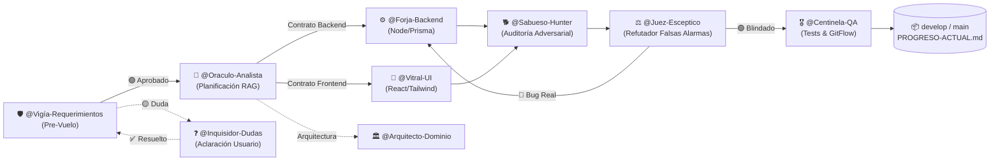

# Mapa Mental y Arquitectura de la Oficina de Agentes de IA

Este documento actúa como el **Nodo Central (Hub)** para el grafo de Obsidian y la orquestación en Antigravity. Conecta a cada agente de la oficina con sus áreas de responsabilidad, subagentes invocables, skills operativas y notas de dominio del proyecto.

> [!TIP]
> **Para ver el lienzo interactivo completo:** Abre en Obsidian el archivo [[Oficina-Agentes.canvas]].  
> **Para ver la constelación de relaciones:** Presiona `Ctrl + G` en Obsidian (Vista de Grafo) y filtra por la etiqueta `#agente`.

---

## 1. Estructura de la Oficina de Agentes y Flujo en 5 Etapas

---

## 2. Departamentos, Agentes y Matriz de Skills

### 🏛️ Área 0: Gobernanza, Pre-Vuelo y Clarificación
- **Agente:** `@Vigía-Requerimientos`
  - **Función:** Evalúa cada instrucción o issue antes de programar. Aplica el DoR (*Definition of Ready*), comprueba dependencias de equipo (evita pedir frontend o testing sobre código que aún no existe) y asegura respeto a las 7 invariantes.
  - **Skills:** `pos-evaluador-solicitudes`
  - **Relacionado:** [[PLAN-MAESTRO-SPRINTS]] | [[RN-GEN-Principios-Inmutables]]
- **Agente:** `@Inquisidor-Dudas`
  - **Función:** Protocolo de parada obligatoria ante cualquier ambigüedad técnica o de negocio. Formula preguntas interactivas (`ask_question`).
  - **Skills:** `pos-clarification-interview`, `grilling`, `grill-me`
  - **Regla Inquebrantable:** Prohibido rellenar vacíos con suposiciones.

### 📜 Área 1: Análisis de Dominio y Arquitectura
- **Agente:** `@Oraculo-Analista`
  - **Función:** RAG Quirúrgico. Lee únicamente notas atómicas de `docs/vault/01-Reglas-Dominio/` y emite un contrato de implementación de máximo 30 líneas (tablas Prisma afectadas, validaciones y casos de borde). Ahorra hasta 96% de tokens.
  - **Skills:** `orquestador-pos-rag-audit`, `to-spec`, `to-tickets`
  - **Relacionado:** [[00-Indice-Mapa-Mental-MOC]] | [[Matriz-CA-01-a-CA-65]]
- **Agente:** `@Arquitecto-Dominio`
  - **Función:** Clean Architecture y Monolito Modular. Separa la lógica de negocio pura de Express y Prisma. Diseña puertos y adaptadores para pasarelas, DIAN y transportadoras.
  - **Skills:** `pos-clean-architecture`, `domain-modeling`, `codebase-design`
  - **Relacionado:** [[ARQ-03-Patrones-Arquitectura-y-Diseno]] | [[ARQ-05-Estructura-Carpetas-y-Tres-Portales]]

### ⚙️ Área 2: Construcción (Backend & Frontend)
- **Agente:** `@Forja-Backend`
  - **Función:** Construcción de endpoints, servicios, migraciones y queries en Node.js, Express y Prisma aplicando las 7 invariantes (Dinero entero COP, Hora Colombia, Kardex inmutable, anti-deadlock, doble reserva, idempotencia).
  - **Skills:** `pos-postgres-concurrency-optimizer`, `pos-kardex-transaction`, `pos-ecommerce-checkout-machine`, `pos-financial-ledger-audit`, `postgresql-best-practices`
  - **Relacionado:** [[MOD-04-Inventario-Ledger]] | [[RN-INV-Kardex-y-Saldos]] | [[Constraints-SQL-e-Indices]]
- **Agente:** `@Vitral-UI`
  - **Función:** Maquetación e interacción de los 3 portales: Storefront (Apple Liquid Glass), Terminal POS (táctil, rápido, cero scroll) y Admin Dashboard (tablas densas, reportes).
  - **Skills:** `pos-storefront-ui-designer`, `ui-ux-pro-max`, `storefront-best-practices`, `pos-sales-ui-design`, `react-shadcn-admin`, `stitch`, `frontend-design`
  - **Regla Inquebrantable:** `RN-GEN-01`: Cero cálculo de precios, stock o fletes en cliente.

### 🔍 Área 3: Seguridad y Auditoría Adversarial
- **Agente:** `@Sabueso-Hunter`
  - **Función:** Caza de fallos agresiva. Intenta romper la lógica de negocio, condiciones de carrera en stock, deadlocks, desbordamiento de dinero COP o fugas de datos entre sedes.
  - **Skills:** `pos-adversarial-audit`, `security-audit`, `diagnosing-bugs`
- **Agente:** `@Juez-Esceptico`
  - **Función:** Filtro escéptico de falsas alarmas. Intenta refutar cada hipótesis de Sabueso revisando constraints SQL CHECK, schemas Zod y middlewares. Emite veredicto: descarta falsos positivos y pasa solo bugs reales a Forja/Vitral.
  - **Skills:** `pos-adversarial-audit`

### 🎖️ Área 4: Quality Assurance, Tests & GitFlow
- **Agente:** `@Centinela-QA`
  - **Función:** Ejecución obligatoria de `npx tsc --noEmit` y `npx vitest run`. Audita Pull Requests contra GitFlow, formula tareas de prueba para Duvan y actualiza la bitácora de progreso.
  - **Skills:** `pos-gitflow-pr-review`, `pos-sprint-progress-tracker`, `code-review`, `webapp-testing`
  - **Relacionado:** [[PROGRESO-ACTUAL]] | [[MATRIZ-ROLES-Y-TAREAS]]

---

## 3. ¿Cómo Visualizar esta Red en Obsidian?

1. **Vista de Grafo Global (`Ctrl + G`):**
   - Abre la pestaña de **Filters** (Filtros).
   - En **Groups** (Grupos), añade las siguientes reglas de color:
     - `tag:#agente` ➔ Color Azul Eléctrico
     - `tag:#skills` ➔ Color Naranja
     - `tag:#reglas` o `path:01-Reglas-Dominio` ➔ Color Verde
     - `path:02-Modulos-RF` ➔ Color Púrpura
     - `path:05-Estado-Sprints` ➔ Color Amarillo
2. **Lienzo Infinito ([[Oficina-Agentes.canvas]]):**
   - Haz doble clic en el archivo `.canvas` para ver el mapa 2D tipo whiteboard con las 5 columnas departamentales, tarjetas informativas y flechas de flujo.
3. **Vista de Grafo Local:**
   - Abre cualquier nota de módulo (ej. `MOD-04-Inventario-Ledger.md`) y abre la vista de **Local Graph** para ver qué agentes y reglas están vinculados directamente a ese archivo.
