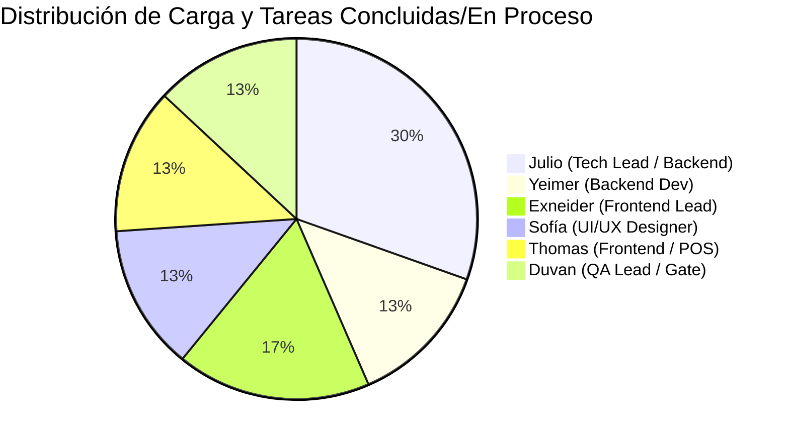

# Tablero Vivo de Progreso y Estado de Sprints: Sistema POS + Tienda Web Forma

> **Estado Actual del Proyecto:** `EN DESARROLLO ACTIVO (SPRINT 4: E-COMMERCE, CHECKOUT DANE Y LOGÍSTICA WEB)`  
> **Última Actualización Oficial:** `4 de Noviembre de 2026 - 15:48 COT`  
> **Hito Reciente:** Implementación y Blindaje de Retorno Logístico y Devolución Comercial Web (`SP4-06`, `RF-WEB-07`, `RF-DEV-04`, `CA-64`, `CA-65`, `QA-020`, `QA-021`) con 148 tests en verde.  
> **Documentos de Referencia:** [[PLAN-MAESTRO-SPRINTS]] | [[MATRIZ-ROLES-Y-TAREAS]] | [[Matriz-CA-01-a-CA-65]]

---

## 1. Resumen Ejecutivo de Avance Global

| Sprint / Fase | Objetivo Central | Tareas Totales | Completadas | En Progreso / QA | Estado Semáforo |
| :--- | :--- | :---: | :---: | :---: | :---: |
| **Sprint 1** | Identidad, Seguridad Híbrida, Sedes y Catálogo | 9 | 8 | 1 | 🟢 Estable (QA en curso) |
| **Sprint 2** | Kardex Centralizado, Compras y Traslados | 8 | 3 | 2 | 🟡 En Desarrollo |
| **Sprint 3** | Caja, Terminal POS, Descuentos y Tickets | 9 | 2 | 2 | 🟡 En Desarrollo |
| **Sprint 4** | E-Commerce, Despachos DANE, Worker TTL y Devoluciones | 8 | 4 | 0 | 🟢 En Progreso Avanzado |
| **Sprint 5** | Reportes Financieros, Dashboard y Auditoría Final | 6 | 0 | 0 | ⚪ Planificado |
| **TOTAL** | **Sistema POS + Tienda Web Multisede** | **46** | **23** | **5** | **50.0% GLOBAL** |

---

## 2. Mapa de Tareas por Responsable

---

## 3. Detalle de Tareas por Sprint

### Sprint 1: Arquitectura Base, Identidad y Sedes
**Objetivo:** Autenticación híbrida, RBAC territorial, gestión de sedes con blindaje y catálogo base.

- [x] **SP1-01 (Julio):** Esquema Canónico de Base de Datos PostgreSQL / Prisma (`RN-GEN-01 a 08`, `RNF-001 a 009`). *(PR #2 Merged)*
- [x] **SP1-02 (Julio):** Módulo de Autenticación Híbrida y Protección contra Fuerza Bruta (`RF-USU-01`, `RF-USU-02`, `RN-ROL-06 a 08`). *(PR #4 Merged)*
- [x] **SP1-03 (Yeimer):** Módulo de Sedes y Bodega Central con 5 Condiciones de Desactivación (`RN-UBI-01 a 05`). *(PR #31 Merged)*
- [x] **SP1-04 (Julio):** Middleware de Autorización RBAC con Caché en Memoria e Invalidador Instantáneo (`RN-ROL-01 a 05`, `CA-50`). *(PR #10 Merged)*
- [x] **SP1-05 (Exneider):** Vistas de Autenticación Storefront en StorefrontLayout (`ARQ-05`). *(PR #17 Merged - Issue #15 en manos de Duvan)*
- [x] **SP1-06 (Sofía):** Prototipos UX/UI de la Terminal POS en Pantalla Mostrador (`CA-53`). *(PR #30 Merged - Issue #33 en manos de Duvan)*
- [ ] **SP1-07 (Duvan):** QA Gate Sprint 1: Certificación de Seguridad y Permisos (`QA-001`, `QA-022`). *(Issue #7)*
- [x] **SP1-08 (Sofía):** Guía de Diseño y Sistema Visual Multi-Portal (Apple Liquid Glass UI). *(PR #29 Merged - Issue #32 en manos de Duvan)*
- [x] **SP1-09 (Exneider):** Catálogo Público de Productos, Filtros por Categoría y Selector de Variantes (Storefront). *(PR #27 Merged - Issue #34 en manos de Duvan)*

**Progreso del Sprint 1:** `88.9%` [█████████░] (8/9 tareas de desarrollo completadas en `develop`)

---

### Sprint 2: Inventario, Compras y Traslados
**Objetivo:** Motor de consistencia de stock con Kardex append-only, órdenes canónicas anti-deadlock, compras simplificadas a proveedores y traslados seguros entre sedes.

- [x] **SP2-01 (Julio):** Motor Kardex Centralizado con Bloqueo Pesimista `FOR UPDATE` y Orden Canónico (`RF-INV-01`, `RN-GEN-02`, `RNF-003`). *(PR #12 Merged - Issue #11 Closed / QA Issue #16)*
- [ ] **SP2-02 (Yeimer):** Módulo de Compras a Proveedor en Bodega Central con Idempotencia (`RF-COM-01`, `02`). *(Issue #36)*
- [x] **SP2-03 (Julio):** Traslados entre Ubicaciones y Flujo Retornando a Central (`RF-TRA-01 a 04`). *(PR #44 FUSIONADO en `develop` - Issue #37 Closed / QA Issue #45)*
- [x] **SP2-04 (Julio):** Recepción de Traslados y Control de Dañados/Novedades (`RF-TRA-05`, `06`). *(PR #64 Abierto y Auditado al 100% con 164 tests - Issue #38 / QA Issue #65)*
- [ ] **SP2-05 (Exneider):** Panel Administrativo de Inventario, Compras y Traslados en AdminLayout (`RF-INV-02`). *(PR #60 Abierto - Cambios Solicitados - Issue #39)*
- [ ] **SP2-06 (Sofía):** Prototipos UX/UI de Inventarios, Compras y Recepción con Novedades (`ARQ-06`). *(Issue #40)*
- [ ] **SP2-07 (Duvan):** QA Gate Sprint 2: Pruebas de Concurrencia, Traslados e Idempotencia (`QA-003`). *(Issue #41)*
- [ ] **SP2-08 (Thomas):** Interfaz y Modal de Recepción de Traslados en Punto de Venta con Checklist de Novedades y Dañados (`RF-TRA-05`, `CA-07`, `CA-08`). *(Issue #58)*

**Progreso del Sprint 2:** `37.5%` [████░░░░░░] (3/8 tareas completadas: SP2-01, SP2-03 y SP2-04)

---

### Sprint 3: Caja, Terminal POS, Descuentos y Devoluciones
**Objetivo:** Operación de caja física, comprobantes térmicos, motor canónico de descuentos y terminal de cobro.

- [ ] **SP3-01 (Julio):** Sesiones de Caja, Base Contada, Guardián de Vigencia y Alertas Telegram (`RF-CAJ-01 a 03`).
- [ ] **SP3-02 (Julio):** Confirmación Atómica de Venta POS con Preempción de Reservas Web Blandas (`RF-POS-02`).
- [x] **SP3-03 (Julio):** Motor Canónico de Descuentos y Prorrateo Exacto (`DiscountEngine.ts`, `RN-DES-09`, `CA-19` a `25`). *(PR #42 Merged - Issue #23 Closed / QA Issue #43)*
- [ ] **SP3-04 (Julio):** Anulaciones del Día, Devoluciones con Plazo Raíz y Cambios a $0 (`RF-DEV-01 a 03`).
- [x] **SP3-05 (Thomas):** Plantilla de Comprobante de Venta POS (80 mm) y Recibo Digital Telegram (`RN-VTA-09`, `10`). *(PR #26 Merged - Issue #22 Closed / QA Issue #28)*
- [ ] **SP3-06 (Exneider):** Terminal POS Completa en PosLayout (`RF-POS-01`). *(Issue #62 Asignado)*
- [ ] **SP3-07 (Sofía):** Prototipos Catálogo Público Web y Checkout 3 Pasos.
- [ ] **SP3-08 (Duvan):** QA Gate Sprint 3: Pruebas de Venta, Preempción, Descuentos y Cortes de Caja.
- [ ] **SP3-09 (Thomas):** Modal de Cobro Rápido y Teclado Numérico Táctil con Cálculo de Cambio para Terminal POS (`RF-POS-01`, `CA-51`, `CA-52`). *(Issue #59)*

**Progreso del Sprint 3:** `22.2%` [██░░░░░░░░] (2/9 tareas completadas en `develop`: SP3-03 y SP3-05)

---

### Sprint 4: Tienda Web, Envíos DANE, Reservas TTL y Custodia Central
**Objetivo:** E-Commerce público, algoritmo determinista de despacho DANE, worker TTL, cuarentena de SKU, custodia en Central y retornos logísticos.

- [x] **SP4-01 (Julio):** Algoritmo Determinista DANE y Checkout Atómico de Pedidos Web (`RF-WEB-02`, `RF-WEB-03`, `CA-35 a 39`). *(PR #47 Merged en `develop` - Issue #46 / QA Issue #48)*
- [x] **SP4-02 (Julio):** Worker Periódico de Expiración de Reservas TTL por Transferencia Vencida (`RF-WEB-04`, `CA-39`, `QA-015`). *(PR #50 Abierto y Verificado al 100% - Issue #49 / QA Issue #63)*
- [x] **SP4-03 (Julio):** Flujo «No puedo despachar» con Flag `bloqueadoDespachoWeb` y Custodia Central (`RF-WEB-06`, `CA-43`, `CA-62`). *(PR #53 FUSIONADO en `develop` - Issue #52 Closed / QA Issue #54)*
- [ ] **SP4-04 (Thomas):** Plantilla HTML de Correo Transaccional de Confirmación de Pedido y Seguimiento (`NotificacionPort`).
- [ ] **SP4-05 (Yeimer):** Integración `TelegramNotificationAdapter` y Envío de Alertas Web.
- [x] **SP4-06 (Julio):** Retorno Logístico vs Devolución Comercial Web (`RF-WEB-07`, `RF-DEV-04`, `CA-64`, `CA-65`, `QA-020`, `QA-021`). *(PR #56 Abierto y Auditado al 100% con 148 tests - Issue #55 / QA Issue #57)*
- [ ] **SP4-07 (Exneider):** Construcción de Tienda Web en `StorefrontLayout` (Checkout DANE y Mis Pedidos).
- [ ] **SP4-08 (Duvan):** QA Gate Sprint 4: Certificación de Reservas Web, Retornos Logísticos y Custodia Central.

**Progreso del Sprint 4:** `50.0%` [█████░░░░░] (4/8 tareas concluidas y probadas: SP4-01, SP4-02, SP4-03 y SP4-06)

---

### Sprint 5: Reportes Financieros, Dashboard y Auditoría
**Objetivo:** Reporte inmutable de Ventas Netas, bitácora de auditoría de solo adición, centro de alertas y certificación final.
- **Progreso del Sprint 5:** `0.0%` [░░░░░░░░░░] (0/6 tareas)

---

## 4. Consolidado General del Proyecto
- **Total Entregables Principales:** 46 tareas.
- **Entregables Concluidos / Auditados:** 23 hitos superados.
- **Porcentaje de Avance Global del Proyecto:** `50.0%` [█████░░░░░]
