# ARQ-07: Ley Canónica de Diseño E-Commerce, Navegación Intuitiva, Experiencia de Usuario y Conversión Storefront

> [!IMPORTANT]
> **ESTATUS NORMATIVO: LEY VINCULANTE Y CONSTITUCIÓN VISUAL DEL STOREFRONT FORMA**  
> Este documento establece los principios inquebrantables de diseño web, navegación intuitiva, jerarquía visual, páginas de producto (PDP), vistas de catálogo (cuadrícula/lista), carrito, checkout, rendimiento técnico, personalización y conversión para la tienda online oficial de FORMA. Todo componente, pantalla, flujo y decisión de interfaz DEBE alinearse al 100% con este marco normativo y sus 13 evidencias visuales.

---

## 1. Crear una Navegación Intuitiva

Es esencial que las etiquetas de los menús, botones y enlaces sean claras y concisas. No abrumes a los clientes con excesivas opciones, ¡o podrían confundirse demasiado y decidirse por tu competencia!

### 1.1 Las Migas de Pan (Breadcrumbs)
[Las migas de pan](https://www.justinmind.com/es/blog/navegacion-web-breadcrumb/), esos pequeños enlaces que muestran tu ubicación actual en el sitio web, son como un GPS para los compradores online. Ayudan a los clientes a seguir su progreso y a volver fácilmente si se pierden, como en Hansel y Gretel, pero mejor. ¡Sin molestos pájaros que les hagan desaparecer!

Las migas de pan proporcionan una forma clara e intuitiva de volver a navegar por el sitio. Muestran a los usuarios su ubicación actual dentro de la jerarquía del sitio web, lo que puede reducir significativamente la frustración y mejorar la experiencia general del usuario.

Además, las migas de pan pueden mejorar la optimización de tu sitio web para los motores de búsqueda (SEO). Los motores de búsqueda utilizan las migas de pan como señales para comprender la estructura y el contenido de tu sitio web. Cuando proporcionas migas de pan claras, ayudas a los motores de búsqueda a indexar tus páginas con mayor eficacia, lo que conduce a una mejor clasificación en los resultados de búsqueda.

#### Mejores Prácticas para las Migas de Pan:
* **Etiquetas claras y concisas:** Utiliza etiquetas claras y concisas en cada enlace de migas de pan para indicar la página o categoría actual.
* **Colocación coherente:** Coloca las migas de pan de forma coherente en tu sitio web, ya sea en la parte superior o inferior de la página.
* **Jerarquía:** Asegúrate de que las migas de pan reflejan la estructura jerárquica correcta de tu sitio web.
* **Enlace a la página de inicio:** Incluye siempre un enlace a la página de inicio como primera miga de pan.

> **Ejemplo:** Si un usuario está en una página de producto de una camisa azul, las migas de pan deben tener este aspecto:  
> `Inicio / Ropa / Camisas / Camisa Azul`

### 1.2 Potente Funcionalidad de Búsqueda
Una potente funcionalidad de búsqueda es como un motor de búsqueda dentro de tu sitio web. Permite a los clientes encontrar rápidamente productos o información específicos, ahorrándoles tiempo y esfuerzo.
* **Búsqueda predictiva (Autocompletar):** Sugiere términos y referencias de búsqueda relevantes a medida que el usuario escribe, acelerando la localización exacta de prendas.
* **Sugerencias de búsquedas relacionadas:** Sugiere alternativas que mejoran el descubrimiento.
* **Acceso accesible y prominente:** Ubicado de forma intuitiva en la cabecera.

---

## 2. Evidencia Visual I: Estructura de Navegación, Búsqueda y Migas de Pan

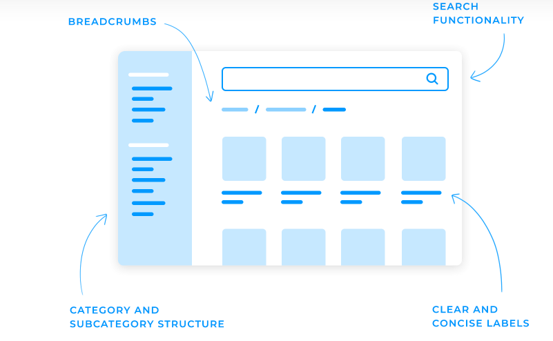

* **Breadcrumbs (Migas de Pan):** Ubicadas en la cabecera del espacio de exploración para orientar al comprador.
* **Search Functionality:** Barra de búsqueda predominante con acceso rápido y sugerencias.
* **Category and Subcategory Structure:** Menú lateral o desplegable organizado lógicamente.
* **Clear and Concise Labels:** Rótulos de productos directos, legibles y concisos en cada tarjeta.

---

## 3. Principios Clave del Diseño de Sitios Web de Comercio Electrónico

Un sitio web de comercio electrónico bien diseñado es algo más que estéticamente agradable; es una herramienta estratégica para impulsar las ventas y fidelizar a los clientes. En esta sección, exploraremos los principios esenciales del diseño que sustentan el éxito de las tiendas online.

### 3.1 Diseño Centrado en el Usuario
Todos lo hemos oído al menos una vez en la vida: el cliente es el rey. Por eso, trasladándolo a los sitios web de comercio electrónico, un [diseño centrado en el usuario](https://www.justinmind.com/es/blog/diseno-centrado-en-el-usuario/) es un principio fundamental que puede hacer o deshacer tu sitio web.

Piensa en un sitio web de comercio electrónico para una tienda de jardinería. Tras investigar un poco, podrías descubrir que a tus clientes les interesa sobre todo encontrar plantas adecuadas para su clima específico y su nivel de experiencia en jardinería. Basándote en esta información, podrías diseñar un sitio web que permitiera a los clientes filtrar los productos por clima y nivel de jardinería, facilitándoles la búsqueda de las plantas perfectas.

Sin embargo, debes tener en cuenta que el diseño no es un proceso de una sola vez. Recoge continuamente opiniones, analiza los datos de los usuarios y realiza mejoras en tu sitio web basándote en las percepciones del mundo real. Este enfoque garantiza que tu sitio web siga siendo relevante y fácil de usar a lo largo del tiempo.

### 3.2 Diseño Responsivo
En la era digital actual, los consumidores utilizan cada vez más sus teléfonos inteligentes y tabletas para comprar en Internet. Por eso [el diseño responsive](https://www.justinmind.com/es/diseno-web/ejemplos-sitios-web-responsivos) ya no es una opción, sino una necesidad.

Un sitio web responsivo ajusta automáticamente su diseño y contenido para adaptarse a distintos tamaños de pantalla, garantizando una experiencia fluida y agradable para todos los usuarios, independientemente de su dispositivo.

Pero el diseño de un sitio web adaptable no sólo tiene que ver con la experiencia del usuario. Los motores de búsqueda como Google también recompensan a los sitios web adaptados a dispositivos móviles. Un diseño adaptable puede ayudar a que tu sitio web de comercio electrónico aparezca mejor clasificado en los resultados de búsqueda, aumentando tu visibilidad y atrayendo más tráfico orgánico.

Básicamente, un diseño adaptable puede aumentar tu tasa de conversión e impulsar las ventas, incluso si tu público objetivo son principalmente usuarios de ordenadores de sobremesa. Además, gestionar un único sitio web responsivo que se adapte a cualquier dispositivo también es más fácil que mantener versiones móviles y de escritorio separadas. Esto ahorra tiempo y recursos, permitiéndote centrarte en otros aspectos importantes de tu negocio.

---

## 4. Evidencia Visual II: Diseño Responsivo y Optimización Multi-Dispositivo

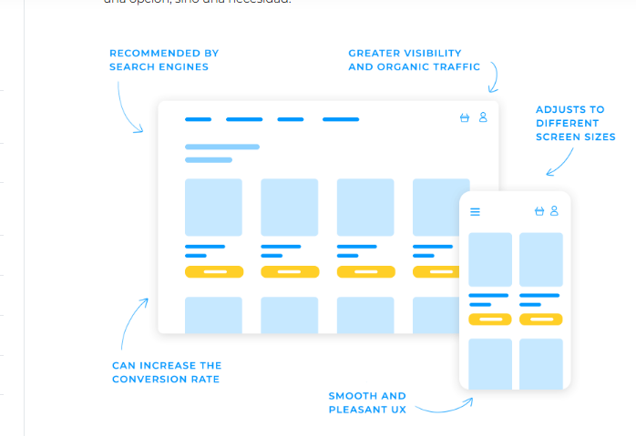

* **Adjusts to Different Screen Sizes:** Adaptación elástica inmediata entre monitores de escritorio, laptops, tablets y smartphones.
* **Greater Visibility and Organic Traffic & Recommended by Search Engines:** Indexabilidad y rendimiento optimizados para algoritmos de motores de búsqueda.
* **Smooth and Pleasant UX & Can Increase Conversion Rate:** Menú móvil fluido (drawer / hamburguesa), grilla táctil adaptativa (2 columnas en smartphone, 4 en desktop) y compra en 1 clic.

---

## 5. Jerarquía Visual

Quieres que los focos brillen sobre los elementos más importantes del diseño de tu sitio web de comercio electrónico, atrayendo la atención de tu público hacia donde tú quieres. Ahí es donde entra en juego la [jerarquía visual](https://www.justinmind.com/es/ui-diseno/jerarquia-visual).

La jerarquía visual es el arte de disponer los elementos de una página de forma que guíen la mirada del usuario. Puedes destacar componentes clave como llamadas a la acción, imágenes de productos y menús de navegación utilizando técnicas como el tamaño, el color y la colocación.

Piénsalo como un director que pone en escena una obra; quieres asegurarte de que la atención del público se dirige a los actores y escenas más importantes:
* **El tamaño:** Los elementos más grandes son naturalmente más prominentes, así que utiliza el tamaño para destacar la información más importante.
* **El color:** Los colores contrastados pueden llamar la atención, así que utilízalos para diferenciar los elementos primarios de los secundarios.
* **La colocación:** Los elementos situados en la parte superior izquierda suelen verse primero, así que aprovéchalo.

Una jerarquía visual bien diseñada ofrece numerosas ventajas. Facilita que los usuarios encuentren lo que buscan, mejora el compromiso e incluso puede aumentar las tasas de conversión. Cuando los usuarios pueden identificar rápidamente los elementos importantes, es más probable que realicen la acción deseada, como comprar o suscribirse a un boletín.

Por ejemplo, en una página de producto de comercio electrónico, la imagen del producto podría ser el elemento más grande, seguido del nombre del producto y el precio. Las reseñas y los productos relacionados podrían ser más pequeños y colocarse debajo de la información principal del producto. Esta jerarquía visual guía la atención del usuario hacia los elementos más importantes y facilita que encuentre la información que necesita.

---

## 6. Evidencia Visual III: Jerarquía Visual en Detalle de Producto (PDP)

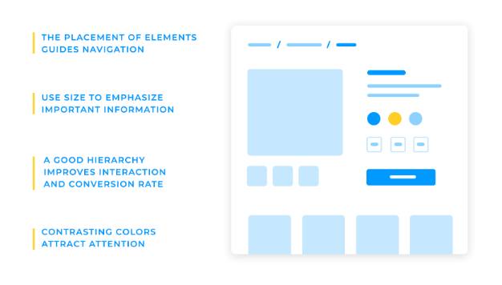

* **The placement of elements guides navigation:** Disposición estratégica de migas de pan y selectores.
* **Use size to emphasize important information:** Galería de producto predominante con miniaturas subordinadas.
* **Contrasting colors attract attention:** Selectores de color y talla diferenciados.
* **A good hierarchy improves interaction and conversion rate:** Botón de acción principal destacado en contraste y posición dominante.

---

## 7. Coherencia

La coherencia es clave para construir una marca reconocible y memorable. Si mantienes la uniformidad en los elementos de diseño, la tipografía y los colores en todo tu sitio web, crearás una experiencia cohesiva que ayudará a los usuarios a reconocer tu marca y a confiar en ella con su dinero.

Imagina visitar una tienda en la que todo, desde la señalización hasta los envases y los uniformes de los empleados, no coincide. Sería confuso y desorientador, ¿verdad? Lo mismo ocurre con el diseño de tu sitio web de comercio electrónico. Una identidad de marca coherente crea una sensación de orden y armonía, facilitando a los clientes la navegación y la comprensión de tus ofertas.

### Directrices de Coherencia de Marca:
1. **Paleta de Colores Limitada:** Elige una paleta limitada de colores que reflejen la personalidad y los valores de tu marca. Utiliza estos colores de forma coherente en todo tu sitio web, desde el logotipo hasta las páginas de producto.
2. **Tipografía Consistente:** Selecciona fuentes que sean fáciles de leer y se ajusten a la personalidad de tu marca. Utiliza fuentes y tamaños de fuente coherentes en todo tu sitio web para crear un aspecto cohesionado y profesional.
3. **Conjunto Exclusivo de Elementos de Diseño:** Más allá de los colores y la tipografía, crea un conjunto de elementos de diseño, como iconos, botones y gráficos, que sean exclusivos de tu marca. Utiliza estos elementos de forma coherente en todo tu sitio web para reforzar la identidad de tu marca.
4. **Mensaje y Tono de Voz Coherente:** Asegúrate de que tu mensaje es coherente con los valores y el tono de voz de la marca. Utiliza un lenguaje claro y conciso que sea fácil de entender.

---

## 8. Diseño de la Página de Inicio

### 8.1 La Primera Impresión Importa
Tu página de inicio es como el escaparate de tu negocio online. Es lo primero que ven los visitantes, así que es crucial causar una impresión fuerte y positiva desde el primer momento. Una página de inicio bien diseñada puede atraer a los visitantes para que permanezcan en tu sitio, exploren tus productos y, en última instancia, realicen una compra.

### 8.2 Sección de Héroe Clara y Convincente
Este es el espacio principal de tu página de inicio, así que haz que cuente. Utiliza elementos visuales llamativos, titulares contundentes y una llamada a la acción clara para captar la atención de los visitantes y animarles a seguir explorando. Una sección principal convincente debe transmitir la propuesta de valor de tu marca y marcar la pauta para el resto de tu sitio web.
* **Imagen principal clara y convincente** que capte inmediatamente la atención y transmita el mensaje de tu marca.
* **Titular contundente** que exponga concisamente tu propuesta de valor.
* **Llamada a la acción (CTA) clara y destacada**, como «Compra ahora» o «Más información», que anime a los visitantes a realizar la acción deseada.

### 8.3 Mostrar los Productos Más Vendidos o Destacados
Destaca tus ofertas más populares o únicas. Esto puede incitar a los visitantes a hojear tu catálogo y realizar una compra. Puedes demostrar tu experiencia, generar confianza y fomentar las compras impulsivas mostrando tus productos más vendidos o destacados:
* **Utiliza carruseles deslizantes:** Muestra un carrusel giratorio de productos destacados en tu página de inicio o en las páginas de categorías de productos.
* **Crea secciones dedicadas:** Dedica secciones específicas de tu sitio web a destacar los productos más vendidos o destacados.
* **Incluye insignias o etiquetas:** Utiliza insignias o etiquetas para indicar productos populares o destacados, como «Bestseller» o «Elección del Editor».

### 8.4 Indicadores de Confianza
Los indicadores de confianza, como las opiniones de los clientes, las certificaciones y los logotipos de socios de confianza, pueden aumentar significativamente tu credibilidad y tranquilizar a los clientes potenciales.

Piénsalo: Cuando te planteas hacer una compra en Internet, ¿no sueles buscar opiniones o recomendaciones de otros clientes? Las opiniones positivas de los clientes pueden ser una poderosa prueba social de que tu empresa es fiable y ofrece productos o servicios de calidad.

Las certificaciones y los premios del sector demuestran tu experiencia y compromiso con la calidad. Imagina ver un sello de aprobación de una organización respetada en la página de un producto. Transmite al instante que el producto cumple ciertas normas y que merece la pena tenerlo en cuenta.

Asociarte con empresas de renombre también puede aumentar tu credibilidad. Mostrar los logotipos de socios de confianza indica que tu empresa está asociada a otras organizaciones reputadas, lo que genera confianza en tu marca. Los indicadores de confianza pueden aliviar las dudas y preocupaciones que puedan tener los clientes potenciales, animándoles a dar el siguiente paso, como realizar una compra.

Cuando los clientes ven que otras personas han tenido experiencias positivas con tu empresa y que estás asociado a organizaciones reputadas, es más probable que confíen en ti y se sientan seguros de su decisión:
* Muestra de forma destacada las **opiniones de los clientes** en tu sitio web.
* Resalta las **certificaciones y los premios**.
* Presenta **logotipos de socios de confianza**.
* Anima activamente a los clientes a dejar opiniones.

---

## 9. Evidencia Visual IV: Composición Canónica de la Página de Inicio

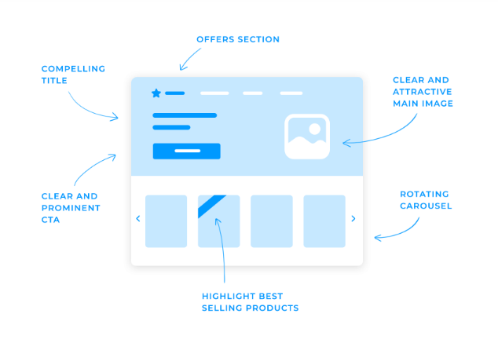

* **Compelling Title:** Titular de impacto, conciso y contundente.
* **Clear and Attractive Main Image:** Fotografía editorial de autor en proporción equilibrada.
* **Clear and Prominent CTA:** Botón principal de llamada a la acción visible de inmediato.
* **Offers Section (Directamente visible en primer plano):** Carrusel de ofertas y descuentos que asoma o se visualiza *above the fold*.
* **Rotating Carousel:** Desplazamiento rotatorio continuo con controles de flechas.
* **Highlight Best Selling Products:** Distintivos (etiquetas / listones diagonales) destacando los productos líderes en ventas.

---

## 10. Navegación Inteligente y Arquitectura de Menú

Lo ideal es un diseño de sitio web de comercio electrónico que ponga a los usuarios en movimiento, para que vean tantos artículos diferentes como sea posible. Quieres que exploren el sitio web, que es el equivalente digital a un paseo por la tienda. Pero para eso, el diseño de la navegación tiene que ser inteligente.

He aquí algunas directrices básicas que puedes aplicar al diseño de la navegación de tu sitio web de comercio electrónico:
1. **Las etiquetas son importantes:** Al diseñar la barra de navegación basada en etiquetas, es crucial que éstas sean representativas y descriptivas.
2. **Las subcategorías son igual de importantes:** Recuerda volver a enumerarlas cuando sea necesario, ya que algunas subcategorías podrían pertenecer a más de una categoría, y los usuarios podrían llegar lógicamente a esa subcategoría por una vía u otra.
3. **Haz que se pueda hacer clic en las categorías de nivel superior:** Muchos usuarios esperan que sea un enlace que funcione y pueden experimentar un ligero atisbo de confusión si no lo es.
4. **Invierte tiempo y esfuerzo en una buena barra de búsqueda:** Que lleve a la gente más rápidamente a tipos específicos de artículos.

La sencilla razón por la que la navegación es tan importante es que **los usuarios no pueden comprar lo que no encuentran**. Necesitan poder explorar y encontrar artículos que puedan comprar. Con un buen diseño de navegación, es más probable que los usuarios encuentren varios artículos antes de pasar por caja.

---

## 11. Evidencia Visual V: Menú por Etiquetas, Búsqueda y Subcategorías Multinivel

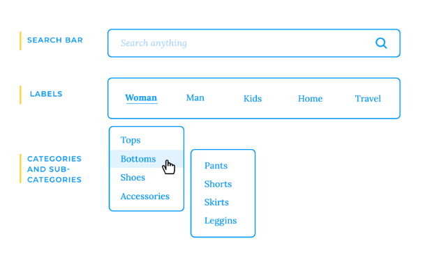

* **Search Bar:** Buscador superior universal visible y accesible ("Search anything").
* **Labels:** Barra horizontal de categorías principales claramente etiquetadas.
* **Categories and Sub-categories:** Desplegable interactivo multinivel (ej. Tops, Bottoms -> Pants, Shorts, Skirts, Leggins, Shoes, Accessories) para exploración sin fricción.

---

## 12. Elementos Clave de los CTAs Eficaces

* **Claridad y concisión:** Utiliza un lenguaje claro y conciso que indique directamente a los usuarios lo que deben hacer. Evita los mensajes vagos o confusos.
* **Atractivo visual:** Diseña CTA que destaquen del resto de tu sitio web. Utiliza colores contrastados, fuentes en negrita y un texto de llamada a la acción claro.
* **Colocación:** Coloca los CTA estratégicamente en tu sitio web, donde sean fácilmente visibles y accesibles.
* **Urgencia:** Crea una sensación de urgencia utilizando ofertas por tiempo limitado o mensajes de escasez.
* **Especificidad:** Adapta tus CTA a la acción específica que quieres que realicen los usuarios. Por ejemplo, en lugar de un botón genérico «Más información», utiliza un CTA más específico como «Comprar ahora» o «Ver colección».

---

## 13. Páginas de Productos (PDP) y Experiencia Visual Inmersiva

### 13.1 Exposición de Productos e Imágenes de Alta Resolución
En el mundo del diseño de sitios web de comercio electrónico, donde los clientes no pueden tocar o examinar físicamente los productos, los elementos visuales de alta calidad desempeñan un papel crucial para impulsar las ventas. Las imágenes y vídeos de productos permiten a los clientes visualizar y apreciar tus productos, haciéndoles sentir más seguros en sus decisiones de compra.

Imagina que entras en una tienda y ves un producto expuesto en una estantería. Puedes examinarlo, tocarlo e incluso probártelo. Las compras en línea no ofrecen la misma experiencia física, pero los elementos visuales de alta calidad sin duda se acercan:
* **Fotografía Multi-Ángulo:** Tomas frontales, traseras, laterales y detalles de costura.
* **Funciones de Zoom de Alta Fidelidad:** Permitir al usuario inspeccionar texturas y acabados artesanales.
* **Vista 360° Interactiva:** Posibilidad de rotar la pieza para una apreciación espacial completa.
* **Vídeos de Producto en Acción:** Dan vida a las prendas, muestran la caída de la tela, destacan sus características y demuestran sus ventajas reales. Especialmente efectivo para productos difíciles de describir solo con palabras.

---

## 14. Evidencia Visual VI: Exposición de Producto (Multi-Ángulo, Zoom y Vista 360°)

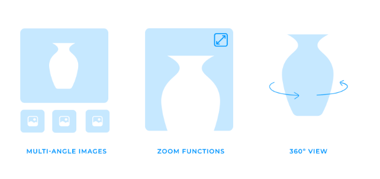

* **Multi-Angle Images:** Miniaturas inferiores o laterales que alternan encuadres del producto.
* **Zoom Functions:** Botón de lupa / expansión para examinar el tejido en detalle.
* **360° View:** Indicador de giro interactivo para exploración tridimensional de la pieza.

---

## 15. Descripciones de Producto Persuasivas ("El Vendedor Silencioso")

Cuando diseñes tu sitio web de comercio electrónico y llegue el momento de escribir en el copy, piensa que las descripciones de tus productos deben imitar a las de un vendedor. Tienen que ser persuasivas, informativas y atractivas para convencer a los clientes de que añadan productos a sus carritos.

Las descripciones de productos deben ir más allá de la simple enumeración de características y destacar las ventajas de tus productos:
1. **Lenguaje claro y conciso:** Utiliza un lenguaje sencillo y fácil de entender que evite la jerga.
2. **Destaca las ventajas, no sólo las características:** En lugar de limitarte a enumerar características, céntrate en cómo esas características benefician al cliente. Por ejemplo, en lugar de decir «Este producto es impermeable», di «Mantente seco y cómodo con cualquier tiempo».
3. **Utiliza verbos de acción fuertes:** Utiliza verbos vívidos para pintar una imagen del producto en la mente del cliente.
4. **Cuenta una historia:** Crea una narración en torno a tu producto, explicando cómo resuelve el problema de un cliente o satisface un deseo.
5. **Utiliza viñetas:** Divide la descripción del producto en viñetas para facilitar su lectura rápida.
6. **Incluye palabras clave:** Optimiza las descripciones de tus productos para el SEO incluyendo palabras clave relevantes.

---

## 16. Precios, Promociones y Estrategias de Urgencia

Cuando se trata de precios y promociones, la claridad y la prominencia son fundamentales. Asegúrate de que los precios se muestran con claridad y son fáciles de leer, utilizando un formato coherente:
* **Precios Claros y Legibles:** Presentación limpia del valor final frente al precio original tachado.
* **Destacar Descuentos y Ofertas Especiales:** Insignias visualmente atractivas (cintas diagonales de "OFFER", banners de descuento porcentual).
* **Ofertas Basadas en Tiempo (Urgencia):** Bloques destacados como "Only today" o temporizadores de cuenta atrás para motivar la compra inmediata.
* **Estrategias de Precios:** Precios impares o paquetes promocionales (bundles) para aumentar el valor percibido.

---

## 17. Evidencia Visual VII: Precios, Descuentos e Indicadores de Tiempo

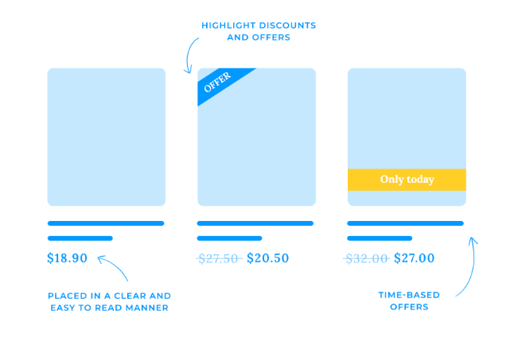

* **Placed in a Clear and Easy to Read Manner:** Precio base sin distracciones, tipografía legible.
* **Highlight Discounts and Offers:** Listón diagonal "OFFER" en la esquina superior con precio anterior tachado ($27.50 $\rightarrow$ $20.50).
* **Time-Based Offers:** Cintillo distintivo "Only today" para generar urgencia legítima.

---

## 18. Opiniones, Valoraciones y Prueba Social

El boca a boca se ha vuelto más poderoso que nunca. Las opiniones y valoraciones de los clientes pueden influir significativamente en el éxito de tu negocio de comercio electrónico.

Imagina que entras en una tienda y ves un producto con una reseña elogiosa de un cliente anterior. Es tranquilizador, ¿verdad? Del mismo modo, las reseñas en línea proporcionan una prueba social de que merece la pena tenerlo en cuenta. Cuando los clientes potenciales ven que otros han tenido experiencias positivas, es más probable que confíen en tu marca y realicen una compra.
* **Generan Confianza y Credibilidad:** Respaldan la calidad del producto y la satisfacción real.
* **Decisiones Informadas:** Dan visibilidad sobre el rendimiento, ajuste de talla y acabado.
* **Impulso SEO Orgánico:** Los motores de búsqueda consideran las reseñas de clientes como un factor clave de posicionamiento.

---

## 19. Evidencia Visual VIII: Reseñas y Valoraciones de Clientes

* **Avatar y Nombre del Cliente:** Identidad humana que aporta autenticidad.
* **Sistema de Estrellas (1 a 5):** Lectura visual instantánea de satisfacción promedio.
* **Comentario y Testimonio:** Descripción cualitativa de la experiencia de compra.

---

## 20. Productos Relacionados, Venta Cruzada y Upselling

Un buen vendedor sabe que cada venta cuenta. Para aumentar tus ingresos de comercio electrónico, eleva la experiencia del cliente ofreciendo versiones premium o productos complementarios:
* **Recomendaciones Basadas en IA / Comportamiento:** Sugerir productos basándose en el historial de navegación y patrones de compra.
* **Secciones Dedicadas de Colección:** Bloque "Completa tu Look" o "Prendas Similares" en la PDP y en el carrito.
* **Paquetes y Bundles con Descuento:** Conjuntos coordinados (ej. Pantalón + Camisa de Lino) a precio especial para elevar el ticket promedio.

---

## 21. Cesta de la Compra y Prevención del Abandono de Carrito

Estás en una tienda a punto de pagar y suena el teléfono, es tu hijo pidiéndote que hagas otro recado. La cola de la caja es larga, el cajero es lento y hay comisiones inesperadas. Frustrado, lo más probable es que digas que al diablo con eso, abandones tu compra y te vayas. Lo mismo ocurre en Internet: un proceso de pago mal diseñado hace perder ventas.

### 21.1 Diseño Simplificado y Claro del Carrito
* **Minimiza las distracciones:** Elimina elementos innecesarios que desvíen la atención de completar la compra. Enfócate en la información esencial.
* **Diseño claro y coherente:** Disposición lógica e intuitiva que se mantenga uniforme en todo el flujo.
* **Optimización Mobile First:** Carrito ágil en pantallas táctiles con controles generosos de cantidad (steppers) y botones de eliminación accesibles.

### 21.2 Transparencia Total en Costos de Envío y Precios
* **Muestra claramente los costes totales:** Desglose honesto por adelantado (subtotal, IVA discriminado, flete). Prohibidas las sorpresas o cargos ocultos en el último paso.
* **Formato de precios coherente:** Formato uniforme (ej. `$ 189.000 COP`).
* **Condiciones transparentes de envío:** Indicar el costo del flete por municipio o condiciones de envío gratuito por monto mínimo.

---

## 22. Evidencia Visual IX: Carrito de Compras en Desktop y Mobile

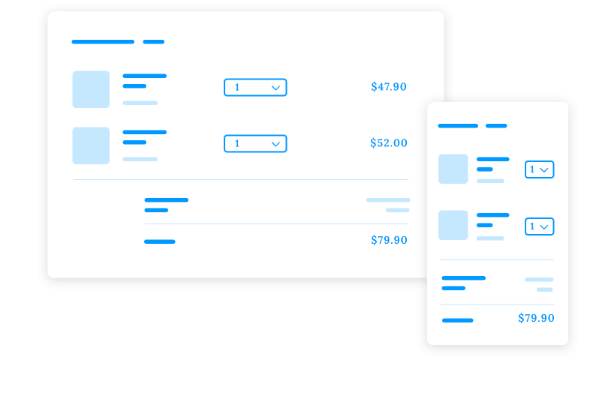

* **Lista Limpia de Prendas:** Fotografía, título descriptivo, selector desplegable o stepper de unidades y precio unitario visible.
* **Desglose Inferior Transparente:** Subtotal, flete e importe total destacado sin fricciones.
* **Adaptación Mobile:** Fila compacta que aprovecha el 100% del ancho en pantallas pequeñas sin desbordamientos.

---

## 23. Diseño del Proceso de Checkout (Caja)

### 23.1 Pago en un Solo Paso (1-Step) vs. Varios Pasos (Multi-Step)
* **Pago en un Solo Paso (1-Step):** Ventanilla única donde el cliente completa envío y pago en una pantalla dividida (formulario a la izquierda, resumen de pedido a la derecha). Ideal para compras rápidas, prendas sencillas y usuarios que buscan máxima eficiencia.
* **Pago en Varios Pasos (Multi-Step):** Proceso estructurado paso a paso con indicador de progreso. Ideal para pedidos personalizados o clientes que desean revisar deliberadamente cada detalle.

### 23.2 Opción de Pago como Invitado (Guest Checkout)
Permite comprar sin obligar a crear una cuenta previa, reduciendo drásticamente la fricción inicial y el abandono.

### 23.3 Indicadores de Progreso Claros y en Tiempo Real
* **Barras de progreso paso a paso:** Indicaciones visuales numeradas que muestran la cercanía a la confirmación final.
* **Etiquetas descriptivas:** «Información de Envío», «Método de Pago», «Revisión del Pedido».
* **Actualizaciones en tiempo real:** Reflejo inmediato de cambios en flete, códigos de descuento o datos del pedido.

---

## 24. Evidencia Visual X: Proceso de Checkout (1-Step vs. Varios Pasos)

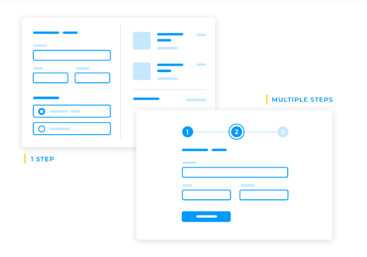

* **1 STEP:** Layout balanceado en 2 columnas: Datos del cliente y método a la izquierda, resumen con prendas e importes a la derecha.
* **MULTIPLE STEPS:** Wizard lineal con pasos numerados `(1) - (2) - (3)`, formulario enfocado y botón de avance prominente.

---

## 25. Pasarelas de Pago y Seguridad PCI-DSS

### 25.1 Diversidad de Opciones de Pago Seguras
* **Tarjetas de crédito/débito:** Visa, Mastercard, American Express.
* **Monederos digitales y transferencias inmediatas:** Nequi, Daviplata, Bancolombia, Bre-B, PSE.
* **Pago Contraentrega:** Pago al recibir el paquete en la dirección del cliente.

### 25.2 Garantizar Cumplimiento de Normativa PCI
* **Cifrado de datos:** Encriptación robusta de extremo a extremo.
* **Auditorías de seguridad periódicas:** Monitoreo y prevención de vulnerabilidades.
* **Tokenización:** El sistema nunca almacena números de tarjeta sensibles en plano; opera exclusivamente con tokens bancarios seguros.

---

## 26. Búsqueda Predictiva, Filtros Avanzados y Opciones de Clasificación

### 26.1 Búsqueda Predictiva y Autocompletado
La búsqueda predictiva sugiere términos relevantes a medida que el usuario escribe, acelerando la localización exacta de prendas en el catálogo.

### 26.2 Filtros Multi-Criterio Potentes
Dar a los clientes la capacidad de filtrar es darles una herramienta de precisión. En moda y retail, los filtros indispensables son:
* **Tallas:** `One size`, `XS`, `S`, `M`, `L`, `XL`.
* **Colores:** Paletas circulares táctiles y visibles.
* **Materiales / Fibras:** Selección por lino, seda, algodón, cuero legítimo, lana, etc.
* **Rango de Precios en COP:** Filtro por presupuestos con importes enteros.
* **Disponibilidad Inmediata en Boutique / Multisede:** Stock en tienda cercana.

### 26.3 Opciones de Clasificación (Sorting)
Las opciones de clasificación como «Más popular» o «Más reciente» ayudan a los clientes a descubrir tus productos más vendidos o las novedades de temporada:
* **Best sellers (Más populares):** Artículos de alta rotación y preferencia comprobada.
* **The best rated (Mejor valorados):** Prendas con las calificaciones más altas de los clientes.
* **From cheapest to most expensive (Menor a mayor precio):** Para compradores orientados al presupuesto.
* **From most expensive to cheapest (Mayor a menor precio):** Para colecciones exclusivas de lujo.
* **Más recientes:** Destacar las piezas recién salidas del atelier o de última colección.

---

## 27. Evidencia Visual XI: Filtros Multi-Criterio y Menú de Clasificación

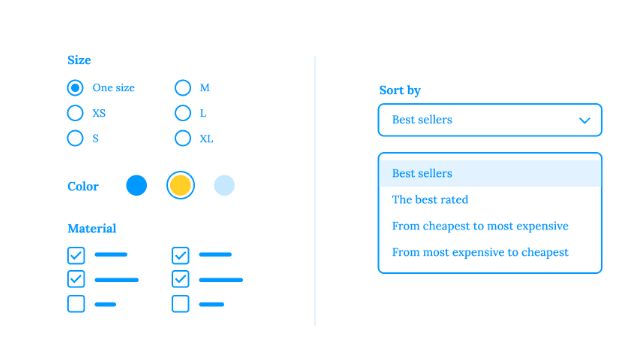

* **Filtros por Atributos:** Talla (`Size`), Color interactivo, Material con casillas de verificación (`Material`).
* **Selector Desplegable "Sort by":** Menú accesible con opciones claras (*Best sellers, The best rated, From cheapest to most expensive, From most expensive to cheapest*).

---

## 28. Páginas de Categoría y Modos de Visualización

### 28.1 Organización Clara de Categorías y Subcategorías
Una estructura de categorías bien organizada es esencial para ayudar a los clientes a navegar por tu sitio web y encontrar los productos que buscan.
* **Etiquetas descriptivas:** Mantener una jerarquía lógica y comprensible.
* **Señales visuales e iconos:** Iconografía o miniaturas que proporcionan reconocimiento visual instantáneo.
* **Re-enumeración cuando sea necesario:** Si una subcategoría pertenece lógicamente a más de una categoría, permitir llegar a ella por ambas vías sin callejones sin salida.

### 28.2 Opciones de Vista de Cuadrícula o de Lista (Grid vs. List View)
Para proporcionar una experiencia de compra flexible y personalizable, ofrece a los clientes la opción de elegir entre una vista de cuadrícula o de lista:
* **Vista de Cuadrícula (Grid View):** Es como un festín visual, que muestra los productos como miniaturas para que los clientes puedan comparar rápidamente las opciones estéticas y tomar decisiones informadas.
* **Vista de Lista (List View):** Es más parecida a un menú detallado, que proporciona información pormenorizada sobre cada producto (composición, disponibilidad por sede, descripción) para quienes prefieren un enfoque más basado en texto.
* Al ofrecer ambas opciones, atiendes a las distintas preferencias de navegación y te aseguras de que cada cliente pueda encontrar su producto perfecto.

---

## 29. Evidencia Visual XII: Selector de Vista en Cuadrícula vs. Lista

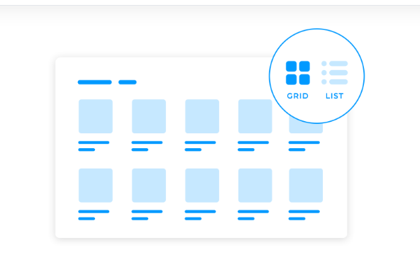

* **Selector de Modo de Visualización:** Botones de alternancia superior (*Grid / List*) claramente identificados mediante íconos reconocibles.
* **Flexibilidad de Exploración:** Transición instantánea entre cuadrícula visual de prendas y lista con información técnica ampliada.

---

## 30. Diseña una UX Impresionante: Velocidad, Rendimiento y Optimización Móvil

### 30.1 Velocidad y Rendimiento del Sitio
En el vertiginoso mundo de las compras online, la velocidad lo es todo. Los tiempos de carga lentos pueden frustrar a los clientes y alejarlos de tu sitio web:
* **El costo del retraso:** Los estudios han demostrado que un retraso de sólo un segundo puede provocar una disminución significativa de las conversiones.
* **Beneficio SEO:** Un sitio web de carga rápida no sólo mejora la experiencia del usuario, sino que también mejora tu posicionamiento en los motores de búsqueda de Google.

#### Herramientas Clave para el Rendimiento:
1. **La carga lenta (Lazy Loading):** Retrasa la carga de elementos no esenciales (como imágenes de catálogo fuera de pantalla o vídeos) hasta que el usuario se desplace hasta ellos, reduciendo el peso de la carga inicial.
2. **Optimización y compresión de imágenes (Image Compression):** Las imágenes son de los mayores culpables de la lentitud. Comprimir sin perder calidad visual reduce drásticamente el peso del archivo.
3. **Imágenes responsivas (Responsive Images):** Servir imágenes adaptadas a la densidad de píxeles y ancho de cada dispositivo, evitando descargar fotos de 1920px en teléfonos de 390px.

---

## 31. Evidencia Visual XIII: Herramientas de Rendimiento Técnico

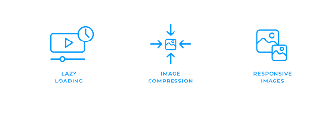

* **Lazy Loading:** Diferir la carga de medios hasta el momento de visualización efectiva.
* **Image Compression:** Algoritmos modernos de compresión (WebP / AVIF) para alta fidelidad sin peso excesivo.
* **Responsive Images:** Variantes de tamaño según el breakpoint del dispositivo.

---

## 32. Optimización Móvil Específica

En el vertiginoso mundo actual, en el que cada vez más personas acceden a Internet desde sus teléfonos inteligentes, tu sitio web de comercio electrónico debe estar totalmente optimizado para dispositivos móviles:
* **Tocar para Llamar (Click to Call):** Facilita que los clientes se comuniquen con la boutique o soporte oficial con un simple toque en la pantalla táctil.
* **Pago Rápido (Apple Pay, Google Pay, Bre-B):** Agiliza el checkout eliminando la digitación tediosa de números de tarjeta en teclados virtuales móviles, reduciendo el abandono de carrito.

---

## 33. Personalización y Experiencia del Cliente como "Estilista Personal"

La personalización es la clave para crear una experiencia de comercio electrónico realmente atractiva y eficaz:
* **Recomendaciones Basadas en el Comportamiento:** Analizar el historial de navegación, compras previas e interacciones para recomendar prendas que se ajusten a las preferencias del usuario (ejemplo: si compró un pantalón sastre de lino, sugerirle la camisa de lino coordinada o el cinturón de cuero artesanal; si compró zapatillas de correr, sugerir calcetines o bebida deportiva).
* **Uso Inteligente de Datos del Usuario:**
  - Campañas y notificaciones dirigidas con prendas afines.
  - Páginas de producto que parecen anticiparse a las necesidades del cliente, actuando como un estilista personal digital.
  - Promociones y descuentos personalizados que hacen sentir al cliente valorado y exclusivo.

---

## 34. Matriz Completa de las 13 Evidencias Visuales Normativas

| Figura | Archivo Normativo | Principio E-Commerce | Ubicación en Storefront |
| :--- | :--- | :--- | :--- |
| **Fig. 1** | `fig1-breadcrumbs-search-categories.png` | Breadcrumbs (GPS), Búsqueda y Etiquetas | Cabecera y Catálogo |
| **Fig. 2** | `fig2-responsive-design.png` | Diseño Responsivo y Mobile First | Layout Global Multi-Dispositivo |
| **Fig. 3** | `fig3-visual-hierarchy-pdp.png` | Jerarquía Visual Z/F y Tamaño en PDP | Detalle de Producto / Modal |
| **Fig. 4** | `fig4-homepage-hero-offers-carousel.png` | Composición Homepage: Hero + Ofertas Visibles | Página de Inicio / Landing |
| **Fig. 5** | `fig5-navigation-labels-dropdowns.png` | Menú por Etiquetas y Subcategorías Cascada | Barra de Navegación (Navbar) |
| **Fig. 6** | `fig6-pdp-multiangle-zoom-360.png` | Fotografía Multi-Ángulo, Zoom y Vistas 360° | Galería de Detalle de Prenda |
| **Fig. 7** | `fig7-pricing-discounts-time-offers.png` | Precios Claros, Listón "OFFER" y Urgencia "Only today" | Tarjetas y Detalle de Prenda |
| **Fig. 8** | `fig8-reviews-and-ratings.png` | Opiniones, Calificaciones de 1-5 Estrellas y Testimonios | Sección de Reseñas en PDP |
| **Fig. 9** | `fig9-shopping-cart-desktop-mobile.png` | Carrito Despejado, Steppers y Costos Transparentes | Slide-over Bolsa y `/bolsa` |
| **Fig. 10** | `fig10-checkout-1step-vs-multistep.png` | Checkout en 1 Paso vs. Varios Pasos con Barra de Progreso | `/checkout` |
| **Fig. 11** | `fig11-filtering-and-sorting-options.png` | Filtros por Talla/Color/Material y Menú Sort By | Barra de Filtros en Catálogo |
| **Fig. 12** | `fig12-grid-vs-list-view-toggle.png` | Selector de Vista en Cuadrícula vs. Lista (Grid/List) | Encabezado del Catálogo |
| **Fig. 13** | `fig13-performance-lazy-compression-responsive.png` | Rendimiento: Lazy Loading, Compresión e Imágenes Responsivas | Motor de Medios y CDN |
