# ARQ-08: Guía Maestra y Ley Canónica de Diseño de Paneles de Control (Dashboards UI/UX)

> **Documento Canónico de Diseño y Experiencia de Usuario**  
> **Área:** Frontend Architecture · UI/UX Design System · Business Intelligence  
> **Agente Responsable:** [[AGE-10-Vitral-Dashboard]]  
> **Skill Vinculante:** [[SKI-pos-dashboard-designer]]  
> **Estado:** Activo y Obligatorio para el Portal Admin (`/admin/dashboard`) y Módulos Analíticos  
> **Alineación:** FORMA SPOS + Storefront Omnicanal  

---

## Preámbulo: Aplicación en el Ecosistema FORMA SPOS

Esta guía constituye la **fuente canónica e inquebrantable** para el diseño, estructura, jerarquía visual y maquetación de cualquier panel de control dentro del sistema FORMA SPOS. El agente **@Vitral-Dashboard** y la skill **pos-dashboard-designer** aplican estas leyes con el máximo rigor para garantizar:
1. **Regla de Oro de Vista de un Vistazo en Pantalla Única (Single-Screen Glance):** El usuario debe comprender el estado de su negocio en menos de 5 segundos sin verse obligado a desplazamientos infinitos.
2. **Máximo de 5 a 6 Tarjetas Primarias en la Vista Inicial:** Prevenir la fatiga cognitiva organizando la información en una arquitectura de 3 niveles: KPIs Esenciales (95px), Gráficos Analíticos Principales (65% / 35%) y Monitores Operativos con scroll interno delimitado.
3. **Cero Transparencias Lavadas y Alto Contraste:** Estética luxury atelier con fondos sólidos (`#151210` en oscuro y blanco puro en claro), bordes delicados (`rgba(255, 255, 255, 0.1)`) y acentos de color vinotinto (`#741C2B`) y champagne gold (`#C49A68`).

---

## 1. ¿Qué es un Panel de Control?

En su forma más simple, un panel de control es una pantalla de tu aplicación que muestra información. Normalmente, un panel de control proporciona al usuario una visión global, con acceso a los datos, funciones y controles más importantes. En realidad, un panel de control suele convertirse en una especie de página de inicio, sobre todo para los usuarios avanzados.

### Los paneles de control sólo deben mostrar información relevante
Los llamamos cuadros de mando porque, como en un coche, están pensados para mostrarnos datos críticos y pertinentes **de un vistazo**. Pero, ¿cómo establecemos qué es lo suficientemente relevante como para mostrarlo en un panel de control?

Piensa en cómo se hace en un coche. El panel de control del coche se utiliza para mostrar al conductor información relevante para la tarea de conducir el coche: velocidad, distancia recorrida, revoluciones del motor, combustible restante y avisos cuando algo no funciona correctamente. No esperamos que el panel de control de un coche muestre información sobre las noticias, lugares de interés local o próximas citas, porque por muy interesante que sea esta información, no es relevante.

> [!IMPORTANT]
> **Los paneles de control siempre deben ahorrar tiempo al usuario.** Diseña siempre tu panel de control de modo que ayude al usuario a ser más eficiente.

Decidir la información relevante que mostrar en tu aplicación puede ser complicado en términos de [diseño de UI](https://www.justinmind.com/es/diseno-ui). En primer lugar, ¡todo es importante! Por supuesto que lo es. Si aún no lo has hecho, desarrolla *user persona* y traza historias de usuario para que puedas comprender las expectativas que tienen los usuarios de tu aplicación. En la mayoría de los paneles de control de aplicaciones, los usuarios esperarán ver información sobre su estado actual, así como cualquier información urgente, advertencia o alerta que deban atender. Una buena regla general para la divulgación de datos en los paneles de control es que siempre debes empezar con una visión general de alto nivel y proporcionar vías fáciles para que tus usuarios aumenten el nivel de granularidad.

---

## 2. Tipos de Diseño de Panel de Control

### Paneles de control de Inteligencia de Negocio (BI)
Probablemente hayas leído que existen 3 tipos principales de diseño de paneles de control. En realidad, esto sólo es cierto cuando se trata de paneles de control de Inteligencia de Negocio. Los tres tipos principales de panel de control de BI son:
- **Paneles de control operativos:** estos paneles ayudan al usuario a ver lo que está ocurriendo en ese momento.
- **Paneles de control analíticos:** estos paneles ofrecen al usuario una visión clara de las tendencias de rendimiento y los posibles problemas.
- **Paneles de control estratégicos:** este tipo de panel de control permite al usuario realizar un seguimiento de sus principales objetivos estratégicos a través de los KPI.

He aquí las principales ventajas de los distintos tipos de paneles de control BI, y cuándo utilizarlos:

#### Paneles de control operativos
Los paneles de control operativos son estupendos porque permiten a tu usuario comprobar su estado de un vistazo. Debes estructurarlos de modo que los datos más importantes estén visibles en la parte superior izquierda (para idiomas de lectura izquierda-derecha), ayudando a tu usuario a obtener una instantánea nada más abrir el panel de control. Pueden contener algunos gráficos, pero no deben reflejar vistas detalladas de los datos.

#### Paneles de control analíticos
Los paneles de control analíticos se utilizan para presentar al usuario conjuntos de datos clave, siempre reflejados en comparación con el rendimiento anterior. Deben estar centrados en los datos, y mostrar tantas vistas de datos relevantes como sea factible. Los paneles de control analíticos deben estar encabezados por los datos clave de la cuenta en primer plano, y deben reducir al mínimo los elementos gráficos. Sirven como barómetro del estado del usuario en tu aplicación, y facilitan la detección de problemas.

Mira este bonito ejemplo de [Manson Yarnell](https://dribbble.com/shots/5196478-PatientPop-Medical-Professional-Dashboard-Patient-Engagement):

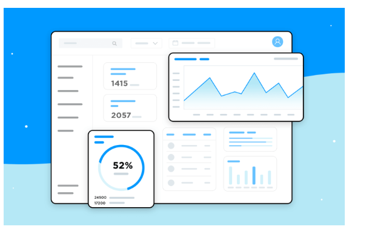

#### Paneles de control estratégicos
Los paneles de control estratégicos se utilizan para indicar el rendimiento con respecto a un conjunto de indicadores clave de rendimiento (KPI). Como se ve en este magnífico ejemplo de panel de control, un panel de control estratégico debe reflejar el rendimiento de tu usuario con respecto a sus objetivos estratégicos… y no mucho más.

---

### Otros tipos de panel de control
Fuera del ámbito de la inteligencia empresarial, los paneles de control pueden tener todo tipo de formas y tamaños, según el tipo de aplicación. Horarios, páginas de perfil, tu biblioteca de películas… si se trata de una sola página con la información o las acciones más importantes a las que el usuario puede querer acceder, es un panel de control.

#### Paneles de control de la plataforma
Los paneles de control de las plataformas se utilizan para dar al usuario acceso a controles, herramientas y análisis relacionados con su cuenta en una plataforma social. El panel de control de YouTube Studio es un buen ejemplo. Una vista inicial sencilla muestra los últimos vídeos del usuario, con algunas estadísticas para cada uno. También hay tarjetas para el análisis del canal, comentarios y noticias y consejos. En la barra lateral, el usuario puede acceder a un gran número de herramientas y controles de la cuenta, incluido el gestor de vídeos, el estado del canal y mucho más. YouTube mantiene las cosas sencillas, al tiempo que ofrece al usuario un control total.

#### Paneles de control de tiempo en la aplicación
Una nueva tendencia popular en las aplicaciones móviles es ofrecer al usuario información sobre el tiempo que pasa en cada aplicación. Si estás trabajando en una nueva aplicación social, querrás incluir este tipo de panel de control. La idea es ayudar a los usuarios a ver si pasan demasiado tiempo en su dispositivo. El panel de control *Tu actividad* de Instagram es bastante típico. Es muy básico, comienza con el tiempo medio diario del usuario en la aplicación, con un gráfico de barras que muestra cómo ha cambiado el tiempo diario en la aplicación durante la última semana. Por último, el panel de control incluye dos opciones de control que permiten a los usuarios reducir su tiempo diario en Instagram.

---

## 3. ¿Cuáles son los componentes más comunes del panel de control?

Según el uso al que se destinen, los diseños de los paneles de control pueden variar mucho. Pero todos los paneles de control están formados por **tarjetas**. Según el tipo de panel de control, cada tarjeta puede contener información del perfil, notificaciones, enlaces rápidos o un elemento de navegación, datos clave, gráficos y tablas de datos. Asegúrate de utilizar el tipo correcto de tarjeta para cada componente.

> [!TIP]
> **Regla de Justinmind:** Los mejores paneles de control no suelen incluir más de 5 ó 6 tarjetas en su vista inicial. Intenta ceñirte a una sola pantalla para mejorar la UX del panel de control.

Cada panel de control, sea cual sea su finalidad, se construye a partir de componentes esenciales que trabajan juntos para ofrecer información de un vistazo:

### Tablas y gráficos
Son los narradores visuales de tus datos. Utilizan barras, líneas y otras formas para revelar tendencias, patrones y comparaciones. Los gráficos de barras son estupendos para destacar categorías, mientras que los gráficos de líneas son excelentes para mostrar cambios a lo largo del tiempo. Elige el tipo de gráfico adecuado para que tus datos canten.

### Tablas
A veces, no hay sustituto para los datos en bruto. Las tablas ofrecen una forma clara y organizada de presentar información detallada, perfecta para desgloses o comparaciones entre múltiples variables. Utilízalas cuando necesites que los usuarios vean los números exactos que hay detrás de las imágenes.

### KPI y métricas
Son las piedras angulares de cualquier panel de control. Los KPI (Indicadores Clave de Rendimiento) son las mediciones más críticas del éxito de tus objetivos. Las métricas proporcionan contexto y detalles adicionales en torno a esos KPI. Piensa en los KPI como tus titulares y en las métricas como los detalles de soporte que pintan el cuadro completo.

### Filtros y controles
¡Da poder a tus usuarios! Permíteles interactuar con tu panel de control proporcionándoles filtros y controles. Permíteles desglosar los datos por intervalos de fechas, regiones u otras categorías relevantes. Así podrán adaptar el panel de control a sus necesidades específicas.

### Navegación
Navegar por un panel de control bien organizado es un placer. Asegúrate de que los usuarios puedan encontrar fácilmente la información que buscan con elementos de navegación claros e intuitivos, como menús, pestañas o barras de búsqueda.

---

## 4. Mejores Prácticas de Diseño de Paneles de Control

### 1. Decide qué necesitan tus usuarios de tu panel de control
El primer paso es conocer a tu público. Una vez que conozcas a fondo a tus *user persona*, deberías ser capaz de establecer qué esperan tus usuarios de tu aplicación y qué información es más importante para ellos. Habrá casos en los que la información requerida por los distintos usuarios varíe. En estos casos, puedes considerar la posibilidad de diseñar paneles de control con funciones que puedan añadirse, eliminarse o reorganizarse según las preferencias del usuario.

### 2. Los paneles de control con capacidad de respuesta dan el poder al usuario
Añadir un [diseño adaptable](https://www.justinmind.com/es/diseno-web/ejemplos-sitios-web-responsivos) a tu panel de control puede mejorar enormemente la experiencia del usuario. A tus usuarios les encantará que su panel de control se redimensione para adaptarse a cualquier pantalla que estén utilizando. Poder acceder a un panel de control desde el móvil es una ventaja fantástica para los usuarios que viajan con frecuencia. No olvides tener en cuenta cómo se reorganizarán las tarjetas de tu panel de control cuando la pantalla se reduzca al tamaño de un móvil. Asegúrate de que los datos más importantes siguen siendo visibles al instante.

Echa un vistazo a este panel de control responsivo de [Cuberto](https://dribbble.com/shots/4814056-Smart-Home-Dashboard):

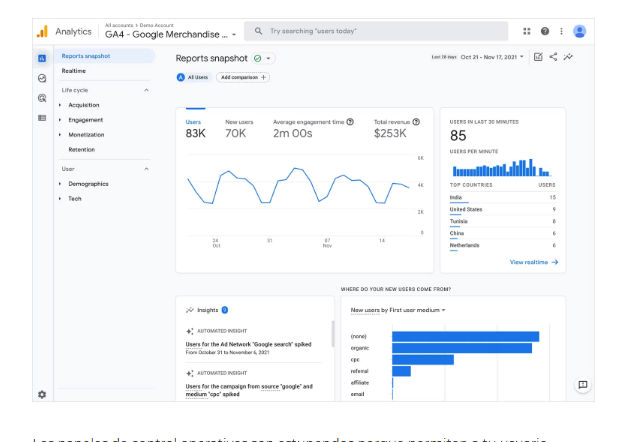

### 3. Los grandes paneles de control lideran con datos clave
Nos encantan los paneles de control que se dejan de tonterías y se centran en cifras grandes y llamativas.

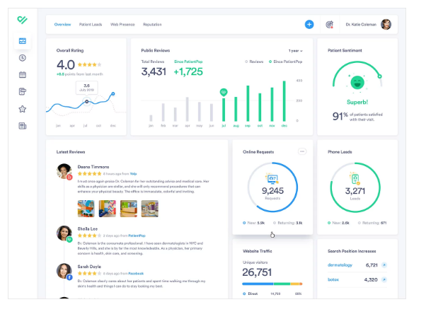

El estilo está a la última, con un diseño moderno y limpio. Hay mucho espacio en blanco y datos claros y fáciles de leer. Aquí tienes algunos consejos para conseguir un aspecto similar:
- **Piensa en números grandes y audaces:** No es el momento de detalles sutiles. El tamaño y la ubicación de las cifras clave comunican su importancia de un vistazo.
- **Corta la litera:** Deshazte de los adornos y textos innecesarios. Deja que los datos hablen por sí solos.
- **Aprovecha el espacio en blanco:** No agobies al usuario. Mucho espacio en blanco permite que los puntos de datos individuales destaquen y respiren.
- **La ventaja de ahorrar tiempo:** En el acelerado mundo actual, el tiempo es un bien preciado. Los paneles de control deben ayudar a los usuarios a actuar con rapidez, no a atascarse descifrando gráficos complejos.

### 4. Utiliza la arquitectura de la información para un gran diseño del panel de control
Cuando diseñes tu panel de control, ten en cuenta los principios de la [arquitectura de la información](https://www.justinmind.com/es/diseno-ui/arquitectura-informacion-guia). Es muy común estructurar los paneles de control según patrones visuales como la cuadrícula en F o el patrón en Z, situando los datos más críticos en la esquina superior izquierda.

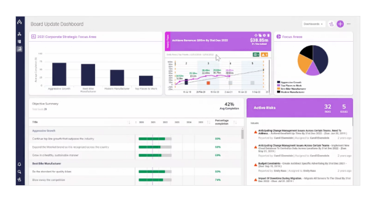

### 5. Utiliza diferentes puntos de vista para mantener las cosas ligeras
Nos gustan los paneles de control que utilizan distintas vistas para que la vista principal sea lo más limpia posible. Aunque algunos usuarios prefieren tener acceso a todos los datos posibles en su panel de control, a menudo es mejor tener un panel de control inicial relativamente sencillo, con la opción de cambiar a vistas de datos más complejas.

### 6. Utiliza un lenguaje de diseño y un esquema de colores coherentes
El hecho de que los paneles de control incluyan a menudo vistas de datos no significa que no puedan tener un aspecto estupendo. Elige una paleta de colores coherente y adecuada para tu público. La coherencia de colores y tipografía ayuda a los usuarios a asimilar rápidamente la información.

---

## 5. Dominar el Diseño y la Estructura del Panel de Control

Un panel de control bien diseñado no consiste sólo en los datos que muestra, sino en cómo se presentan.

### Disposición en cuadrícula: Tu columna vertebral organizativa
Piensa en un sistema de cuadrícula como el andamiaje invisible que lo mantiene todo unido. Proporciona una estructura coherente, garantizando que los elementos estén alineados y espaciados uniformemente. Esto no sólo tiene un aspecto profesional, sino que también facilita que los usuarios escaneen y procesen la información rápidamente.

### Secciones y paneles: Dividir y conquistar
Incluso la cuadrícula más meticulosamente organizada puede resultar abrumadora si todo está amontonado. Ahí es donde entran las secciones y los paneles. Al agrupar visualmente la información relacionada mediante tarjetas, colores de fondo sutiles o divisores claros, creas una sensación de orden y jerarquía. Por ejemplo, dedica una sección a las métricas de rendimiento de ventas, otra al compromiso de los clientes y otra a las tareas pendientes. Esta separación lógica ayuda a los usuarios a centrarse en áreas específicas sin perder de vista el panorama general.

### Jerarquía de la información
Reconoce que cierta información es intrínsecamente más importante que otra. Utiliza el diseño para establecer una jerarquía clara:
- Coloca las métricas y los KPI más críticos en un lugar destacado, idealmente en la parte superior izquierda de la pantalla.
- Utiliza tamaños de letra más grandes, colores más llamativos o incluso tarjetas de tamaño diferente para llamar la atención sobre los puntos de datos clave.
- La información de apoyo menos crítica puede residir más abajo en la página o dentro de secciones desplegables.

Si dominas estos principios de diseño, tu panel de control dejará de ser un revoltijo de datos para convertirse en una herramienta racionalizada y fácil de usar que capacite a tus usuarios.

---

## 6. Visualización de Datos: El Poder Visual de los Paneles de Control

La visualización de datos trasciende la mera decoración de los paneles de control; es el motor de discernimiento y compromiso que transforma los números brutos en historias convincentes y comprensibles.

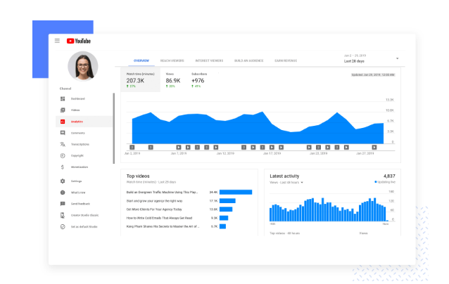

La elección del tipo de gráfico, la paleta de colores y el diseño desempeñan un papel crucial en la eficacia de tus datos. Aquí tienes un desglose de cómo la visualización de datos eleva el diseño de tu panel de control:
- **Claridad a través de lo visual:** Sustituye las densas tablas de datos por tablas y gráficos claros y concisos. Deja que las barras diferencien categorías, las líneas tracen tendencias y las porciones ilustren porcentajes.
- **Potencia del patrón:** El ojo humano destaca en el reconocimiento de patrones. La visualización de datos aprovecha esta capacidad innata, permitiendo a los usuarios detectar instantáneamente anomalías, fluctuaciones o correlaciones que de otro modo quedarían ocultas en las filas de datos.
- **Comunicación con impacto:** Los paneles de control tienen que ver con la comunicación dirigida. La visualización de datos te permite destacar las conclusiones clave y centrar la atención del usuario en lo que realmente importa.
- **Compromiso a través del diseño:** Reconozcámoslo, los paneles de control llenos de texto son un aburrimiento. La visualización de datos aporta dinamismo a tu diseño, manteniendo a los usuarios interesados e implicados en el análisis.

---

## 7. Impresionantes Ejemplos de Paneles de Control para Inspirarse (Los 37 Ejemplos de Justinmind)

A veces lo más difícil es empezar. Por eso hemos reunido 37 ejemplos fantásticos de diseño de paneles de control procedentes de Justinmind y de los mejores diseñadores de UI de todo el mundo.

### 1. Panel de control de ventas de navegación vertical
El panel de control de ventas de navegación vertical de Justinmind es un excelente ejemplo de cómo un diseño limpio y moderno puede mejorar enormemente la experiencia del usuario. La barra lateral vertical proporciona una forma sencilla de acceder a las diferentes secciones del panel de control, como el resumen de ventas, las métricas de rendimiento y las herramientas de gestión de clientes. Los gráficos limpios y las métricas claramente etiquetadas facilitan a los usuarios el análisis de sus datos y la toma de decisiones informadas.

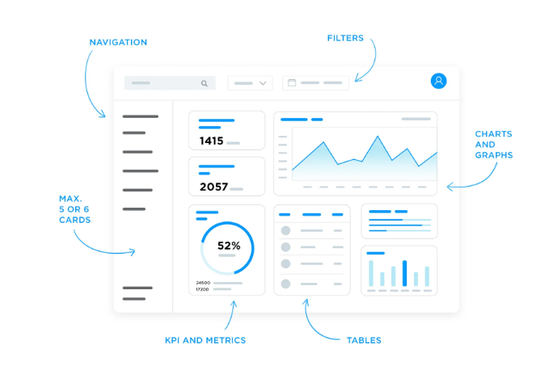  
[Descargar ejemplo en Justinmind](https://www.justinmind.com/open-resource?url=/design-templates/sales-dashboard-v-nav.vp)

### 2. Plantilla de sitio web de e-learning
Un buen panel de control de e-learning no sólo debe funcionar como una herramienta, sino también como una experiencia. Con un diseño limpio y un toque de color, este panel de control convierte el aprendizaje en un placer. El progreso de los cursos, las próximas tareas y los foros de debate son fácilmente accesibles, manteniendo a los estudiantes motivados y al día con sus estudios.

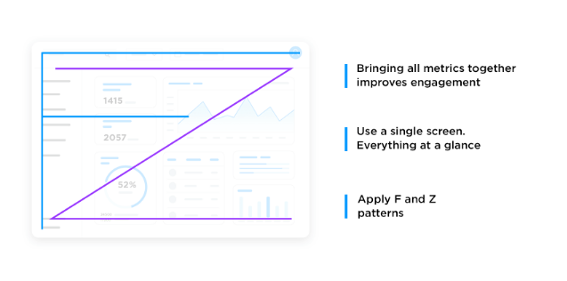  
[Descargar ejemplo en Justinmind](https://www.justinmind.com/open-resource?url=/design-templates/E-learning-website.vp)

### 3. Panel de control de ventas de navegación horizontal
El panel de control de ventas de navegación horizontal de Justinmind te ofrece básicamente las mismas opciones que la versión vertical, pero con una barra de navegación horizontal en la parte superior. La barra de navegación superior hace que sea muy sencillo navegar entre las diferentes vistas y tareas, mientras que los gráficos proporcionan una visión clara de los datos de ventas.

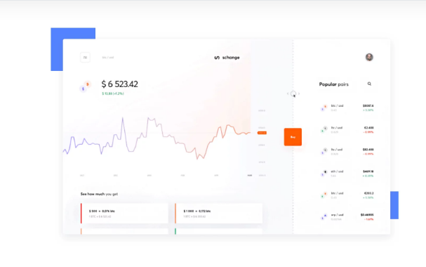  
[Descargar ejemplo en Justinmind](https://www.justinmind.com/open-resource?url=/design-templates/sales-dashboard-h-nav.vp)

### 4. Aplicación de panel de control de análisis
¿Alguna vez has deseado tener la analítica de tu empresa al alcance de la mano, literalmente? La aplicación de panel de control de analítica de Justinmind hace realidad ese deseo. Esta elegante aplicación proporciona una visión clara y concisa del rendimiento de tu negocio, todo en la palma de tu mano. Desde las cifras de ventas hasta las métricas de compromiso de los clientes, puedes hacer un seguimiento de los indicadores clave y mantenerte al tanto de la salud de tu negocio.

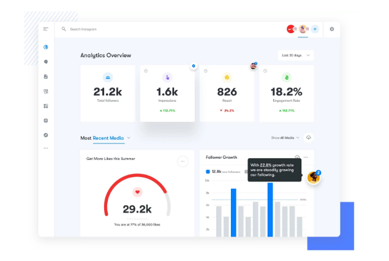  
[Descargar ejemplo en Justinmind](https://www.justinmind.com/open-resource?url=/design-templates/analytics-dashboard-app.vp)

### 5. Panel de control de la casa inteligente
¿Quieres crear una interfaz doméstica inteligente que sea funcional y visualmente atractiva? No busques más que el ejemplo de panel de control de casa inteligente de Justinmind. El diseño limpio y despejado del panel de control y su navegación intuitiva hacen que sea un placer utilizarlo, facilitando el control de todos tus dispositivos inteligentes conectados desde una ubicación central.

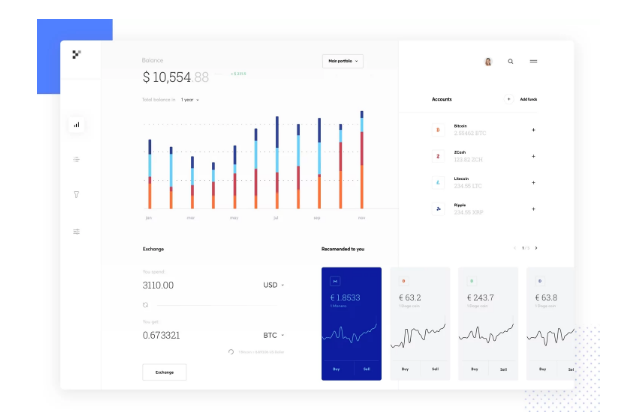  
[Descargar ejemplo en Justinmind](https://www.justinmind.com/open-resource?url=/design-templates/smart-home-dashboard.vp)

### 6. Panel de control de gestión de tareas
¡Se acabaron los malabarismos con múltiples listas de tareas pendientes y sentirse abrumado! El ejemplo de panel de control de gestión de tareas de Justinmind es tu arma secreta para conquistar el caos. La barra lateral izquierda proporciona una forma sencilla de navegar entre las diferentes secciones, como tareas pendientes, proyectos y calendarios. La vista principal ofrece una instantánea clara de las tareas, los plazos y los niveles de prioridad.

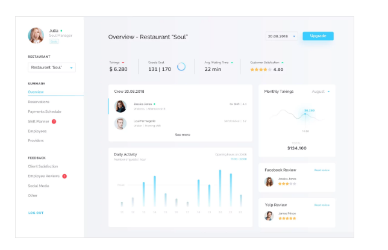  
[Descargar ejemplo en Justinmind](https://www.justinmind.com/open-resource?url=/design-templates/task-management-dashboard.vp)

### 7. Página web de banca a domicilio
El panel de control de Justinmind ofrece una gran cantidad de inspiración para aquellos de vosotros que estéis diseñando una aplicación financiera o un sitio web de banca en línea. El diseño del panel de control, la claridad del etiquetado y la navegación intuitiva proporcionan una experiencia bancaria en línea fluida y sin estrés. Con sus completas funciones y su diseño fácil de usar, este ejemplo demuestra cómo crear un panel de control que inspire confianza.

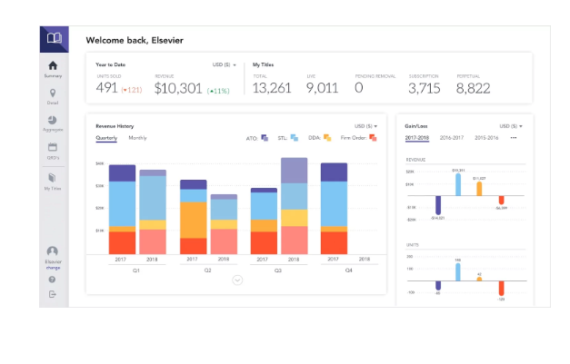  
[Descargar ejemplo en Justinmind](https://www.justinmind.com/open-resource?url=/examples/Home-Banking_Prototype.vp)

### 8. Flujo de la app de fitness
Este panel de control de la aplicación de fitness de Justinmind hace lo que debe hacer: realiza un seguimiento de los entrenamientos, establece objetivos y proporciona información sobre el progreso general. Además, la integración en el panel de control de funciones de salud y bienestar, como el seguimiento de la nutrición y los registros del sueño, añade un valor inmenso para los usuarios que buscan un enfoque holístico de su viaje de fitness.

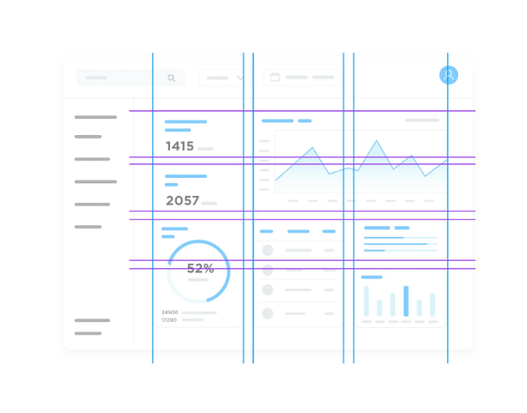  
[Descargar ejemplo en Justinmind](https://www.justinmind.com/open-resource?url=/design-templates/fitness-app-template.vp)

### 9. Aplicación de seguimiento del peso
Imagina tener un entrenador de salud personalizado que haga un seguimiento de tus progresos, te proponga retos y celebre tus victorias. La aplicación de control de peso de Justinmind puede ayudarte a crear ese tipo de experiencia. Las barras de progreso y los gráficos facilitan el seguimiento de los progresos a lo largo del tiempo, ayudando a los usuarios a mantenerse motivados y en el buen camino para alcanzar sus objetivos.

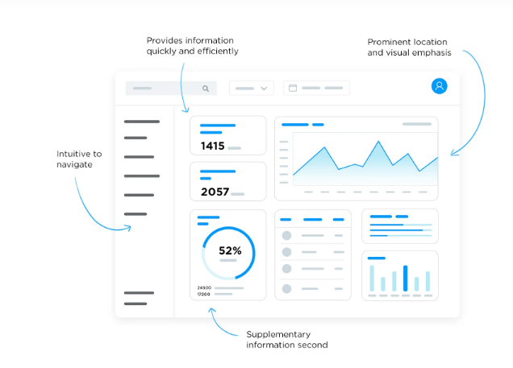  
[Descargar ejemplo en Justinmind](https://www.justinmind.com/open-resource?url=/design-templates/weight-tracking-app.vp)

### 10. Plantilla Bootstrap para el servicio de asistencia
El panel de control de la plantilla de soporte de Bootstrap de Justinmind es tu arma secreta para crear un sistema de soporte que mantenga contentos tanto a tus clientes como a tu equipo. Con los componentes predefinidos de Bootstrap y el sistema de cuadrícula adaptable, puedes diseñar intuitivamente un panel de control que muestre las incidencias abiertas, asigne tareas a los miembros del equipo y realice un seguimiento de los tiempos de resolución.

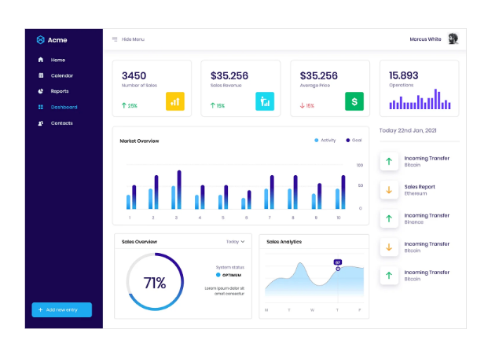  
[Descargar ejemplo en Justinmind](https://www.justinmind.com/open-resource?url=/design-templates/Bootstrap-Helpdesk-template.vp)

### 11. Aplicación de criptomoneda
El panel de control de la aplicación de criptomonedas de Justinmind es el sueño de un diseñador de UI. Repleto de gráficos visualmente atractivos y fáciles de leer, este panel de control proporciona a los usuarios información en tiempo real sobre los precios de las criptomonedas, las tendencias del mercado y el rendimiento de las carteras.

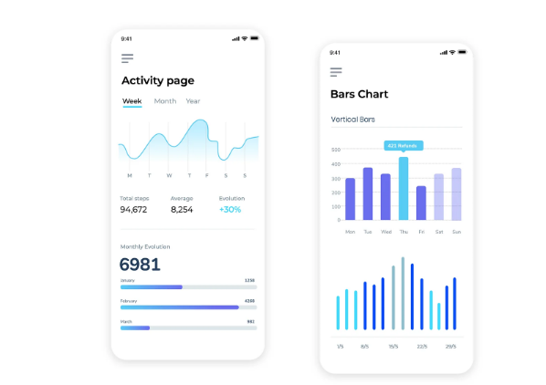  
[Descargar ejemplo en Justinmind](https://www.justinmind.com/open-resource?url=/design-templates/Kryptonite-crypto-app.vp)

### 12. Panel de control de finanzas personales
El ejemplo de panel de control de finanzas personales de Justinmind es tu Estrella del Norte para construir una experiencia de gestión financiera atractiva y fácil de usar. Su eficaz uso de tablas y gráficos hace que los datos financieros complejos sean fáciles de entender, proporcionando a los usuarios información en tiempo real sobre sus ingresos, gastos y hábitos de ahorro.

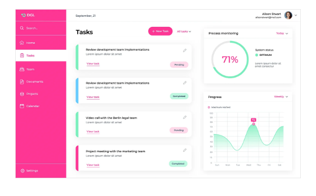  
[Descargar ejemplo en Justinmind](https://www.justinmind.com/open-resource?url=/examples/finance-web-dashboards.vp)

### 13. Panel de control de gestión de proyectos
El panel de control de gestión de proyectos de Justinmind es tu modelo para diseñar una herramienta que optimice el flujo de trabajo, mejore la colaboración y mantenga a los equipos alineados hacia el éxito del proyecto. Al descargar este ejemplo de diseño de panel de control, los diseñadores de UX pueden crear un panel de control que facilite la gestión de proyectos y permita a los equipos alcanzar sus objetivos.

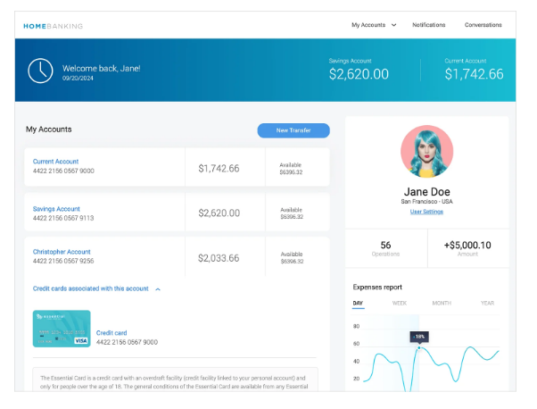  
[Descargar ejemplo en Justinmind](https://www.justinmind.com/open-resource?url=/design-templates/project-management-dashboard.vp)

### 14. Plantilla MUI CRM
El panel de control MUI CRM de Justinmind ofrece una solución completa y personalizable que puede ser fácilmente adaptada para satisfacer las necesidades de cualquier organización. También puedes profundizar en tus datos con gráficos interactivos que te permiten descubrir perspectivas valiosas, identificar tendencias y tomar decisiones basadas en datos.

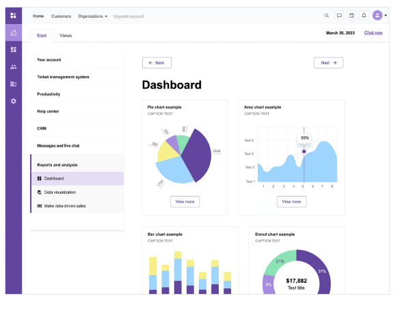  
[Descargar ejemplo en Justinmind](https://www.justinmind.com/open-resource?url=/design-templates/MUI-CRM-template.vp)

### 15. Aplicación doméstica inteligente
El ejemplo de diseño de panel de control de aplicación para hogares inteligentes de Justinmind es un modelo para crear un centro de control intuitivo y estéticamente agradable. Se proporciona una visión clara del número de dispositivos conectados al sistema, lo que permite a los usuarios identificar rápidamente posibles problemas o desconexiones. Además, la posibilidad de crear programas de automatización personalizados permite a los usuarios adaptar su experiencia en el hogar inteligente a sus rutinas diarias.

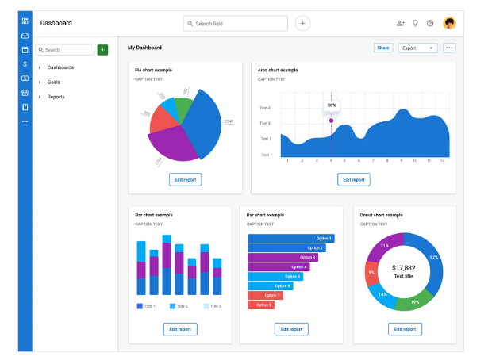  
[Descargar ejemplo en Justinmind](https://www.justinmind.com/open-resource?url=/design-templates/smart-home-app.vp)

### 16. Plantilla de aplicación web de RRHH en Angular
La plantilla web Angular HR de Justinmind es una herramienta visualmente atractiva y fácil de usar que agiliza la gestión de RRHH. Los widgets personalizables del panel de control permiten a los usuarios mostrar los datos más relevantes para sus necesidades específicas, mientras que el diseño intuitivo y la jerarquía clara facilitan la navegación y la búsqueda de la información necesaria.  
[Descargar ejemplo en Justinmind](https://www.justinmind.com/open-resource?url=/design-templates/Angular-HR-webapp.vp)

### 17. Plantilla wireframe de panel de control
La plantilla wireframe de panel de control de Justinmind es tu lienzo en blanco. Con su estructura flexible y sus componentes personalizables, puedes adaptar fácilmente el panel de control a las necesidades específicas de tu público objetivo. Además, con el diseño responsive, tu panel de control tendrá un aspecto estupendo y funcionará sin problemas en una gran variedad de dispositivos y tamaños de pantalla.  
[Descargar ejemplo en Justinmind](https://www.justinmind.com/open-resource?url=/design-templates/Dashboard+wireframe.vp)

### 18. Análisis de redes sociales
Orizon Agencia de diseño UI/UX Socooil es una impresionante muestra de cómo transformar los datos brutos de las redes sociales en información práctica. Una característica destacada es el seguimiento detallado de las interacciones de los usuarios, incluyendo me gusta, comentarios y compartidos, lo que permite a los profesionales del marketing medir el impacto de sus campañas.  
[Ver en Dribbble](https://dribbble.com/shots/18791307-Social-Media-Analytics-Dashboard)

### 19. Entrenamiento físico
Budiarti R. ha diseñado para Orely un ejemplo de panel de control de seguimiento de actividad y frecuencia cardíaca que cambia el modo oscuro por el claro en función de la hora del día. Esta función mejora la experiencia del usuario al proporcionar confort visual en diferentes condiciones de iluminación.  
[Ver en Dribbble](https://dribbble.com/shots/18854443-Fitness-Activity-Tracker-Dashboard)

### 20. Informes de ventas
El concepto de panel de control de ventas SellesLab de Fireart Studio es un diseño elegante y moderno que combina elementos estéticos con funcionalidad. El panel de control opta por una paleta de colores claros, para que los datos sean legibles sin esfuerzo visual, apoyado por gráficos bien estructurados para desglosar el rendimiento de ventas.  
[Ver en Dribbble](https://dribbble.com/shots/18388422-Sales-Dashboard-Concept)

### 21. Visualización de datos meteorológicos
El ejemplo de panel de control meteorológico creado por Vitalii P. destaca por su diseño elegante con iconos interactivos que representan diversas condiciones meteorológicas. Proporciona una visión completa de la previsión semanal, temperatura por horas y mapas térmicos.  
[Ver en Dribbble](https://dribbble.com/shots/19113627-Weather-Dashboard)

### 22. Gestión de proyectos
El tablero kanban diseñado por Brightscout es una herramienta visualmente atractiva y fácil de usar que agiliza la gestión de proyectos. El diseño destaca columnas para las distintas fases de realización de las tareas, facilitando a los miembros del equipo el seguimiento de sus progresos y la colaboración en tiempo real.  
[Ver en Dribbble](https://dribbble.com/shots/19555778-Kanban-Board)

### 23. Panel de control de soporte al cliente
Con funciones para priorizar y hacer un seguimiento de las incidencias, analizar los datos de soporte y supervisar los tiempos de resolución, este panel de control de soporte al cliente empodera a los equipos. Desde integrar varias herramientas hasta ayudar a los equipos a responder y resolver rápidamente las quejas de los clientes, es una solución integral.

### 24. Panel de control de e-learning
El ejemplo de panel de control de e-learning diseñado por Paperpillar es una solución educativa intuitiva y atractiva. Diseñado para satisfacer la creciente demanda de plataformas educativas digitales, este panel de control ayuda a los educadores a realizar un seguimiento del rendimiento de los estudiantes, gestionar las inscripciones a cursos y evaluar la eficacia de los contenidos.  
[Ver en Dribbble](https://dribbble.com/shots/18420820-E-learning-Dashboard)

### 25. Gestión de entradas de blog
Con este ejemplo de panel de control versátil y fácil de usar, la gestión de las tareas de SEO y la publicación de artículos se vuelve sencilla y sistemática. Con widgets personalizables, este panel de control te permite personalizar tu experiencia para adaptarla a tus objetivos específicos de contenidos.

### 26. Panel de control de análisis de datos de ventas
Diseñada para dar alegría a la gestión y el análisis de los datos de ventas, esta plataforma ofrece funciones completas para realizar el seguimiento del rendimiento de los ingresos, el valor medio de los pedidos y la adquisición de clientes. Y con sus visuales nítidos y su información detallada, el seguimiento del rendimiento de las ventas se convierte en algo estimulante.

### 27. Panel de control de marketing por correo electrónico
Diseñado pensando en la sencillez y la funcionalidad, este panel de control ofrece una visión global de las campañas de marketing por correo electrónico. Pero eso no es todo: este panel de control también incluye widgets personalizables, que te permiten hacer un seguimiento de métricas clave como tasas de apertura, clics y conversiones de suscriptores.

### 28. CleanMac
Outcrowd creó este bonito y ligero panel de control para CleanMac. Nos gusta especialmente que el diseño del panel de control disfrute de una barra de navegación vertical que no ocupa demasiado espacio en la pantalla.  
[Ver en Dribbble](https://dribbble.com/shots/9551899-Dashboard-CleanMac)

### 29. Aplicación médica H-care
Max Panchyk, de Toglas Studio, diseñó este magnífico panel de control para una aplicación médica. Lo que más nos gusta del diseño de este panel de control es que, aunque los usuarios pueden profundizar en los historiales y constantes de los pacientes, la vista inicial está despejada y se centra en las métricas más importantes.  
[Ver en Dribbble](https://dribbble.com/shots/8813361-H-care-Medical-App)

### 30. Panel de control del sistema de análisis de productos
Kostia Varhatiuk, de Fireart Studio, diseñó este magnífico panel de control para un sistema de análisis de productos. Nos gusta que, aunque este ejemplo de panel de control no ofrece a los usuarios tanta información como otros de esta lista, se centra en las métricas esenciales y evita la sobrecarga cognitiva.  
[Ver en Dribbble](https://dribbble.com/shots/6140702-Product-Analytics-Management-System-Dashboard)

### 31. Podcast panel de control
Valery Pevnev de Insoft ha creado un ejemplo de panel de control de podcast. Nos encanta todo, desde la barra de navegación vertical hasta la forma en que los bloques separan la información en categorías claras de oyentes, episodios y monetización.  
[Ver en Dribbble](https://dribbble.com/shots/9699028-Podcast-Dashboard)

### 32. Análisis de productos: informes
Vladimir Gruev ha creado un interesante ejemplo de panel de control para informes de análisis de productos. El diseñador también hizo un gran uso de formas más visuales de transmitir la información, utilizando gráficos de radar e indicadores circulares de cumplimiento.  
[Ver en Dribbble](https://dribbble.com/shots/7024031-Product-Analytics-Reports)

### 33. Programar el diseño del panel de control
No todos los paneles de control tienen que estar llenos hasta los topes de métricas y puntos de datos. El panel de control en sí es minimalista, dando a todos los elementos mucho espacio para respirar. Además, nos encanta el uso de tarjetas de tareas para simplificar la gestión de agendas.

### 34. Panel de control Rockecoon
Los servicios financieros y el comercio son un área primordial para un gran diseño de panel de control. Toglas Studio consiguió crear una página de aspecto minimalista y limpio para el panel de control de Rockecoon, que utiliza gráficos sencillos para transmitir grandes cantidades de datos financieros de trading.  
[Ver en Dribbble](https://dribbble.com/shots/9142192-Rockecoon-Dashboard)

### 35. Panel de control del cliente
Otro maravilloso ejemplo de panel de control financiero que ayuda a los usuarios a hacer las cosas. El estilo y el uso de los colores funcionan bien para resaltar los datos sin abrumar al usuario. Otras características interesantes son el desglose de carteras de inversión y los botones de acción rápida.

### 36. Panel de control Keyhub
Este es un ejemplo más tecnológico del diseño de un panel de control. Vladimir Gruev, de Heartbeat Agency, diseñó este panel de control con un aspecto de alta tecnología y widgets personalizables que proporcionan un control total sobre infraestructuras cloud y licencias.

### 37. Aplica
Nuestro último ejemplo de panel de control ha sido creado para directores de RRHH y reclutadores. Budiarti R., de Orely, ha creado este alegre diseño para Aplica. Es una página colorida y agradable, con un aire juvenil. Los usuarios podrían comprender el estado de las solicitudes de empleo y las etapas de contratación de un solo vistazo.

---

## 8. Diseña Paneles de Control Fácilmente con Justinmind

En Justinmind es fácil crear paneles de control bonitos y fáciles de usar desde el punto de vista del usuario. He aquí tres razones:
- **Hazlo sencillo:** Incluye sólo la información más relevante para tus usuarios, al menos en la pantalla de inicio del panel de control. Esto ayuda a garantizar que tu panel de control siga siendo intuitivo y rápido de leer.
- **Agrupa los datos relacionados o relevantes:** Cuando tengas conjuntos de datos que sean más fáciles de procesar juntos, asegúrate de que aparezcan juntos en la pantalla.
- **Utiliza los kits UI de panel de control de Justinmind:** Ahorra tiempo y crea paneles de control más atractivos utilizando kits de interfaz de usuario prediseñados y probados.

### Wireframing y prototipado
El *wireframing* y la creación de prototipos son etapas cruciales en el proceso de diseño de aplicaciones y paneles de control. Te permiten visualizar la disposición, la navegación y la funcionalidad de tu aplicación antes de escribir una sola línea de código. Las bibliotecas de UI desempeñan un papel importante en este proceso, ya que proporcionan componentes prediseñados:
- **Componentes prediseñados:** Botones, formularios, barras de navegación, iconos y mucho más.
- **Elementos de diseño responsive:** Componentes que se adaptan a distintos tamaños y orientaciones de pantalla.
- **Plantillas personalizables:** Plantillas ya preparadas que pueden adaptarse a las necesidades específicas de tu proyecto.
- **Elementos interactivos:** Componentes que permiten simular interacciones y flujos de trabajo de los usuarios en tiempo real.

Utilizar una biblioteca de UI puede reducir significativamente el tiempo y el esfuerzo necesarios para crear wireframes y prototipos, permitiéndote centrarte en la experiencia global del usuario.

### Biblioteca UI de gráficos
Nuestra [biblioteca UI de gráficos](https://www.justinmind.com/es/ui-kits/graficos) está pensada para ayudarte a crear prototipos con visualizaciones de datos ricas e interactivas. Con una amplia gama de tipos de gráficos para elegir, incluyendo gráficos de barras, gráficos de líneas, gráficos circulares y gráficos de dispersión, puedes representar fácilmente datos complejos de una manera clara y visualmente atractiva.  
[Descargar el kit UI de Gráficos](https://www.justinmind.com/open-resource?url=/widgets/charts-widget-library.jpl)

### Kit UI para Salesforce Lightning Design
Gracias a nuestro [kit de UI Lightning Design](https://www.justinmind.com/es/ui-kits/salesforce-sistema-diseno-lightning), puedes crear prototipos que imitan fielmente el aspecto y la funcionalidad de la plataforma Salesforce. Destinado a fomentar el desarrollo rápido de aplicaciones, incluye una amplia gama de componentes, desde botones y formularios hasta tablas de datos y componentes de navegación.  
[Descargar el kit UI de Salesforce](https://www.justinmind.com/open-resource?url=/widgets/Salesforce-widget-library.jpl)

### Kit de UI para el diseño del panel de control de SAP Fiori
Fiori de SAP es el sistema de diseño que se utiliza para crear aplicaciones SAP empresariales. Anunciado como una experiencia de usuario más intuitiva y atractiva para los usuarios de software de gestión, cuenta con iconos, patrones de diseño y plantillas especializadas.  
[Descargar el kit UI de SAP Fiori](https://d2ld3he4yll0xl.cloudfront.net/widgets/SAP_Fiori.zip)  
[Ver artículo sobre SAP Fiori en Justinmind](https://www.justinmind.com/es/ui-kits/prototype-great-ux-with-justinmind-sap-fiori)

### Kit UI para diseño de panel de control en Oracle Alta UI
Alta UI es el sistema de diseño de Oracle para las aplicaciones de su servicio en la Nube, así como para las aplicaciones móviles. El kit Oracle Alta UI de Justinmind incluye todo lo que necesitas para crear prototipos para móviles y navegadores:
- **Iconos:** Los iconos de nuestro kit de UI están diseñados para coincidir exactamente con los iconos oficiales de Alta UI.
- **Patrones de diseño:** ¿Por qué perder el tiempo creando formularios o páginas de inicio cuando puedes reutilizar patrones estándar ya validados?
- **Cuadrículas de datos:** Las cuadrículas de datos de nuestro kit Alta UI son una forma reconocible al instante de visualizar y manipular datos de listas complejas.  
[Descargar el kit UI de Oracle Alta](https://www.justinmind.com/open-resource?url=/widgets/Oracle-Alta-UI.jpl)

---

## 9. Conclusión

Los paneles de control deben comunicar la información más importante para el usuario, **en una pantalla y de un vistazo**. Recuerda la analogía del salpicadero de un automóvil: si no es vital para la conducción, no debe ocupar espacio en el panel de control. Elige el tipo de panel de control adecuado para las necesidades de tus usuarios, estructura la información utilizando la arquitectura de la información y sistemas de cuadrícula, lidera con números grandes y audaces, y apóyate en el poder de la visualización de datos para que los datos cobren vida y ahorren tiempo a quien los consulta.
