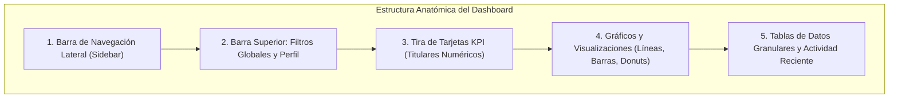

# ARQ-08: Guía Maestra de Diseño de Paneles de Control (Dashboards UI/UX)

> **Documento Canónico de Diseño y Experiencia de Usuario**  
> **Área:** Frontend Architecture · UI/UX Design System  
> **Estado:** Activo y Vinculante  
> **Alineación:** FORMA SPOS + Storefront Omnicanal  

---

## 1. Fundamentos: ¿Qué es un Panel de Control?

En su forma más simple, un panel de control (*dashboard*) es una pantalla de la aplicación que muestra información consolidada. Proporciona al usuario una visión global inmediata, con acceso prioritario a los datos, funciones y controles más importantes. En la práctica, el panel de control suele convertirse en la página de inicio principal para directores, administradores y operadores avanzados.

### La Analogía del Automóvil
Los llamamos «cuadros de mando» porque, al igual que en un vehículo, están concebidos para mostrar datos críticos y pertinentes **de un solo vistazo**.

```
    ┌─────────────────────────────────────────────────────────────┐
    │                      CUADRO DE MANDO                        │
    │  Velocidad actual   •   Combustible   •   Revoluciones RPM  │
    │  Kilometraje total  •   Alertas críticas del motor          │
    └─────────────────────────────────────────────────────────────┘
                               ▲
           NO muestra noticias, redes sociales ni clima
           porque NO son relevantes para la tarea de conducir.
```

* **Regla de Oro:** Los paneles de control sólo deben mostrar información relevante para la toma de decisiones inmediata. No deben saturarse con datos secundarios que distraigan del objetivo operativo.
* **Ahorro de Tiempo:** El propósito esencial de un panel de control es hacer al usuario más eficiente. Si un usuario tarda más de 5 segundos en comprender el estado de su negocio, el diseño ha fracasado.

---

## 2. Los 3 Tipos Principales de Paneles de Control (BI) y Otros Enfoques

En la Inteligencia de Negocios (BI) existen tres tipos fundamentales de paneles de control, cada uno con un propósito cognitivo específico:

| Tipo de Panel | Propósito Principal | Frecuencia de Actualización | Componentes Clave |
| :--- | :--- | :--- | :--- |
| **1. Operativo** | Monitorizar lo que está ocurriendo **en este mismo instante**. | Tiempo real / Minuto a minuto | KPIs en vivo, gráficos de actividad reciente, alertas inmediatas. |
| **2. Analítico** | Descubrir **tendencias históricas**, patrones y anomalías. | Diario / Semanal / Mensual | Gráficos de series de tiempo, comparativas vs período anterior, desgloses multifactoriales. |
| **3. Estratégico** | Medir el avance frente a los **grandes objetivos y KPIs de la empresa**. | Mensual / Trimestral / Anual | Tacómetros de meta, porcentaje de cumplimiento, barras de progreso y riesgos activos. |

### Otros Paneles Especializados
* **Paneles de Plataforma:** Ofrecen acceso rápido a herramientas y métricas de creadores o administradores (ej. YouTube Studio, con tarjetas de canal, últimos videos y métricas clave).
* **Paneles de Gestión de Tiempo y Bienestar:** Muestran hábitos de uso y permiten fijar límites (ej. Instagram «Tu Actividad»).

---

## 3. Anatomía y Componentes Esenciales de un Dashboard

Cualquier panel de control efectivo se articula a partir de 5 componentes estructurales organizados en tarjetas (*cards*):




1. **Navegación Intuitiva:** Barra lateral o superior con iconos legibles y estados activos bien diferenciados.
2. **Filtros y Controles:** Selectores de fecha (*Hoy, 7 Días, Este Mes, Año*), selector de sede o ámbito, y botones de exportación.
3. **KPIs y Métricas:** Cifras en negrita, números grandes y deltas de cambio porcentual (+14.2% vs ayer).
4. **Gráficos y Visualizaciones:** Gráficos de línea/área para series de tiempo, barras para comparativas categóricas y donuts para participación.
5. **Tablas de Datos:** Vistas densas y ordenadas cuando se requiere verificar el número exacto detrás de las imágenes.

---

## 4. Las Reglas de Oro de Usabilidad y Experiencia de Usuario (UI/UX)

### Regla 1: Máximo 5 o 6 Tarjetas en la Vista Inicial
Los mejores paneles de control no saturan la mente del usuario. No incluyas más de **5 ó 6 tarjetas o contenedores principales** en la pantalla inicial. Más de 6 tarjetas fragmenta la atención y eleva la carga cognitiva.

### Regla 2: El Principio de «Una Sola Pantalla» (Single Screen - Everything at a Glance)
Siempre que sea posible en escritorio, la información crítica del negocio debe caber en una sola pantalla sin forzar un scroll vertical excesivo. Agrupar las métricas en una pantalla limpia incrementa el *engagement* y evita la fatiga visual.


### Regla 3: Patrones de Lectura F y Z
El ojo humano en occidente escanea las pantallas siguiendo patrones en **F** o en **Z**:
* **Esquina Superior Izquierda:** El área de máxima atención. Aquí deben situarse las cifras de negocio más importantes (Ventas Netas, Saldo, Ingresos).
* **Zona Superior Derecha:** Filtros rápidos, fecha y avatar de usuario.
* **Diagonal / Centro:** Gráficos visuales de tendencia e impacto.
* **Línea Inferior:** Desgloses complementarios, tablas o actividad reciente.

### Regla 4: Sistema de Cuadrícula Invisible (Grid Layout)
Una cuadrícula ortogonal (típicamente de 12 columnas) actúa como el esqueleto invisible que garantiza alineación, simetría y ritmo visual.


### Regla 5: Jerarquía de la Información y Énfasis Visual
No todos los datos son iguales. Utiliza la jerarquía para situar lo crucial primero y los datos complementarios después:


---

## 5. Galería Maestra de las 20 Referencias Visuales Analizadas

### Referencia 1: Wireframe Estructural con Tarjetas y Métricas

* **Patrón Visual:** Tarjeta principal de KPIs a la izquierda con gráfico de área a la derecha; widget donut de 52% flotante y tabla condensada inferior. Demuestra cómo una retícula asimétrica mantiene el orden.

### Referencia 2: Google Analytics GA4 (Panel Operativo en Tiempo Real)

* **Lección UX:** Presentación de 4 métricas compactas (Users, New Users, Engagement Time, Total Revenue) seguidas de una línea de tendencia limpia y un panel lateral de actividad en los últimos 30 minutos.

### Referencia 3: PatientPop por Manson Yarnell (Panel Analítico Médico)

* **Lección UX:** Tarjetas con calificación 4.0 estrellas, Donut de satisfacción 91%, histograma de reseñas y tarjetas de leads telefónicos y online. Uso magistral de acentos turquesas sobre blanco puro.

### Referencia 4: Board Update Dashboard (Panel Estratégico Corporativo)

* **Lección UX:** Diseñado específicamente para juntas directivas. Resumen de objetivos corporativos, barras de avance porcentual y panel derecho de riesgos activos con semáforos de advertencia.

### Referencia 5: YouTube Studio Analytics (Panel de Plataforma para Creadores)

* **Lección UX:** Tira de métricas (Tiempo de visualización, Vistas, Suscriptores), gráfico de área interactivo con puntos de publicación y lista de videos destacados en barras horizontales.

### Referencia 6: Anatomía Fundamental de Componentes

* **Lección UX:** Delimita con flechas la posición exacta de cada elemento: Sidebar de navegación, filtros superiores, tira de 5-6 tarjetas, gráficos y tablas.

### Referencia 7: Patrones de Escaneo F y Z

* **Lección UX:** Guía sobre cómo estructurar la mirada del usuario en pantalla única (*Single Screen*) para maximizar la retención y la agilidad operativa.

### Referencia 8: Panel Responsivo con Interfaz Deslizante (Cuberto)

* **Lección UX:** Control interactivo deslizante que permite al usuario alternar foco entre la gráfica de mercado y el desglose de pares comerciales.

### Referencia 9: Panel de Influencer con Números Grandes y Negrita

* **Lección UX:** Tipografía audaz en titulares (`21.2k`, `1.6k`, `826`), tacómetro semicircular de likes y gráfico de barras con tooltip en foco.

### Referencia 10: Cryptocurrency Exchange Dashboard

* **Lección UX:** Comienza con el balance total en la cabecera superior izquierda, barras apiladas mensuales y tarjetas de compra/venta rápidas en la base.

### Referencia 11: Restaurant Management «Soul»

* **Lección UX:** Resumen operativo de turnos, ingresos diarios, tiempo de espera promedio y satisfacción del cliente con estrellas.

### Referencia 12: Publisher Central / Elsevier

* **Lección UX:** Análisis editorial con barras apiladas trimestrales (Q1-Q4) y gráfico de cascada (*Gain/Loss*) para ingresos vs pérdidas.

### Referencia 13: Retícula Ortogonal y División de Paneles

* **Lección UX:** Demostración de las líneas guía que coordinan horizontal y verticalmente cada tarjeta en la interfaz.

### Referencia 14: Jerarquía de la Información de Alto a Bajo Nivel

* **Lección UX:** Prioriza la ubicación prominente para datos vitales y reserva la parte inferior para información secundaria o de soporte.

### Referencia 15: Acme Executive Dashboard

* **Lección UX:** Elegante sidebar índigo profundo, 4 KPIs con iconos temáticos y porcentajes, gráfico de barras dobles (*Activity vs Goal*), donut de estado y panel derecho de transferencias entrantes.

### Referencia 16: Dashboard Móvil (Activity & Bars Chart)

* **Lección UX:** Adaptación vertical estricta para teléfonos: curva de pasos fluida, barras verticales de reembolsos y pestañas segmentadas (Semana, Mes, Año).

### Referencia 17: DGL Tasks & Process Monitoring

* **Lección UX:** Sidebar vibrante, lista de tareas con botones de acción y estado (*Pending / Completed*), donut de monitoreo y gráfico de avance semanal ondular.

### Referencia 18: Homebanking Dashboard

* **Lección UX:** Banner superior con saldo disponible, tabla de cuentas (Corriente, Ahorros, Inversión), tarjeta plástica visual y gráfico de reporte de gastos por período.

### Referencia 19: Purple Analytics Dashboard

* **Lección UX:** Paleta púrpura suave con 4 gráficos modulares: Pie chart, Area chart interactivo con tooltip 50%, barras apiladas y donut de ingresos.

### Referencia 20: Blue Enterprise Analytics Dashboard

* **Lección UX:** Múltiples formatos visuales integrados: barra de búsqueda superior, gráficos circulares, barras horizontales de opciones y donut central con cifra destacada `$17,882`.

---

## 6. Directrices Obligatorias para el Dashboard de FORMA SPOS

Para el módulo de Dashboard Administrativo y Ejecutivo de FORMA (`AdminDashboardPage.tsx`), se aplican estrictamente los siguientes mandatos:

1. **Paleta de Color Armónica y Sofisticada:**
   * Fondo: Atelier cálido `#FAF8F5` (modo claro) o Carbón Atelier `#0E0C0A` (modo noche).
   * Primario / Marca: Vinotinto Haute Couture `#741C2B` (usado con mesura, nunca chillón).
   * Acento: Champagne Dorado `#C49A68` y `#D4AF37`.
   * Neutros: Slate `#0F172A` para tipografía en modo claro, `#F8FAFC` en modo noche.
   * Prohibidos colores saturados fluorescentes o estridentes.
2. **Estructura en Pantalla Única:**
   * Cabecera compacta con Breadcrumb, Selector de Sede y Filtro temporal (*Hoy, 7 Días, Mes, Año*).
   * Tira superior de **4 KPIs directivos**: Ventas Netas, Inventario Valorizado, Pedidos Web Activos, Estado de Cajas.
   * Cuadrícula central de 2 columnas (60% / 40%): Gráfico de Tendencia temporal (Línea/Área) a la izquierda, y Gráfico de Distribución por Sede (Donut/Pie) a la derecha.
   * Sección inferior complementaria: Histograma de ventas/unidades y panel compacto de actividad reciente o alertas de stock.
3. **Cero Cálculos en Cliente:** Todos los importes en COP son enteros (`RN-GEN-04`) y las fechas respetan la hora oficial de Colombia (`RN-GEN-05`).
