# Plan de Pruebas — FORMA Tienda & POS

> **Documento de Auditoría Integral de Usabilidad, Consistencia Visual y Flujos Operativos**  
> Transcripción exacta y completa de las 42 páginas del informe de evaluación original (`Plan de puebas-FORMA.pdf`).  
> Incluye el 100% de los textos, descripciones, resultados actuales, resultados esperados, recomendaciones y capturas de evidencia fotográfica.

---

## Matriz Resumen de Hallazgos (Página 1)

### Distribución por Nivel de Prioridad

| Prioridad | Cantidad de Hallazgos | Porcentaje |
| :--- | :---: | :---: |
| **ALTA** | 6 | 20% |
| **MEDIA** | 18 | 60% |
| **BAJA** | 6 | 20% |
| **TOTAL** | **30** | **100%** |

### Distribución por Sección Evaluada

| Sección | Cantidad | Códigos de Hallazgo |
| :--- | :---: | :--- |
| **1. Navegación y desplazamiento** | 6 | CLI-001, CLI-002, CLI-003, CLI-004, CLI-016, CLI-022 |
| **2. Catálogo, productos y filtros** | 10 | CLI-005 al CLI-014 |
| **3. Sedes y cobertura de envíos** | 3 | CLI-015, CLI-020, CLI-025 |
| **4. Soporte y seguimiento de pedidos** | 4 | CLI-017, CLI-018, CLI-019, CLI-021 |
| **5. Checkout: datos personales y pagos** | 2 | CLI-023, CLI-024 |
| **6. Checkout: procesamiento de pedidos** | 3 | CLI-026, CLI-027, CLI-028 |
| **7. Cuenta de usuario y cierre de sesión** | 2 | CLI-029, CLI-030 |

### Matriz de Certificación y Estado de Resolución (30/30 - 100% RESUELTO)

| Código | Prioridad | Sección Evaluada | Descripción Breve | Estado | Archivos / Componentes Modificados |
| :--- | :---: | :--- | :--- | :---: | :--- |
| **CLI-001** | 🔴 ALTA | 1. Navegación | Ofertas exclusivas sin redirección funcional | 🟢 **RESUELTO** | `CatalogPage.tsx`, `Navbar.tsx` |
| **CLI-002** | 🟢 BAJA | 1. Navegación | Sin estado visual activo en pestañas Inicio/Ofertas/Catálogo | 🟢 **RESUELTO** | `Navbar.tsx` |
| **CLI-003** | 🟡 MEDIA | 1. Navegación | Persistencia de scroll en catálogo al cambiar de sección | 🟢 **RESUELTO** | `StorefrontLayout.tsx` |
| **CLI-004** | 🟢 BAJA | 1. Navegación | Desplazamiento no controlado en navegación entre secciones | 🟢 **RESUELTO** | `StorefrontLayout.tsx` |
| **CLI-005** | 🟡 MEDIA | 2. Catálogo | Modal de producto centrado con backdrop oscuro | 🟢 **RESUELTO** | `ProductDetailModal.tsx` |
| **CLI-006** | 🟡 MEDIA | 2. Catálogo | Menú redundante de departamentos eliminado | 🟢 **RESUELTO** | `CatalogPage.tsx` |
| **CLI-007** | 🔴 ALTA | 2. Catálogo | Botón 'Explorar Colección' en banner de ofertas | 🟢 **RESUELTO** | `catalogService.ts`, `CatalogPage.tsx` |
| **CLI-008** | 🟡 MEDIA | 2. Catálogo | Cambio involuntario de atributos sin notificación | 🟢 **RESUELTO** | `ProductDetailModal.tsx` |
| **CLI-009** | 🟡 MEDIA | 2. Catálogo | Rango mínimo de slider $0 COP inconsistente con catálogo | 🟢 **RESUELTO** | `CatalogPage.tsx` |
| **CLI-010** | 🟢 BAJA | 2. Catálogo | Rango máximo de slider desalineado de precios reales | 🟢 **RESUELTO** | `CatalogPage.tsx` |
| **CLI-011** | 🟡 MEDIA | 2. Catálogo | Sincronización de precio de prendas en vitrina y ficha | 🟢 **RESUELTO** | `catalogService.ts` |
| **CLI-012** | 🟡 MEDIA | 2. Catálogo | Selector de tallas y colores con SKU explícito | 🟢 **RESUELTO** | `ProductDetailModal.tsx` |
| **CLI-013** | 🟡 MEDIA | 2. Catálogo | Botón '+ Bolsa' en prendas con múltiples tallas/colores | 🟢 **RESUELTO** | `ProductCard.tsx` |
| **CLI-014** | 🟡 MEDIA | 2. Catálogo | Inconsistencias y subcategorías vacías en catálogo | 🟢 **RESUELTO** | `CatalogPage.tsx` |
| **CLI-015** | 🟡 MEDIA | 3. Sedes | Horarios de atención en sedes físicas incompletos | 🟢 **RESUELTO** | `NosotrosPage.tsx` |
| **CLI-016** | 🟡 MEDIA | 1. Navegación | Botón 'Explorar el Catálogo' en Nosotros no navegaba | 🟢 **RESUELTO** | `NosotrosPage.tsx` |
| **CLI-017** | 🔴 ALTA | 4. Soporte | Rastreador de pedidos aleatorio sin validación de orden | 🟢 **RESUELTO** | `SoportePage.tsx`, `MiCuentaPage.tsx` |
| **CLI-018** | 🔴 ALTA | 4. Soporte | Stepper gráfico de trazabilidad editable por cliente | 🟢 **RESUELTO** | `MiCuentaPage.tsx` |
| **CLI-019** | 🟢 BAJA | 4. Soporte | Duplicidad de botones de rastreo en centro de soporte | 🟢 **RESUELTO** | `SoportePage.tsx` |
| **CLI-020** | 🟡 MEDIA | 3. Sedes | Diferencia de cobertura entre simulador y checkout DANE | 🟢 **RESUELTO** | `SoportePage.tsx` |
| **CLI-021** | 🟢 BAJA | 4. Soporte | Asimetría en acordeón de preguntas frecuentes | 🟢 **RESUELTO** | `SoportePage.tsx` |
| **CLI-022** | 🟡 MEDIA | 1. Navegación | Botón 'Volver al Catálogo' en Soporte no desplazaba | 🟢 **RESUELTO** | `SoportePage.tsx` |
| **CLI-023** | 🔴 ALTA | 5. Checkout | Validación y sanitización estricta de nombres y correos | 🟢 **RESUELTO** | `CheckoutPage.tsx` |
| **CLI-024** | 🟡 MEDIA | 5. Checkout | Sanitización de titular y CUS en transferencia | 🟢 **RESUELTO** | `CheckoutPage.tsx` |
| **CLI-025** | 🟡 MEDIA | 3. Sedes | Orden alfabético confuso en selector DANE | 🟢 **RESUELTO** | `SoportePage.tsx` |
| **CLI-026** | 🔴 ALTA | 6. Checkout | Latencia excesiva de 60s en confirmación de orden | 🟢 **RESUELTO** | `CheckoutPage.tsx` |
| **CLI-027** | 🟡 MEDIA | 6. Checkout | Vaciado inmediato de bolsa antes de llamadas de red | 🟢 **RESUELTO** | `CheckoutPage.tsx` |
| **CLI-028** | 🟡 MEDIA | 6. Checkout | Bloqueo de inputs (`disabled`) durante procesamiento | 🟢 **RESUELTO** | `CheckoutPage.tsx` |
| **CLI-029** | 🟡 MEDIA | 7. Cuenta | Fuga de pedidos de sesión anterior en cuenta nueva | 🟢 **RESUELTO** | `MiCuentaPage.tsx` |
| **CLI-030** | 🟢 BAJA | 7. Cuenta | Botón de cierre de sesión duplicado en Mi Cuenta | 🟢 **RESUELTO** | `MiCuentaPage.tsx`, `Navbar.tsx` |

---

# SECCIÓN 1: NAVEGACIÓN Y DESPLAZAMIENTO

## CLI-001 — Botón «Ofertas» no responde al hacer clic

- **Prioridad:** 🟡 **Media.**
- **Categoría:** Error funcional / Navegación.
- **Módulo:** Clientes / Barra de navegación principal.
- **Páginas en PDF:** Página 2

### Descripción del problema / hallazgo
problema
Al hacer clic en el botón «Ofertas» ubicado en la barra de navegación principal, no se produce ninguna
acción visible. El sistema no redirige a una sección, no desplaza la página ni muestra un cambio en el
estado visual del botón.

### Resultado actual
El botón permanece sin respuesta después de hacer clic, sin proporcionar retroalimentación visual ni
funcional al usuario.

### Resultado esperado
El botón debería dirigir al usuario a la sección de ofertas correspondiente y mostrar el estado visual activo
para indicar que la opción ha sido seleccionada.

### Recomendación
Revisar la funcionalidad de navegación asociada al botón «Ofertas», verificar que tenga correctamente
configurado su evento de interacción y garantizar que redirija a la sección correspondiente.

### Evidencia Visual y Capturas del Informe

#### Capturas Específicas del Hallazgo:

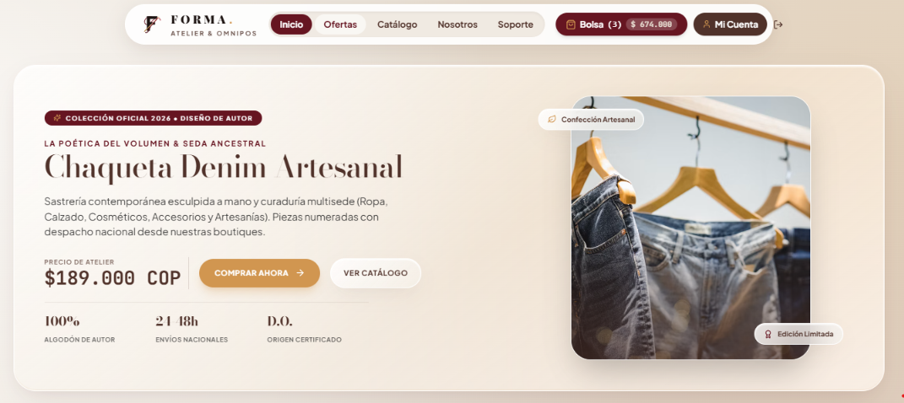

#### Diapositivas Originales del Documento:
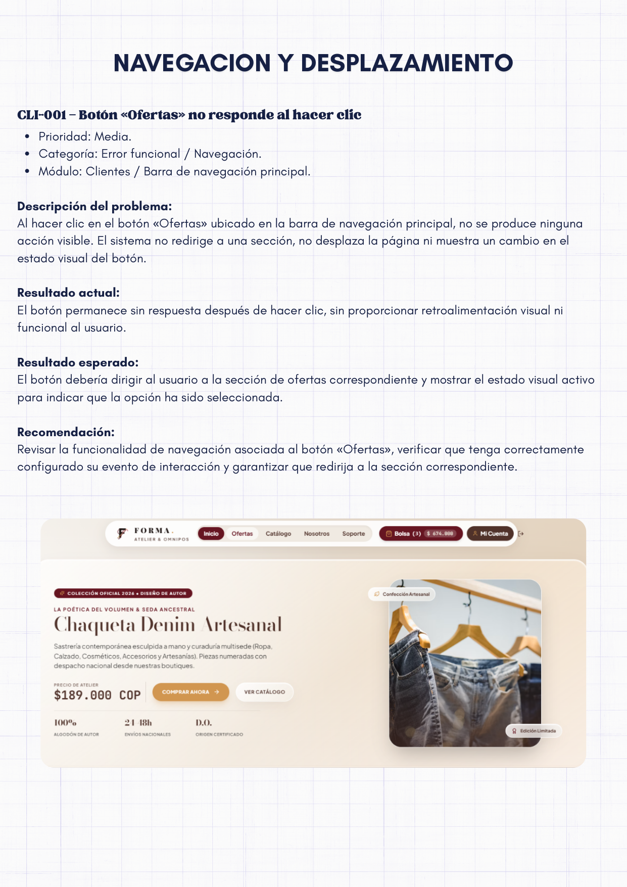

---

## CLI-002 — Estado visual incorrecto de la opción «Catálogo» en la barra de navegación

- **Prioridad:** 🟡 **Media.**
- **Categoría:** Inconsistencia visual / Estado activo de navegación (UI/UX).
- **Módulo:** Clientes / Barra de navegación principal.
- **Páginas en PDF:** Página 3

### Descripción del problema / hallazgo
problema
Al seleccionar la opción «Catálogo» desde la barra de navegación principal, la página se desplaza
correctamente hacia la sección correspondiente, pero el botón no adopta el color vinotinto establecido
para identificar visualmente la opción activa.
Adicionalmente, después de navegar por otras secciones, como «Nosotros» o «Soporte», y regresar a
«Catálogo», el estado visual activo se asigna incorrectamente a «Inicio».

### Resultado actual
La sección «Catálogo» no mantiene correctamente su estado visual de selección, lo que genera una
inconsistencia entre la sección mostrada y la opción resaltada en la navegación.

### Resultado esperado
Al seleccionar «Catálogo», el botón debería adoptar el color vinotinto correspondiente al estado activo y
mantenerse resaltado mientras el usuario se encuentre en dicha sección.

### Recomendación
Revisar la lógica encargada de gestionar los estados activos de la barra de navegación y garantizar que la
opción resaltada corresponda siempre con la sección seleccionada.

### Evidencia Visual y Capturas del Informe

#### Capturas Específicas del Hallazgo:
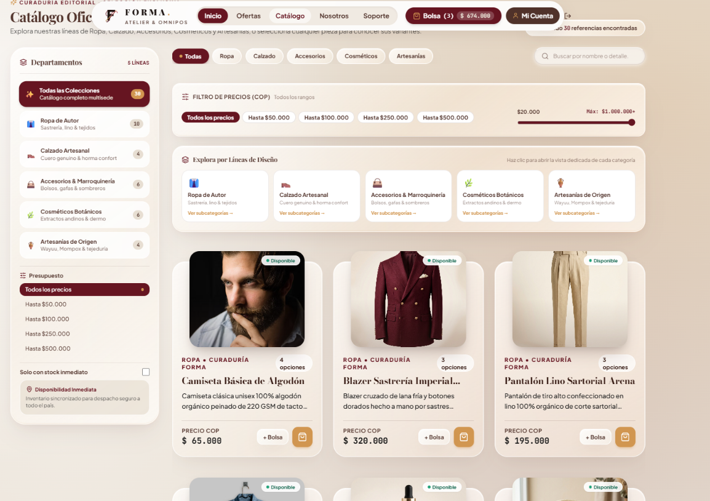

#### Diapositivas Originales del Documento:
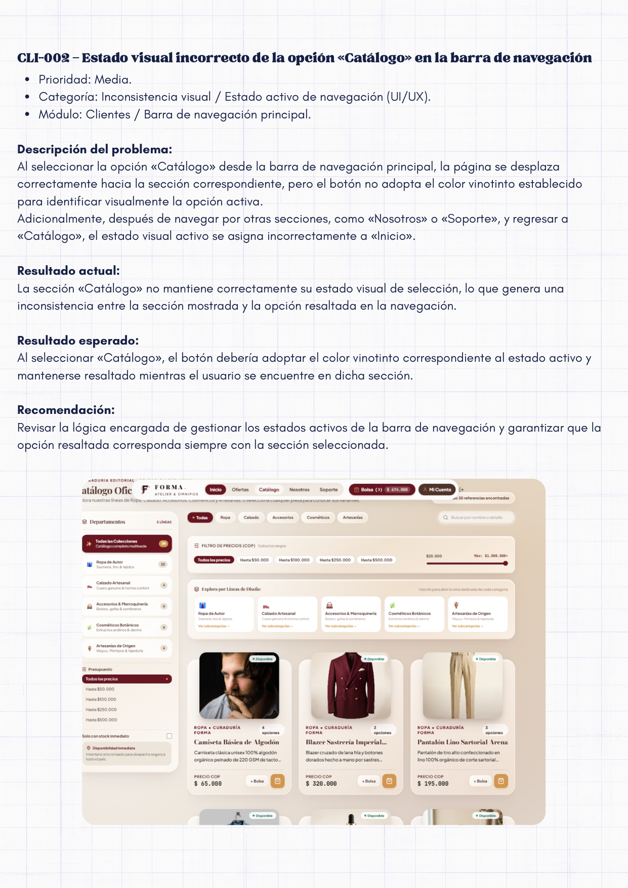

---

## CLI-003 — La posición de desplazamiento no se restablece al cambiar entre secciones de la página

- **Prioridad:** 🟡 **Media.**
- **Categoría:** Error de navegación / Comportamiento del desplazamiento (UI/UX).
- **Módulo:** Clientes / Navegación entre secciones.
- **Páginas en PDF:** Página 4

### Descripción del problema / hallazgo
problema
Al navegar entre las opciones «Inicio», «Nosotros» y «Soporte» desde la barra de navegación principal, la
página conserva la posición de desplazamiento anterior en lugar de iniciar la navegación desde la parte
superior de la sección correspondiente.
Se observa que, al hacer doble clic en «Inicio», la página sí regresa a la parte superior. Sin embargo, al
realizar la misma acción en «Nosotros» o «Soporte», el comportamiento no se presenta de la misma manera.

### Resultado actual
La navegación entre secciones no restablece correctamente la posición de desplazamiento, obligando al
usuario a realizar acciones adicionales para visualizar el contenido desde el inicio.

### Resultado esperado
Al seleccionar cualquier sección desde la barra de navegación, la página debería posicionarse
correctamente desde el comienzo de la sección correspondiente mediante un solo clic.

### Recomendación
Revisar los eventos de navegación y los métodos de desplazamiento utilizados para cada sección,
garantizando un comportamiento uniforme y evitando que se conserve una posición anterior que afecte la
visualización del contenido.

### Evidencia Visual y Capturas del Informe

#### Capturas Específicas del Hallazgo:
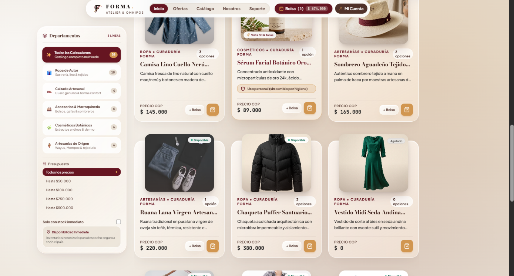
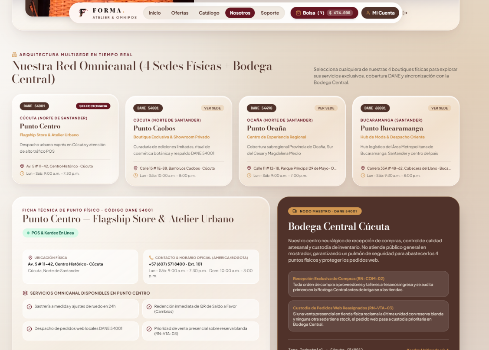

#### Diapositivas Originales del Documento:
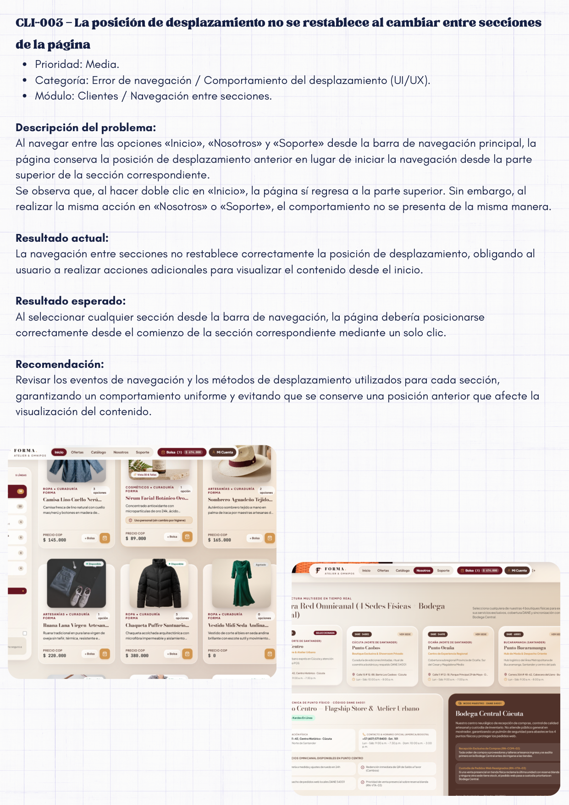

---

## CLI-004 — Salto irregular y desplazamiento transitorio al regresar a la sección «Inicio»

- **Prioridad:** 🟡 **Media.**
- **Categoría:** Error de navegación / Comportamiento visual del desplazamiento (UI/UX).
- **Módulo:** Clientes / Navegación entre secciones.
- **Páginas en PDF:** Página 5

### Descripción del problema / hallazgo
problema
Al encontrarse en las secciones «Nosotros» o «Soporte» y seleccionar la opción «Inicio» desde la barra de
navegación principal, se presenta un desplazamiento visual irregular.
Durante aproximadamente medio segundo, la página realiza un salto hacia una posición inferior, mostrando
momentáneamente contenido ubicado más abajo, como el pie de página. Posteriormente, la vista se
estabiliza en una posición diferente a la esperada, conservando parte del desplazamiento anterior.

### Resultado actual
El regreso a la sección «Inicio» presenta un movimiento transitorio e irregular que afecta la continuidad
visual de la navegación y genera una experiencia poco fluida.

### Resultado esperado
Al seleccionar «Inicio», la página debería desplazarse directamente hacia la parte superior de la sección,
sin saltos intermedios ni movimientos inesperados.

### Recomendación
Revisar la lógica de desplazamiento, las animaciones de navegación y los eventos que se ejecutan al
regresar a «Inicio», evitando conflictos entre el desplazamiento anterior y la nueva posición de destino.

### Evidencia Visual y Capturas del Informe

#### Capturas Específicas del Hallazgo:
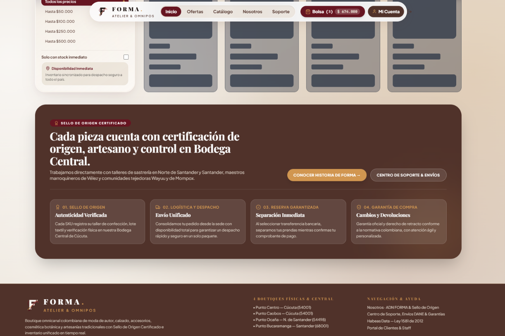
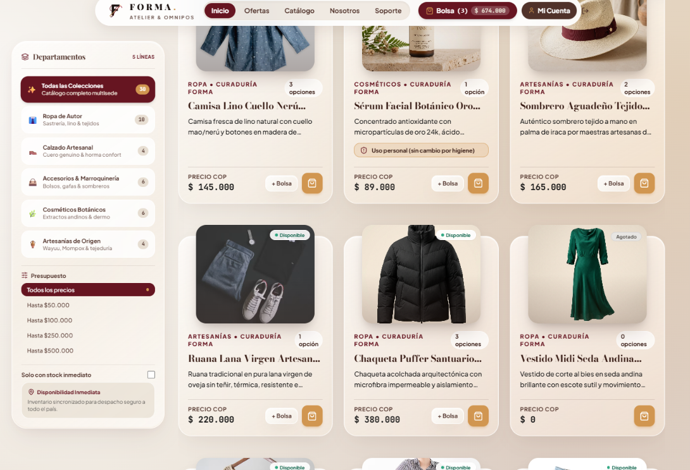

#### Diapositivas Originales del Documento:
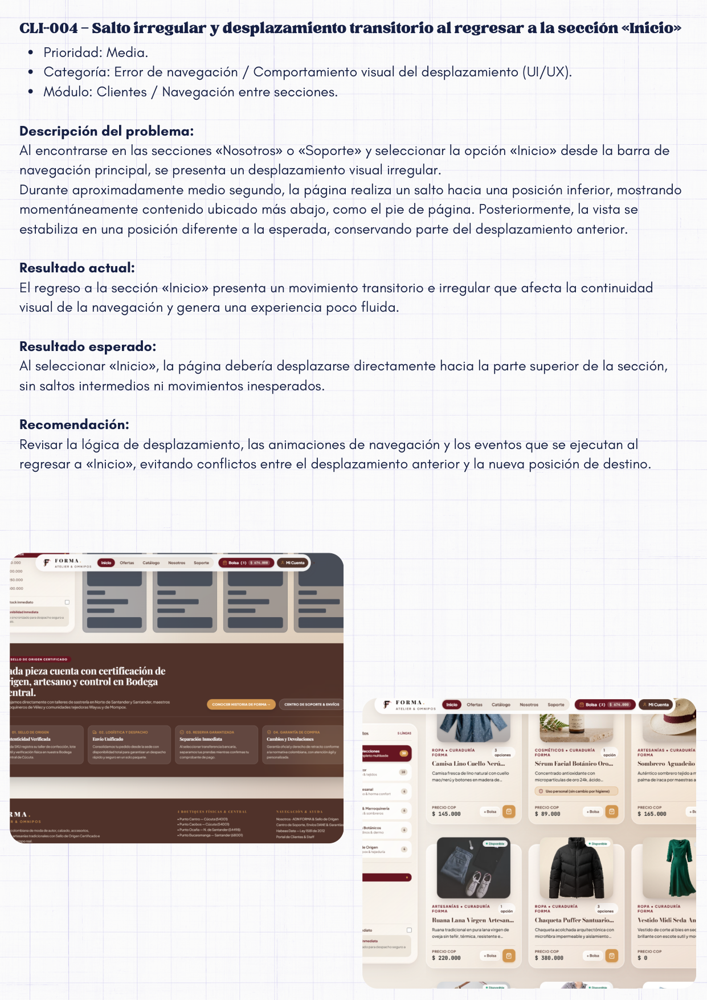

---

## CLI-016 — El botón «Explorar el catálogo oficial» redirige a una posición incorrecta de la sección Catálogo

- **Prioridad:** 🟡 **Media.**
- **Categoría:** Error de navegación / Desplazamiento incorrecto.
- **Módulo:** Clientes / Nosotros – Navegación hacia Catálogo.
- **Páginas en PDF:** Página 6

### Descripción del problema / hallazgo
problema
Al hacer clic en el botón «Explorar el catálogo oficial», ubicado en la sección «Nosotros», el sistema redirige
al usuario hacia el catálogo, pero no lo posiciona al comienzo de dicha sección.
En su lugar, la página muestra una parte avanzada del catálogo, cercana a su contenido final.

### Resultado actual
El usuario llega a la sección «Catálogo», pero queda ubicado en una posición incorrecta, lo que dificulta
identificar y explorar inicialmente los productos disponibles.

### Resultado esperado
Al seleccionar el botón, el sistema debería dirigir al usuario al comienzo de la sección «Catálogo»,
permitiendo visualizar su contenido desde el inicio.

### Recomendación
Revisar el destino de navegación asociado al botón y ajustar el comportamiento del desplazamiento para
garantizar que la redirección se realice hacia la posición inicial del catálogo.

### Evidencia Visual y Capturas del Informe

#### Capturas Específicas del Hallazgo:
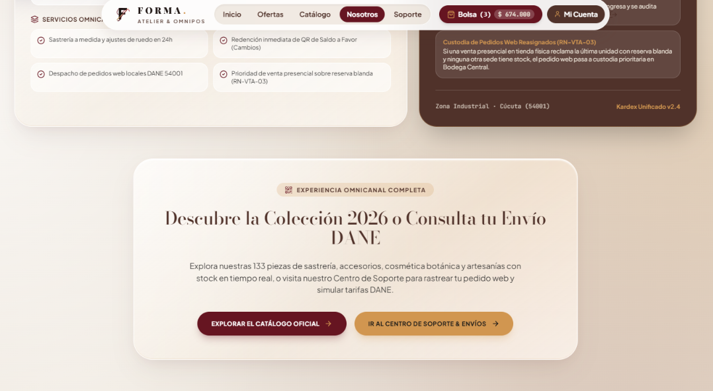
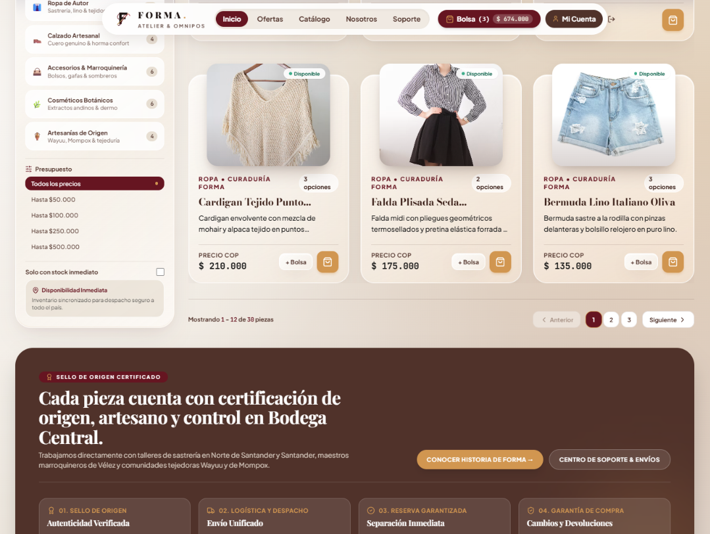

#### Diapositivas Originales del Documento:
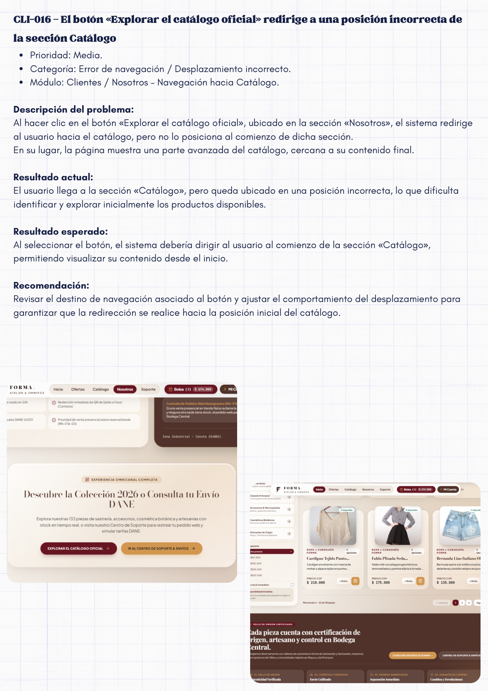

---

## CLI-022 — Desplazamiento incorrecto y falla en el estado activo del menú superior al accionar el botón «VOLVER AL CATÁLOGO»

- **Prioridad:** 🟡 **Media.**
- **Categoría:** Error de navegación / Inconsistencia del estado activo.
- **Módulo:** Clientes / Soporte – Canales Directos por Sede.
- **Páginas en PDF:** Página 7

### Descripción del problema / hallazgo
problema
Al hacer clic en el botón «VOLVER AL CATÁLOGO», ubicado en la sección de Soporte, el sistema redirige
correctamente hacia la sección «Catálogo», pero presenta dos inconsistencias:
1.La página no se posiciona al comienzo del catálogo, sino que muestra una parte inferior de la sección.
2.La opción «Inicio» permanece resaltada en la barra de navegación principal, aunque el usuario se
encuentra visualizando el catálogo.

### Resultado actual
La navegación presenta una posición de desplazamiento incorrecta y un estado visual activo que no
corresponde con la sección mostrada.

### Resultado esperado
Al seleccionar «VOLVER AL CATÁLOGO», el sistema debería:
Dirigir al usuario al comienzo de la sección «Catálogo».
Actualizar el estado visual de la barra de navegación.
Resaltar la opción «Catálogo» y desactivar la opción «Inicio».

### Recomendación
Revisar la función de redirección del botón y sincronizar el desplazamiento con la gestión de estados activos
de la barra de navegación, garantizando que ambos comportamientos correspondan con la sección de
destino.

### Evidencia Visual y Capturas del Informe

#### Capturas Específicas del Hallazgo:
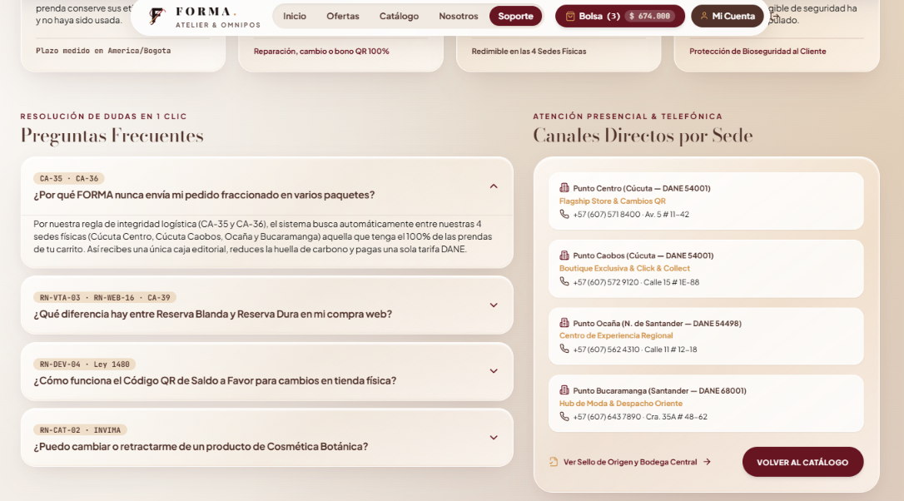
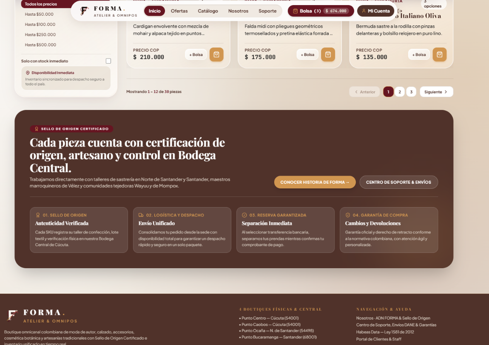

#### Diapositivas Originales del Documento:
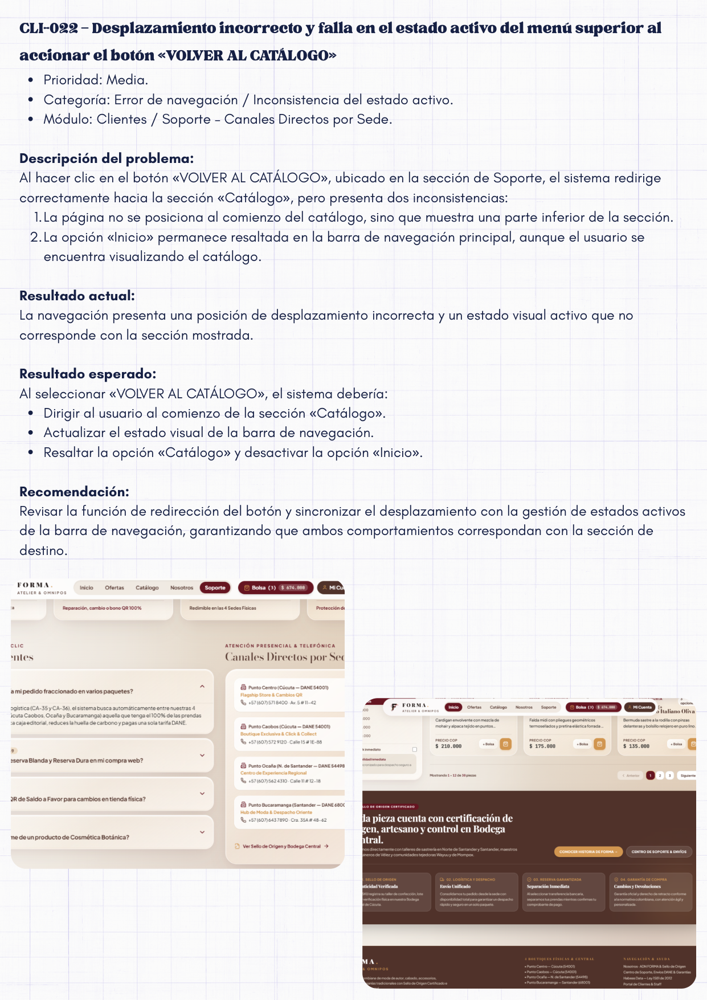

---

# SECCIÓN 2: CATÁLOGO, PRODUCTOS Y FILTROS

## CLI-005 — El fondo del modal de detalles del producto no cubre completamente la pantalla

- **Prioridad:** 🟡 **Media.**
- **Categoría:** Inconsistencia visual / Diseño de interfaz (UI).
- **Módulo:** Clientes / Catálogo – Modal de detalles del producto.
- **Páginas en PDF:** Página 8

### Descripción del problema / hallazgo
problema
Al abrir el modal de detalles de un producto desde el catálogo, se observa que la capa de fondo oscurecida
no cubre completamente el área visible de la pantalla. En la parte superior queda una franja sin oscurecer,
lo que genera una diferencia visual respecto al resto de la interfaz.

### Resultado actual
El fondo superpuesto del modal deja una parte de la pantalla sin cubrir, afectando la uniformidad visual y la
presentación del componente.

### Resultado esperado
La capa de fondo debería cubrir completamente el área visible de la pantalla, manteniendo el mismo nivel
de oscurecimiento en toda la superficie mientras el modal permanezca abierto.

### Recomendación
Revisar las propiedades de posicionamiento, dimensiones y superposición del fondo del modal, garantizando
que ocupe correctamente todo el espacio visible de la ventana.

### Evidencia Visual y Capturas del Informe

#### Capturas Específicas del Hallazgo:

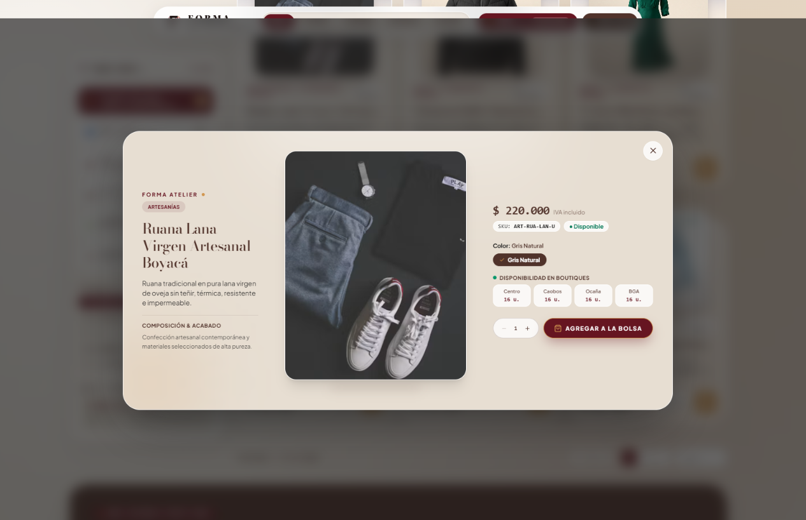

#### Diapositivas Originales del Documento:
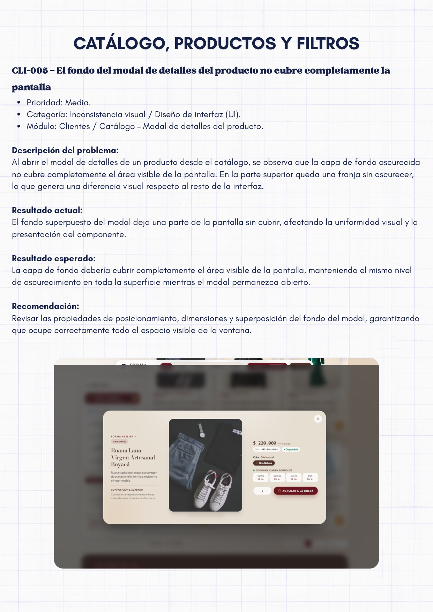

---

## CLI-006 — Duplicidad de controles para la selección de categorías y filtros de precio

- **Prioridad:** 🟢 **Baja.**
- **Categoría:** Oportunidad de mejora / Redundancia visual y usabilidad (UI/UX).
- **Módulo:** Clientes / Catálogo – Filtros de productos.
- **Páginas en PDF:** Página 9

### Descripción del problema / hallazgo
problema
En la sección del catálogo se identifican diferentes controles que permiten realizar las mismas acciones de
filtrado.
La selección de categorías está disponible mediante pestañas superiores, un panel lateral y tarjetas de
categorías. Asimismo, los filtros de precio presentan controles duplicados para establecer el rango de
valores.
Aunque estos elementos funcionan y mantienen sincronizadas las selecciones, su presencia simultánea
genera redundancia en la interfaz.

### Resultado actual
El usuario encuentra varias opciones para realizar una misma acción, lo que aumenta la cantidad de
elementos visuales y puede dificultar la comprensión de la organización de los filtros.

### Resultado esperado
La interfaz debería presentar una organización más sencilla y coherente de los controles de filtrado,
evitando duplicidades innecesarias sin afectar las funcionalidades disponibles.

### Recomendación
Evaluar la posibilidad de consolidar los controles de categorías y precios, conservando las alternativas de
navegación que realmente aporten valor a la experiencia del usuario.

### Evidencia Visual y Capturas del Informe

#### Capturas Específicas del Hallazgo:
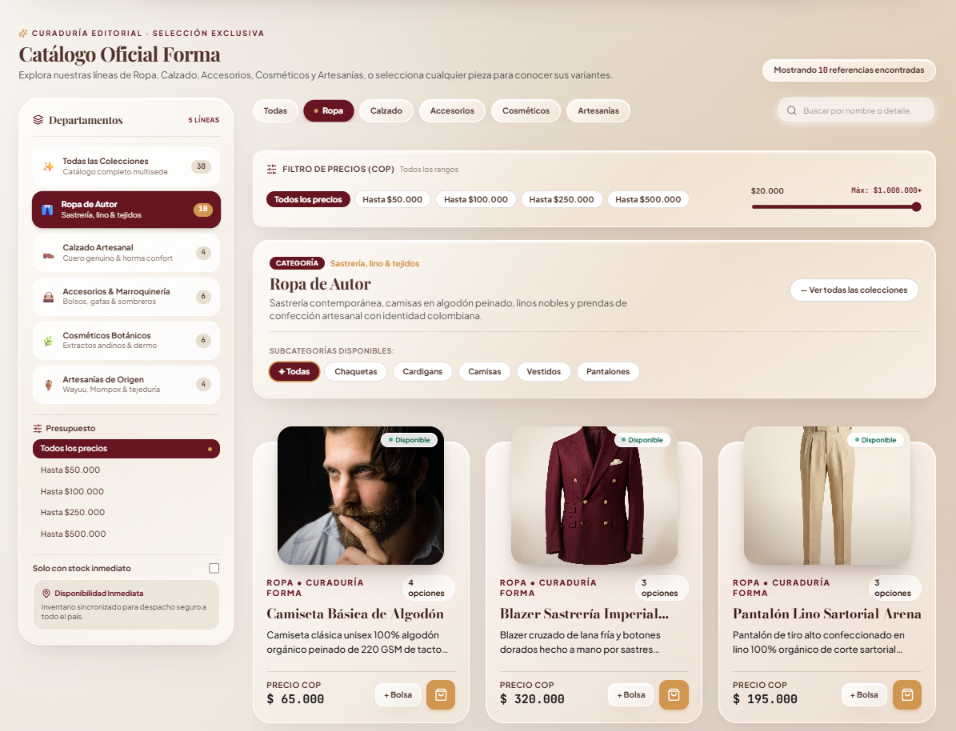

#### Diapositivas Originales del Documento:
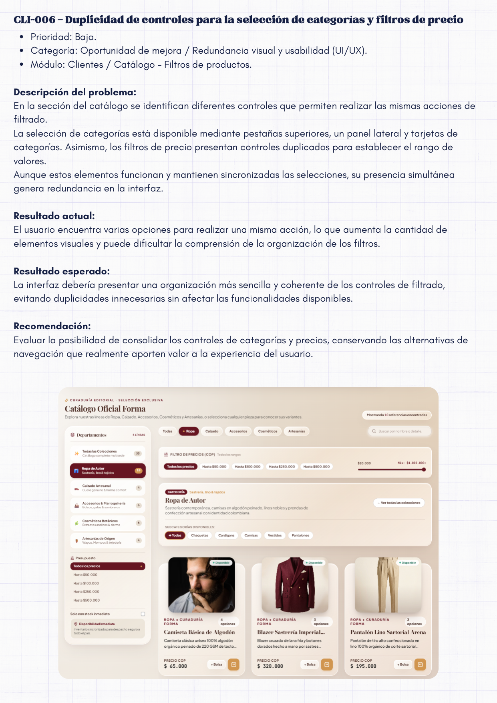

---

## CLI-007 — Inconsistencia entre el producto destacado del banner principal y el producto asociado a la acción de compra

- **Prioridad:** 🔴 **Alta.**
- **Categoría:** Error funcional / Asociación incorrecta de productos.
- **Módulo:** Clientes / Inicio – Banner principal de productos destacados.
- **Páginas en PDF:** Página 10, Página 11

### Descripción del problema / hallazgo
problema
En el banner principal de la página de inicio se presenta el producto «Chaqueta Denim Artesanal». Sin
embargo, al buscar este producto dentro del catálogo, no se obtiene un resultado correspondiente.
Adicionalmente, al seleccionar el botón «Comprar ahora» del banner, el sistema dirige al usuario al
producto «Camiseta Básica de Algodón». Al intentar agregarlo a la bolsa de compras, se incorpora esta
última referencia en lugar de la chaqueta anunciada.

### Resultado actual
Existe una inconsistencia entre el producto mostrado en el banner principal y el producto asociado a la
acción de compra. El usuario puede terminar seleccionando un artículo diferente al que inicialmente le
interesó.

### Resultado esperado
El producto presentado en el banner debería corresponder exactamente con el producto al que dirige el
botón «Comprar ahora». Asimismo, la acción de agregar a la bolsa debería incorporar la misma referencia
anunciada.

### Recomendación
Revisar la asociación entre el contenido del banner, el identificador del producto y las acciones de
navegación y compra. Garantizar que todos los elementos estén vinculados a la misma referencia de
producto.

### Evidencia Visual y Capturas del Informe

#### Capturas Específicas del Hallazgo:
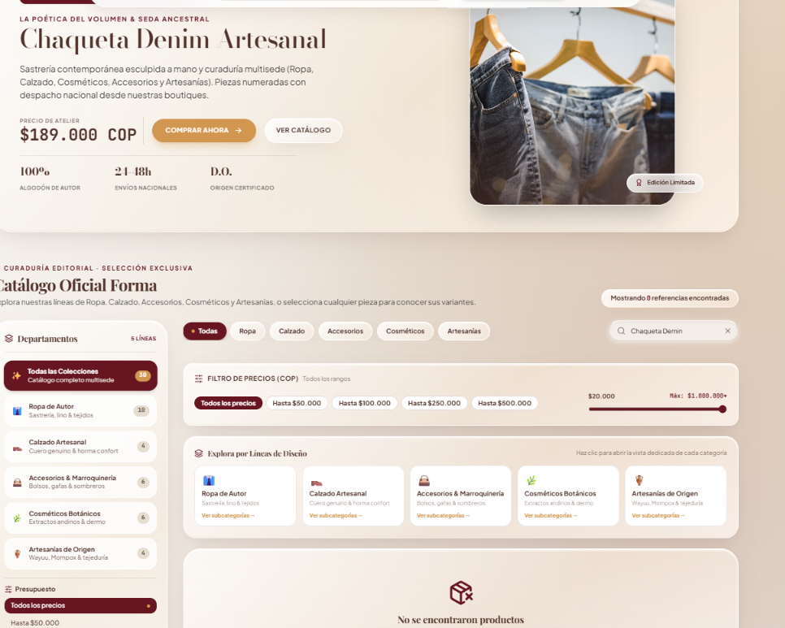
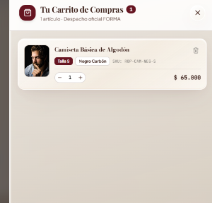

#### Diapositivas Originales del Documento:
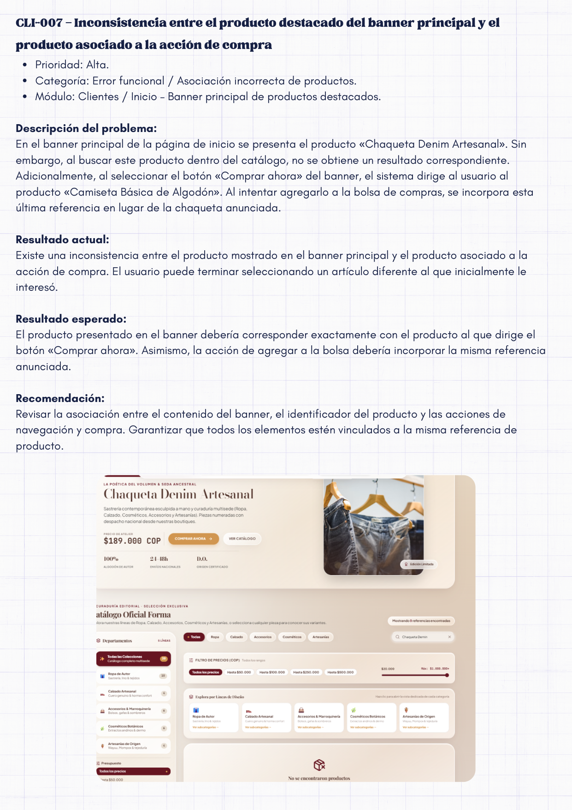
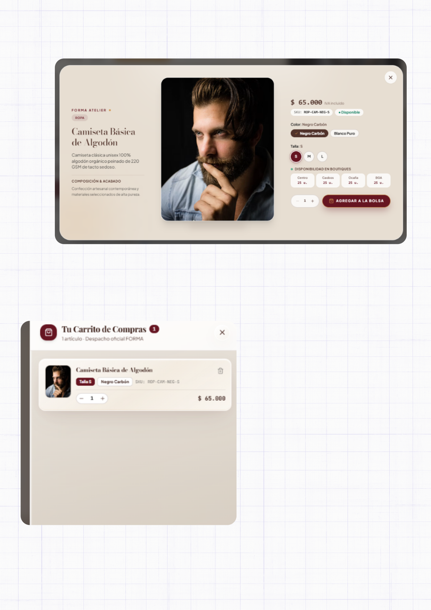

---

## CLI-008 — Comportamiento inconsistente al seleccionar variantes de color y talla de un producto

- **Prioridad:** 🟡 **Media.**
- **Categoría:** Error funcional / Selección de variantes de producto.
- **Módulo:** Clientes / Catálogo – Detalles del producto.
- **Páginas en PDF:** Página 12

### Descripción del problema / hallazgo
problema
Al ingresar al detalle del producto «Camiseta Básica de Algodón», se observa un comportamiento
inconsistente durante la selección de sus variantes.
Al seleccionar el color blanco, el sistema selecciona automáticamente la talla M. Posteriormente, al intentar
cambiar la talla a S o L, el color cambia automáticamente a negro, sin mostrar un mensaje que explique la
disponibilidad o restricción de la combinación seleccionada.

### Resultado actual
La selección de color y talla modifica automáticamente otra característica del producto sin proporcionar
información clara sobre el motivo del cambio ni indicar si determinadas combinaciones se encuentran
disponibles.

### Resultado esperado
El sistema debería permitir seleccionar las combinaciones de color y talla disponibles de manera clara. Si
una combinación no está disponible, debería informar al usuario y evitar cambios automáticos inesperados.

### Recomendación
Revisar la lógica de selección de variantes y la disponibilidad de inventario. Implementar mensajes
informativos para las combinaciones no disponibles y garantizar que los cambios realizados por el usuario
sean claros y coherentes.

### Evidencia Visual y Capturas del Informe

#### Capturas Específicas del Hallazgo:

#### Diapositivas Originales del Documento:
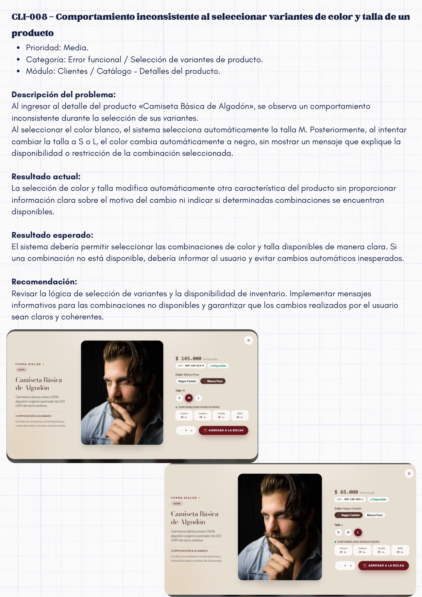

---

## CLI-009 — Falta de actualización dinámica del valor mínimo en el control deslizante de precios

- **Prioridad:** 🟢 **Baja.**
- **Categoría:** Oportunidad de mejora / Retroalimentación visual de filtros (UI/UX).
- **Módulo:** Clientes / Catálogo – Filtro de rango de precios.
- **Páginas en PDF:** Página 13

### Descripción del problema / hallazgo
problema
En el control deslizante utilizado para filtrar productos por precio, se observa que el valor ubicado en el
extremo izquierdo permanece estático en $20.000, incluso cuando el usuario modifica la posición del
control correspondiente al límite mínimo.
Por otra parte, el valor máximo sí presenta una actualización dinámica de acuerdo con la posición
seleccionada.

### Resultado actual
El valor mínimo mostrado no refleja los cambios realizados por el usuario, mientras que el valor máximo sí se
actualiza, generando una diferencia en el comportamiento visual de ambos extremos del filtro.

### Resultado esperado
El valor mínimo debería actualizarse dinámicamente conforme el usuario desplaza el control
correspondiente, mostrando siempre el límite inferior seleccionado.

### Recomendación
Revisar la actualización de los valores asociados al control deslizante y garantizar que ambos límites del
rango de precios reflejen correctamente las selecciones realizadas por el usuario.

### Evidencia Visual y Capturas del Informe

#### Capturas Específicas del Hallazgo:
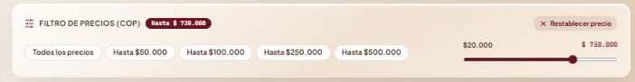
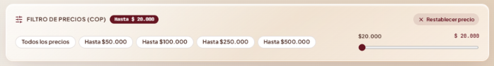

#### Diapositivas Originales del Documento:
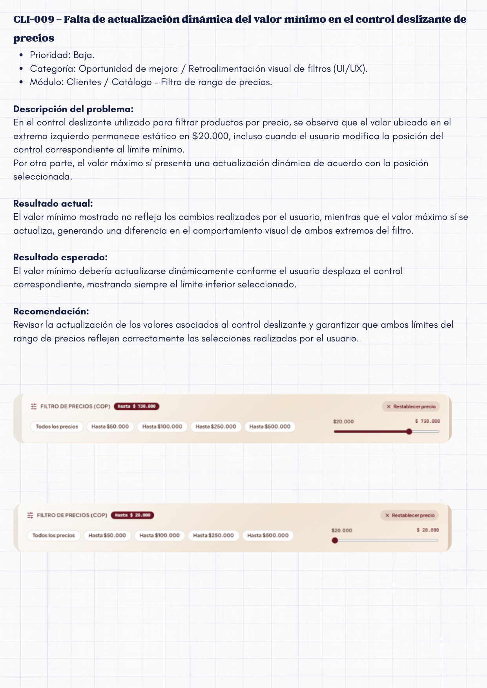

---

## CLI-010 — Ausencia de la etiqueta «MIN» en el valor mínimo del filtro de precios

- **Prioridad:** 🟢 **Baja.**
- **Categoría:** Oportunidad de mejora / Consistencia visual y presentación de información (UI/UX).
- **Módulo:** Clientes / Catálogo – Filtro de rango de precios.
- **Páginas en PDF:** Página 14

### Descripción del problema / hallazgo
problema
En el control deslizante de precios se observa una diferencia en la presentación de los valores mínimo y
máximo.
Cuando el control alcanza el precio máximo, el sistema muestra la etiqueta «MAX: $1.000.000+». Sin
embargo, cuando se encuentra en el precio mínimo de $20.000, únicamente se muestra el valor numérico,
sin incluir la etiqueta «MIN».

### Resultado actual
El valor máximo cuenta con una etiqueta identificativa, mientras que el valor mínimo carece de ella,
generando una inconsistencia en la presentación de ambos límites.

### Resultado esperado
El sistema debería mostrar ambos valores con una estructura visual uniforme:
MIN: $20.000
MAX: $1.000.000+

### Recomendación
Incorporar la etiqueta «MIN» al valor mínimo del filtro de precios, manteniendo la misma estructura de
presentación utilizada para el valor máximo.

### Evidencia Visual y Capturas del Informe

#### Capturas Específicas del Hallazgo:

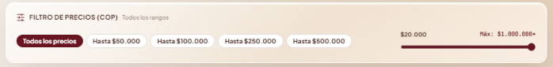

#### Diapositivas Originales del Documento:
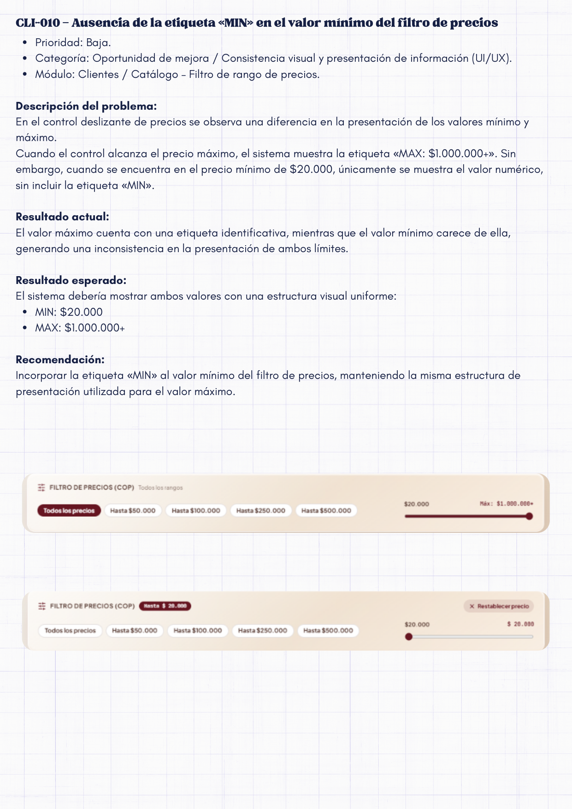

---

## CLI-011 — Diferencia entre el precio mostrado en el catálogo y el precio del detalle del producto

- **Prioridad:** 🔴 **Alta.**
- **Categoría:** Error funcional / Inconsistencia de información comercial.
- **Módulo:** Clientes / Catálogo – Información de precios de productos.
- **Páginas en PDF:** Página 15

### Descripción del problema / hallazgo
problema
Al aplicar el filtro de precio mínimo en el catálogo, se identifica que el producto «Vestido Midi Seda Andina
Esmeralda» aparece con un precio de $0.
Sin embargo, al ingresar al detalle del mismo producto, el sistema muestra un precio de $65.000.
Esta diferencia genera información contradictoria sobre el valor real del artículo.

### Resultado actual
El catálogo presenta un precio de $0, mientras que el detalle del producto muestra $65.000 para la misma
referencia.

### Resultado esperado
El precio mostrado en las tarjetas del catálogo debería coincidir con el precio presentado en el detalle del
producto, garantizando la consistencia de la información comercial.

### Recomendación
Revisar la fuente de datos y los mecanismos utilizados para recuperar y mostrar los precios de los productos,
garantizando que el catálogo y el detalle consulten y presenten el mismo valor actualizado.

### Evidencia Visual y Capturas del Informe

#### Capturas Específicas del Hallazgo:

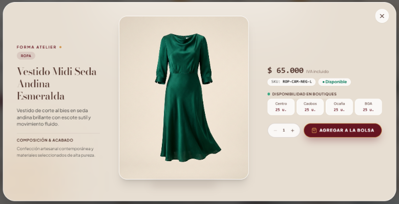

#### Diapositivas Originales del Documento:
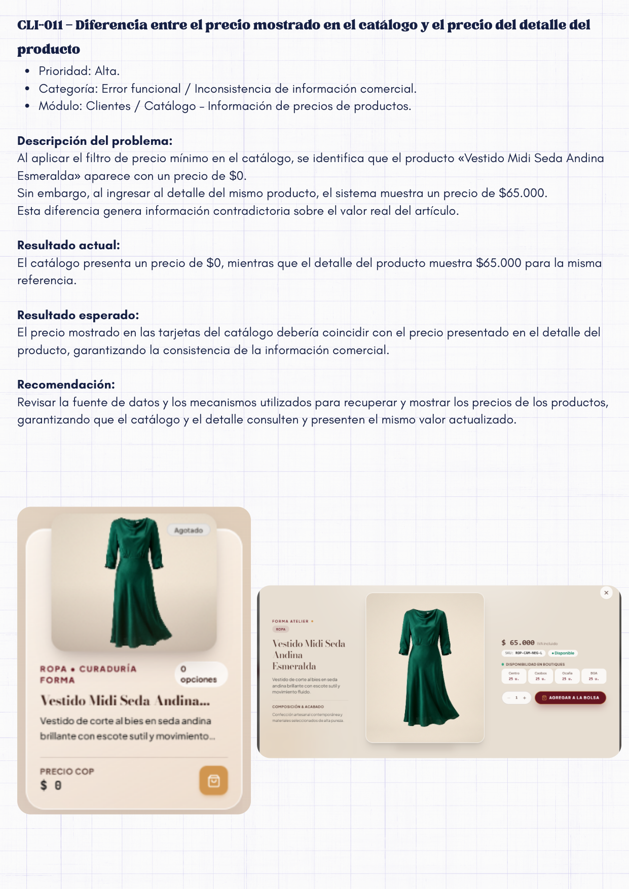

---

## CLI-012 — Ausencia de selector o visualización de la talla en el detalle del producto

- **Prioridad:** 🟡 **Media.**
- **Categoría:** Omisión funcional / Información incompleta de variantes.
- **Módulo:** Clientes / Catálogo – Detalles del producto.
- **Páginas en PDF:** Página 16

### Descripción del problema / hallazgo
problema
Al ingresar al detalle del producto «Vestido Midi Seda Andina Esmeralda», se observa que no existe un
selector de tallas ni un elemento visual que permita identificar claramente la talla correspondiente al
artículo.
Sin embargo, el código SKU del producto termina en L, lo que sugiere que la referencia está asociada a la
talla L.

### Resultado actual
El detalle del producto no proporciona información visible sobre la talla asociada ni permite identificar
claramente esta característica antes de realizar la compra.

### Resultado esperado
El sistema debería mostrar la talla correspondiente al producto. Si existen diferentes tallas disponibles,
debería permitir al usuario seleccionar la opción deseada antes de agregar el artículo a la bolsa de
compras.

### Recomendación
Revisar la configuración de variantes del producto y garantizar que la información de tallas esté
correctamente asociada y visible en el detalle del artículo.

### Evidencia Visual y Capturas del Informe

#### Capturas Específicas del Hallazgo:
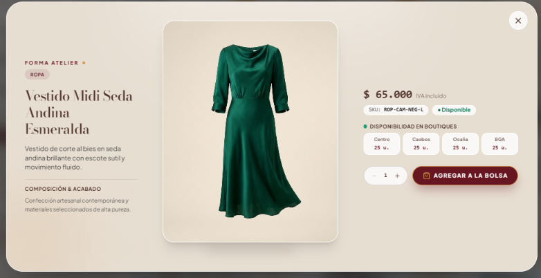

#### Diapositivas Originales del Documento:
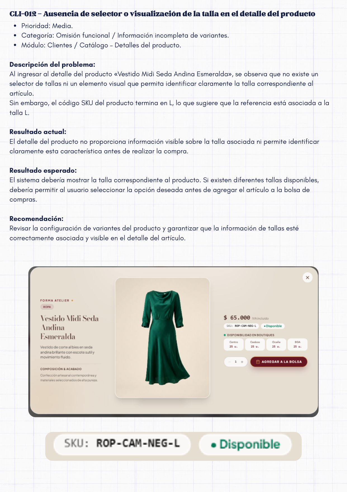

---

## CLI-013 — Posibilidad de agregar productos con variantes a la bolsa sin seleccionar sus características

- **Prioridad:** 🟡 **Media.**
- **Categoría:** Error funcional / Validación de selección de variantes.
- **Módulo:** Clientes / Catálogo – Tarjetas de productos y bolsa de compras.
- **Páginas en PDF:** Página 17

### Descripción del problema / hallazgo
problema
En las tarjetas de productos del catálogo se encuentra disponible el botón «+ Bolsa», que permite agregar
directamente un artículo sin ingresar a su detalle.
Sin embargo, esta acción también está disponible para productos que cuentan con diferentes variantes,
como colores y tallas, sin solicitar previamente la selección de dichas características.
Esto puede ocasionar que el artículo se agregue con una variante predeterminada que no corresponda con
la preferencia del usuario.

### Resultado actual
El sistema permite agregar productos con variantes a la bolsa de compras sin que el usuario haya
seleccionado previamente sus características.

### Resultado esperado
Para los productos que requieren selección de variantes, el sistema debería dirigir al usuario al detalle del
artículo o solicitar la selección de las características necesarias antes de agregarlo a la bolsa.

### Recomendación
Revisar el comportamiento del botón «+ Bolsa» y establecer una validación que permita agregar
directamente únicamente los productos que no requieren selección de variantes. Para los demás, solicitar la
selección previa de sus características.

### Evidencia Visual y Capturas del Informe

#### Capturas Específicas del Hallazgo:
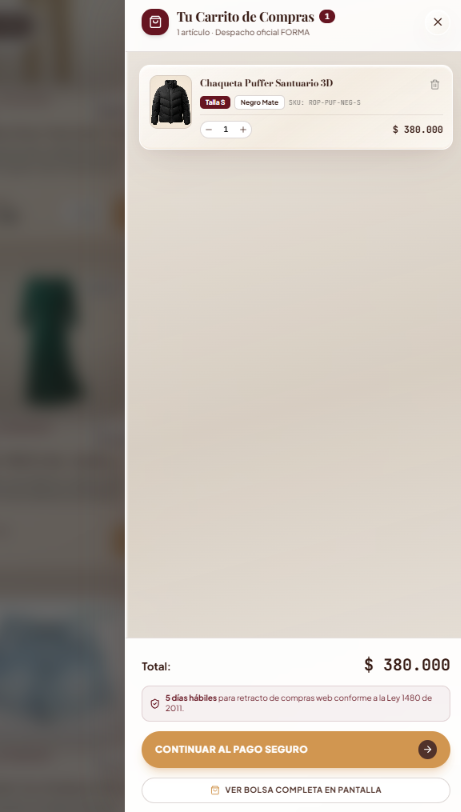
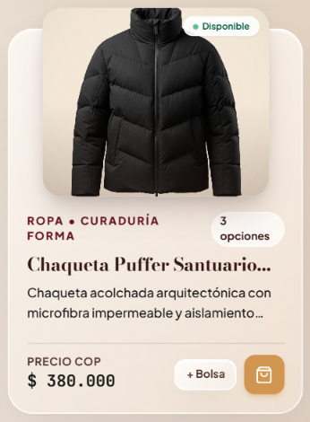

#### Diapositivas Originales del Documento:
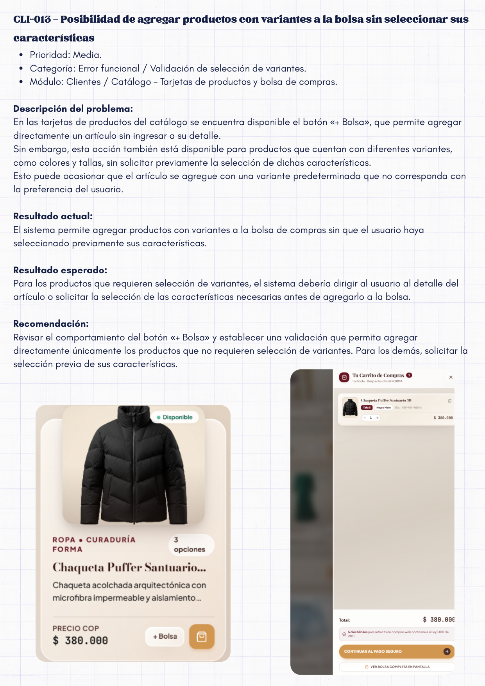

---

## CLI-014 — Inconsistencia en la asignación de productos a categorías y subcategorías del catálogo

- **Prioridad:** 🟡 **Media.**
- **Categoría:** Inconsistencia de clasificación / Organización de productos.
- **Módulo:** Clientes / Catálogo – Categorías y subcategorías.
- **Páginas en PDF:** Página 18, Página 19

### Descripción del problema / hallazgo
problema
Durante la revisión de las categorías y subcategorías del catálogo se identifican diferentes inconsistencias
en la distribución de los productos:
Ropa: se observan cuatro productos sin una subcategoría asignada.
Calzado artesanal: se identifica un producto sin subcategoría.
Accesorios y marroquinería: se encuentran tres productos sin subcategoría, mientras que las
subcategorías «Gorras» y «Joyería» aparecen sin productos asociados.
Cosméticos botánicos: se identifica un producto sin subcategoría. Adicionalmente, el producto «Crema
Hidratante Botánica Rosa Mosqueta 100ml» aparece simultáneamente en las subcategorías «Cremas» y
«Aceites».
Artesanías de origen: se identifica un producto sin subcategoría. Las subcategorías «Filigrana» y
«Cestería» aparecen vacías. Además, el producto «Canasto Tejido Fibra Werregue Maestría Chocó» no
tiene una subcategoría asignada y su imagen parece corresponder a un artículo de tipo bolso tejido.

### Resultado actual
La organización del catálogo presenta productos sin clasificación específica, subcategorías vacías y
posibles asignaciones duplicadas o inconsistentes, lo que dificulta la navegación y clasificación de los
artículos.

### Resultado esperado
Cada producto debería encontrarse asociado a la categoría y subcategoría que corresponda según sus
características. Asimismo, la organización debería evitar asignaciones duplicadas injustificadas y mantener
una distribución coherente de los artículos.

### Recomendación
Revisar la estructura de categorías y subcategorías, validar las asociaciones de cada producto y corregir las
clasificaciones que no correspondan con sus características. También se recomienda verificar las
subcategorías vacías para determinar si deben conservarse o si requieren productos asociados.

### Evidencia Visual y Capturas del Informe

#### Capturas Específicas del Hallazgo:
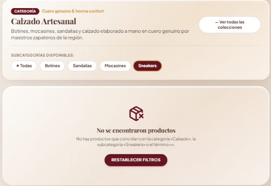
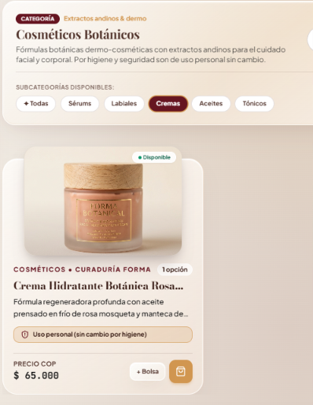
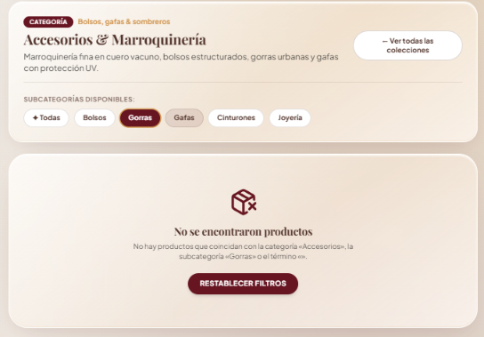
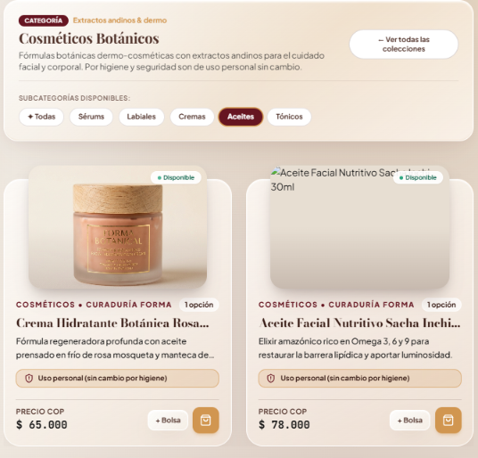

#### Diapositivas Originales del Documento:
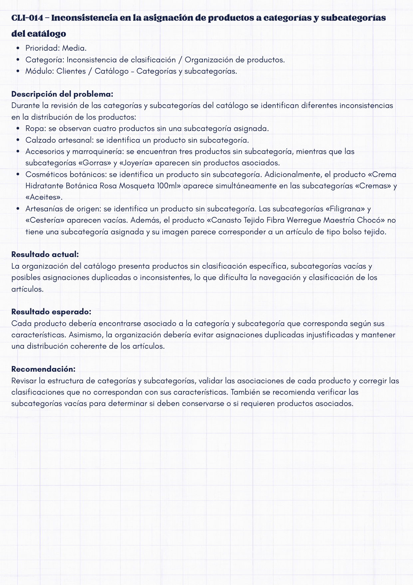
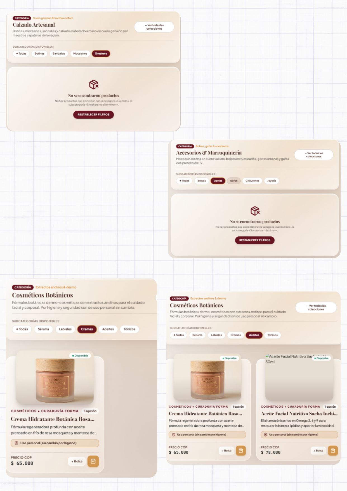

---

# SECCIÓN 3: SEDES Y COBERTURA DE ENVÍOS

## CLI-015 — Información incompleta de horarios de atención en las tarjetas de las sedes físicas

- **Prioridad:** 🟡 **Media.**
- **Categoría:** Inconsistencia de información / Presentación de horarios de atención (UI/UX).
- **Módulo:** Clientes / Nosotros – Información de sedes físicas.
- **Páginas en PDF:** Página 20, Página 21

### Descripción del problema / hallazgo
problema
En la sección «Nosotros», las tarjetas correspondientes a las sedes físicas muestran únicamente los horarios
de atención de lunes a viernes, sin incluir información sobre los horarios especiales de los domingos o días
festivos.
Al revisar el detalle de los horarios de cada sede, se identifican diferencias en sus jornadas de atención:
Punto Centro: cuenta con un horario especial los domingos.
Punto Bucaramanga: cuenta con un horario especial los domingos.
Punto Caobos: permanece cerrado los domingos, pero ofrece atención en días festivos con un horario
reducido.
Punto Ocaña: presenta atención únicamente de lunes a viernes.

### Resultado actual
Las tarjetas de las sedes muestran información parcial sobre los horarios de atención, omitiendo las
condiciones especiales de domingos y días festivos que se encuentran disponibles en el detalle de cada
ubicación.

### Resultado esperado
Las tarjetas deberían presentar información más completa sobre los horarios de atención, incluyendo los
días especiales cuando corresponda, o indicar claramente que existen horarios adicionales que pueden
consultarse en el detalle de cada sede.

### Recomendación
Revisar la información mostrada en las tarjetas de las sedes y garantizar que los horarios publicados sean
coherentes con los detalles de atención establecidos para cada ubicación.
DE ENVÍOS
DE ENVÍOS

### Evidencia Visual y Capturas del Informe

#### Capturas Específicas del Hallazgo:

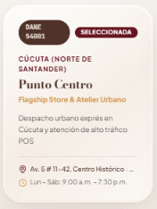
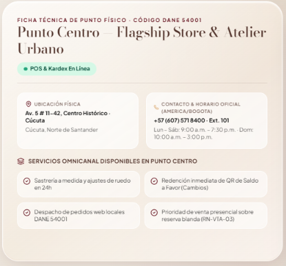
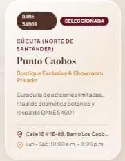
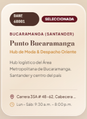
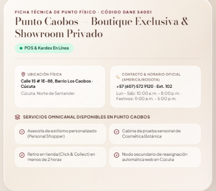
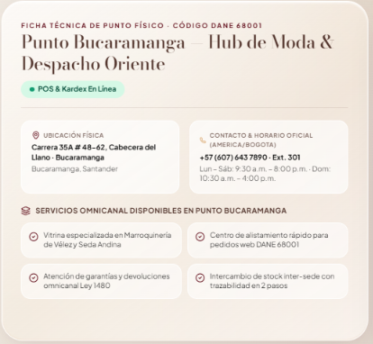

#### Diapositivas Originales del Documento:
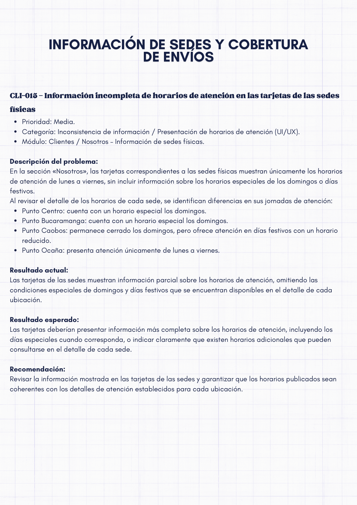

---

## CLI-020 — Agrupación ambigua y falta de enumeración jerárquica en las opciones de sedes de despacho dentro del simulador de cobertura

- **Prioridad:** 🟡 **Media.**
- **Categoría:** Inconsistencia en la lógica de presentación / Organización de opciones de despacho.
- **Módulo:** Clientes / Simulador de Cobertura y Tarifas de Envío DANE.
- **Páginas en PDF:** Página 22, Página 23

### Descripción del problema / hallazgo
problema
Al utilizar el simulador de cobertura y tarifas de envío, se observa que algunas ubicaciones presentan varias
sedes de despacho agrupadas bajo una misma clasificación de prioridad.
Por ejemplo:
Cúcuta: las sedes Punto Centro y Punto Caobos aparecen agrupadas bajo la etiqueta «1ª OPCIÓN
(SEDE MÁS CERCANA CON STOCK)».
Medellín: las sedes Punto Bucaramanga y Punto Ocaña aparecen igualmente agrupadas bajo una misma
etiqueta de primera opción.
Esta presentación no permite identificar claramente si ambas sedes tienen la misma prioridad o si existe un
orden de preferencia entre ellas.

### Resultado actual
Las diferentes sedes aparecen agrupadas bajo una misma clasificación de primera opción, sin una
enumeración individual que permita distinguir su orden de prioridad.

### Resultado esperado
El simulador debería presentar las sedes de despacho mediante una clasificación clara y jerárquica,
indicando individualmente su posición o prioridad cuando exista un orden de preferencia.
Por ejemplo:
1.ª opción: Punto Centro.
2.ª opción: Punto Caobos.
La asignación deberá corresponder a los criterios reales de cercanía y disponibilidad de inventario.

### Recomendación
Revisar la lógica de clasificación y presentación de las sedes de despacho, garantizando que las opciones
se encuentren correctamente ordenadas y que su nivel de prioridad sea comprensible para el usuario.

### Evidencia Visual y Capturas del Informe

#### Capturas Específicas del Hallazgo:

#### Diapositivas Originales del Documento:

---

## CLI-025 — el simulador de soporte

- **Prioridad:** 🟡 **Media.**
- **Categoría:** Inconsistencia de información / Validación de cobertura geográfica.
- **Módulo:** Clientes / Checkout – Selección de municipio y Soporte – Simulador DANE.
- **Páginas en PDF:** Página 24, Página 25

### Descripción del problema / hallazgo
problema
habilitados en el simulador de cobertura y tarifas de envío de la sección de Soporte, se identifican
diferencias en las opciones ofrecidas.
Cúcuta.
Bucaramanga.
Ocaña.
Bogotá.
Medellín.
Cali.
Barranquilla.
Cartagena.
Por otra parte, el simulador de cobertura presenta únicamente las siguientes ubicaciones:
Cúcuta.
Ocaña.
Bucaramanga.
Bogotá D.C.
Medellín.
Como resultado, Cali, Barranquilla y Cartagena aparecen como opciones seleccionables durante el proceso
de compra, pero no se encuentran disponibles en el simulador de cobertura.

### Resultado actual
cobertura, lo que puede generar confusión sobre las ubicaciones a las que realmente se realizan envíos.

### Resultado esperado
Los municipios disponibles deberían mantener una correspondencia entre ambos módulos, de acuerdo con la
cobertura de envíos realmente habilitada por la plataforma.
Si una ubicación no cuenta con cobertura, no debería presentarse como una opción disponible para
completar el proceso de compra.

### Recomendación
Revisar la configuración de cobertura geográfica de ambos módulos y garantizar que utilicen una misma
fuente de información o una lógica sincronizada para determinar los municipios habilitados. También se
recomienda verificar cuál de los dos módulos contiene la cobertura correcta antes de realizar
modificaciones.

### Evidencia Visual y Capturas del Informe

#### Capturas Específicas del Hallazgo:

#### Diapositivas Originales del Documento:

---

# SECCIÓN 4: SOPORTE Y SEGUIMIENTO DE PEDIDOS

## CLI-017 — Generación y visualización de pedidos inexistentes al consultar códigos arbitrarios en el rastreador

- **Prioridad:** 🔴 **Alta.**
- **Categoría:** Error funcional / Control de acceso y validación de datos.
- **Módulo:** Clientes / Soporte – Rastreador interactivo de pedidos y envíos DANE.
Producto afectado: Chaqueta Denim Artesanal Edición Colección.
- **Páginas en PDF:** Página 26, Página 27

### Descripción del problema / hallazgo
problema
Al ingresar códigos de pedido arbitrarios, inexistentes o que no corresponden al usuario autenticado en el
rastreador de pedidos de la sección de Soporte, el sistema muestra un registro logístico asociado al
producto «Chaqueta Denim Artesanal Edición Colección», como si perteneciera al cliente que realiza la
consulta.
Este comportamiento genera dudas sobre la validación de los códigos ingresados y sobre los mecanismos
utilizados para comprobar la pertenencia de los pedidos a cada usuario.

### Resultado actual
El rastreador permite visualizar información de un pedido al consultar códigos que no han sido verificados
como existentes o pertenecientes al usuario autenticado.

### Resultado esperado
El sistema debería validar que el código ingresado corresponda a un pedido existente y que esté asociado
al usuario autenticado.
En caso de que el pedido no exista o no pertenezca al cliente, debería mostrar un mensaje indicando que
no se encontró información o que no se cuenta con autorización para consultar ese registro.

### Recomendación
Revisar las validaciones del rastreador y los mecanismos de autorización implementados en el backend.
Garantizar que cada consulta compruebe la existencia del pedido y su relación con el usuario autenticado
antes de mostrar información logística.
Observación de QA: La visualización de un registro en la interfaz no demuestra por sí sola que se haya
creado un pedido real en la base de datos. Se recomienda verificar si la información corresponde a datos
simulados o a registros persistidos.

### Evidencia Visual y Capturas del Informe

#### Capturas Específicas del Hallazgo:

#### Diapositivas Originales del Documento:

---

## CLI-018 — Posibilidad de modificar los estados logísticos de un pedido desde la interfaz de clientes sin autorización

- **Prioridad:** 🔴 **Alta.**
- **Categoría:** Error funcional / Lógica de negocio y control de permisos.
- **Módulo:** Clientes / Soporte – Línea de tiempo de estados y modal de trazabilidad.
- **Páginas en PDF:** Página 28

### Descripción del problema / hallazgo
problema
En el módulo de seguimiento de pedidos se identifica que el cliente puede interactuar directamente con los
diferentes estados de la línea de tiempo logística, que contiene siete etapas.
Al hacer clic sobre estos estados, se observa que su apariencia cambia y que la modificación parece
conservarse o sincronizarse entre la vista principal y el modal de trazabilidad del pedido.
Este comportamiento permite que un usuario desde la interfaz de clientes modifique visualmente el estado
logístico de un pedido, sin que exista una autorización correspondiente para realizar este tipo de acciones.

### Resultado actual
Los estados logísticos permiten interacción y modificación desde el perfil del cliente, generando la
posibilidad de alterar la información de seguimiento sin contar con los permisos correspondientes.

### Resultado esperado
La línea de tiempo debería funcionar únicamente como un elemento informativo para el cliente, permitiendo
consultar el estado actual del pedido sin modificarlo.
Las actualizaciones de los estados logísticos deberían estar restringidas a los perfiles o procesos
administrativos autorizados.

### Recomendación
Revisar los permisos y eventos asociados a la línea de tiempo de seguimiento. Deshabilitar las acciones de
modificación desde la interfaz de clientes y garantizar que las actualizaciones de estados sean validadas y
autorizadas desde el backend.

### Evidencia Visual y Capturas del Informe

#### Capturas Específicas del Hallazgo:

#### Diapositivas Originales del Documento:

---

## CLI-019 — Duplicidad de controles para abrir el modal de trazabilidad de pedidos

- **Prioridad:** 🟢 **Baja.**
- **Categoría:** Oportunidad de mejora / Redundancia visual y usabilidad (UI/UX).
- **Módulo:** Clientes / Soporte – Vista principal de seguimiento de pedidos.
- **Páginas en PDF:** Página 29

### Descripción del problema / hallazgo
problema
En la vista principal del seguimiento de pedidos se identifican tres controles que permiten abrir el mismo
modal de información detallada de los estados logísticos:
1.Botón «VER MODAL DE ESTADO», ubicado en la tarjeta superior de color dorado.
2.Botón «Ver Trazabilidad», disponible en cada tarjeta de producto.
3.Botón «Abrir Trazabilidad Completa», ubicado debajo de la línea de tiempo de siete estados.
Se observa que los botones primero y tercero abren el modal de manera general, mostrando por defecto la
información del primer producto, mientras que el botón «Ver Trazabilidad» permite consultar
específicamente el producto al que pertenece.

### Resultado actual
La interfaz presenta varios controles con funcionalidades similares para acceder al mismo modal, generando
redundancia visual y una posible confusión sobre cuál debería utilizar el usuario.

### Resultado esperado
La interfaz debería contar con una organización más clara de las acciones de consulta, priorizando los
controles contextuales asociados a cada producto y evitando la repetición innecesaria de botones que
realizan la misma función.

### Recomendación
Evaluar la posibilidad de conservar el botón «Ver Trazabilidad» en cada tarjeta de producto y simplificar o
eliminar los controles generales que duplican su funcionalidad, siempre que esto no afecte la experiencia de
consulta.

### Evidencia Visual y Capturas del Informe

#### Capturas Específicas del Hallazgo:

#### Diapositivas Originales del Documento:

---

## CLI-021 — Apertura predeterminada asimétrica del primer elemento en la sección de Preguntas Frecuentes

- **Prioridad:** 🟢 **Baja.**
- **Categoría:** Inconsistencia visual / Comportamiento de componentes interactivos (UI/UX).
- **Módulo:** Clientes / Soporte – Preguntas Frecuentes (FAQ).
- **Páginas en PDF:** Página 30

### Descripción del problema / hallazgo
problema
Al ingresar a la sección de Preguntas Frecuentes, se observa que el primer elemento desplegable aparece
abierto automáticamente, mientras que los otros tres elementos permanecen cerrados.
Este comportamiento genera una diferencia en el estado inicial de los componentes, sin que exista una
acción previa del usuario que justifique la apertura automática del primer elemento.

### Resultado actual
El primer elemento de la sección aparece expandido de manera predeterminada, mientras que los demás
permanecen contraídos.

### Resultado esperado
Todos los elementos de Preguntas Frecuentes deberían aparecer contraídos inicialmente, permitiendo que el
usuario seleccione cuál desea consultar.

### Recomendación
Revisar el estado inicial de los componentes desplegables y establecer un comportamiento uniforme para
todos los elementos de la sección, evitando aperturas automáticas que no correspondan con una
interacción del usuario.

### Evidencia Visual y Capturas del Informe

#### Capturas Específicas del Hallazgo:

#### Diapositivas Originales del Documento:

---

# SECCIÓN 5: CHECKOUT: DATOS PERSONALES Y PAGOS

## CLI-023 — Ausencia de validación de formato y restricción de caracteres en campos de

- **Prioridad:** 🟡 **Media.**
- **Categoría:** Error de validación de campos / Control de formato y caracteres.
- **Módulo:** Clientes / Checkout – Información personal.
- **Páginas en PDF:** Página 31, Página 32

### Descripción del problema / hallazgo
problema
permiten ingresar caracteres que no corresponden con el tipo de información que deberían recibir.
Se observaron los siguientes comportamientos:
1.Nombre completo: permite ingresar números y símbolos especiales. Por ejemplo: Sofia..%.
2.Cédula/NIT: permite ingresar letras y símbolos especiales. Por ejemplo: 1092944020+ff.
3.Correo electrónico de facturación: permite continuar escribiendo caracteres adicionales después de
una terminación como .com. También acepta caracteres arbitrarios después de ingresar un dominio
incompleto, como gmail..
Estos comportamientos evidencian que los campos no cuentan con validaciones suficientes para garantizar
que la información ingresada corresponda con el formato esperado.

### Resultado actual
Los campos permiten ingresar información con formatos incorrectos o caracteres que no corresponden con
el tipo de dato solicitado, sin presentar restricciones o mensajes de validación adecuados.

### Resultado esperado
Cada campo debería contar con validaciones acordes con la información que solicita:
Nombre completo: aceptar letras, espacios y caracteres válidos en nombres, como tildes, guiones y
apóstrofes cuando corresponda.
Cédula/NIT: validar la estructura y los caracteres permitidos según el tipo de identificación aceptado.
Correo electrónico: validar que la dirección tenga una estructura de correo electrónico válida,
incluyendo una parte local, un dominio y una terminación válida, sin permitir caracteres arbitrarios o
formatos incompletos.

### Recomendación
Implementar validaciones específicas para cada campo, tanto en el frontend como en el backend,
garantizando que los datos cumplan con los formatos correspondientes antes de permitir la finalización de
la compra.
‌PAGOS
PAGOS

### Evidencia Visual y Capturas del Informe

#### Capturas Específicas del Hallazgo:

#### Diapositivas Originales del Documento:

---

## CLI-024 — Ausencia de restricciones de tipo de dato en los campos de confirmación de transferencia bancaria

- **Prioridad:** 🟡 **Media.**
- **Categoría:** Error de validación de campos / Inconsistencia en los tipos de datos.
- **Módulo:** Clientes / Checkout – Transferencia bancaria.
- **Páginas en PDF:** Página 33, Página 34

### Descripción del problema / hallazgo
problema
Durante las pruebas del formulario correspondiente al método de pago mediante transferencia bancaria, se
identificó que los campos destinados a registrar la información del titular de la cuenta y el número de
comprobante no presentan restricciones adecuadas sobre los caracteres ingresados.
Se observaron los siguientes comportamientos:
1.Nombre del titular de la cuenta: permite ingresar únicamente números y símbolos especiales, sin validar
que la información corresponda con un nombre.
2.N.º de comprobante / CUS: permite ingresar letras y signos de puntuación junto con números. Por
ejemplo: 1234567...ggg.
Estos comportamientos evidencian que los campos no están validando correctamente el tipo de información
solicitado.

### Resultado actual
Los campos permiten ingresar datos que no corresponden con la información que deberían recibir, sin
mostrar mensajes de validación que indiquen el formato esperado.

### Resultado esperado
Cada campo debería validar la información de acuerdo con su finalidad:
Nombre del titular de la cuenta: aceptar nombres y apellidos con caracteres válidos, evitando que se
registren únicamente números o símbolos.
N.º de comprobante / CUS: validar la estructura y el formato correspondiente al identificador utilizado
por el sistema de transferencias, de acuerdo con las especificaciones del proveedor de pago.

### Recomendación
Implementar validaciones específicas para ambos campos, tanto en el frontend como en el backend.
Verificar el formato oficial del identificador CUS antes de establecer restricciones definitivas sobre los
caracteres permitidos.

### Evidencia Visual y Capturas del Informe

#### Capturas Específicas del Hallazgo:

#### Diapositivas Originales del Documento:

---

# SECCIÓN 6: CHECKOUT: PROCESAMIENTO DE PEDIDOS

## CLI-026 — Latencia excesiva y demora en la respuesta de confirmación de orden

- **Prioridad:** 🔴 **Alta.**
- **Categoría:** Rendimiento / Tiempo de respuesta.
- **Módulo:** Módulo de Clientes / Checkout – Procesamiento de órdenes.
- **Páginas en PDF:** Página 35

### Descripción del problema / hallazgo
hallazgo
Durante el proceso de finalización de una compra, después de confirmar el pedido, la interfaz permanece
mostrando el mensaje «PROCESANDO PEDIDO...» durante un periodo prolongado, superior a 60 segundos,
antes de generar la factura o mostrar la confirmación correspondiente.
Esta demora afecta la experiencia del usuario, ya que no recibe una respuesta oportuna que le permita
saber si la compra se está procesando correctamente.

### Resultado actual
El sistema mantiene el estado de procesamiento durante más de un minuto sin mostrar una confirmación
inmediata ni proporcionar información adicional sobre el avance de la operación.

### Resultado esperado
El sistema debería responder oportunamente después de confirmar la compra. Si el procesamiento requiere
tiempo adicional, debería proporcionar una confirmación inicial de recepción de la solicitud y mostrar un
indicador de progreso claro, evitando que el usuario tenga incertidumbre sobre el estado de su pedido.

### Recomendación
Revisar los tiempos de respuesta de los servicios backend, las solicitudes API y las posibles integraciones
involucradas en la generación de órdenes y facturas. Considerar un procesamiento asíncrono que permita
informar al usuario que su solicitud fue recibida mientras se completa la operación.
También se recomienda verificar que la orden quede registrada correctamente y que la factura se genere,
para distinguir una demora de procesamiento de un fallo en la confirmación.
‌DE PEDIDOS
DE PEDIDOS

### Evidencia Visual y Capturas del Informe

#### Capturas Específicas del Hallazgo:

#### Diapositivas Originales del Documento:

---

## CLI-027 — Desincronización y persistencia incorrecta de los productos en la bolsa de

- **Prioridad:** 🟡 **Media.**
- **Categoría:** Gestión de estado / Sincronización de datos.
- **Módulo:** Módulo de Clientes / Bolsa de compras – Checkout.
- **Páginas en PDF:** Página 36, Página 37

### Descripción del problema / hallazgo
hallazgo
Se identifica una inconsistencia en la actualización de la bolsa de compras después de confirmar una
genera la factura o si abandona dicha pantalla antes de que finalice el procesamiento.

### Resultado actual
Se presentan dos comportamientos diferentes:
correctamente de la bolsa de compras.
permanecen visibles en la bolsa y el contador de artículos no se actualiza, aunque la orden ya haya sido
confirmada.
Esto provoca que la información de la bolsa no refleje correctamente el estado de la compra.

### Resultado esperado
Una vez que el sistema confirme exitosamente la creación de la orden, la bolsa de compras debería
hacia otra sección.
Los productos comprados deberían eliminarse de la bolsa y el contador debería actualizarse a cero cuando
corresponda.

### Recomendación
Revisar la sincronización del estado global de la bolsa de compras con la respuesta del backend. La
actualización y limpieza de los productos no debería depender de que el usuario permanezca en la pantalla
Se recomienda gestionar correctamente la actualización del estado compartido de la aplicación y de los
datos persistentes utilizados para conservar la bolsa, garantizando que el cambio se refleje en todas las
vistas después de confirmar la orden.

### Evidencia Visual y Capturas del Informe

#### Capturas Específicas del Hallazgo:

#### Diapositivas Originales del Documento:

---

## CLI-028 — Ausencia de bloqueo de edición en los campos del formulario durante el estado de procesamiento del pedido.

- **Prioridad:** 🟡 **Media.**
- **Categoría:** Estado de interfaz / Usabilidad y consistencia de datos.
- **Módulo:** Módulo de Clientes / Checkout – Formulario de datos de compra.
- **Páginas en PDF:** Página 38, Página 39

### Descripción del problema / hallazgo
hallazgo
Durante el procesamiento de una orden, cuando la interfaz muestra el mensaje «PROCESANDO PEDIDO...»,
modificando la información ingresada, como el nombre, documento de identidad y dirección de entrega.
Sin embargo, los cambios realizados después de iniciar el procesamiento no necesariamente se incluyen en
la solicitud que ya fue enviada al servidor.

### Resultado actual
El sistema permite modificar los datos del formulario mientras la orden está siendo procesada. Esto puede
generar diferencias entre la información que el usuario visualiza en pantalla y los datos que realmente
fueron enviados para generar el pedido o la factura.

### Resultado esperado
Al iniciar el procesamiento de una orden, los campos del formulario y los controles relacionados deberían
quedar temporalmente deshabilitados o en modo de solo lectura.
Estos controles deberían permanecer bloqueados hasta que el sistema confirme el resultado de la operación
o informe que ocurrió un error.

### Recomendación
Implementar un estado de procesamiento que controle los campos del formulario y los botones relacionados
con la compra.
Mientras la solicitud esté en curso, se recomienda:
Deshabilitar temporalmente los campos de información personal y entrega.
Evitar modificaciones que no puedan incorporarse a la solicitud enviada.
Mantener el bloqueo hasta recibir una respuesta del servidor.
En caso de error, permitir que el usuario vuelva a editar la información y reintente la operación.

### Evidencia Visual y Capturas del Informe

#### Capturas Específicas del Hallazgo:

#### Diapositivas Originales del Documento:

---

# SECCIÓN 7: CUENTA DE USUARIO Y CIERRE DE SESIÓN

## CLI-029 — Asignación y despliegue automático de pedidos preexistentes en la creación de cuentas de usuario nuevas.

- **Prioridad:** 🔴 **Alta.**
- **Categoría:** Lógica de negocio / Persistencia y asociación de datos.
- **Módulo:** Módulo de Clientes / Gestión de cuenta – Historial de pedidos («Mi Cuenta» y «Soporte»).
- **Páginas en PDF:** Página 40, Página 41

### Descripción del problema / hallazgo
hallazgo
sistema muestra pedidos que aparentemente fueron registrados antes de la creación de dicha cuenta.
Entre los pedidos visualizados se encuentran órdenes con estados como «EN PREPARACIÓN» y
«CONFIRMADO». Este comportamiento genera una inconsistencia en la información presentada al usuario,
ya que una cuenta recién creada debería mostrar únicamente los pedidos asociados a ella.

### Resultado actual
realizadas desde dicha cuenta.
Esto puede provocar confusión y comprometer la confiabilidad de la información presentada en el historial
de pedidos y en las consultas de soporte.

### Resultado esperado
Al crear una cuenta nueva, el historial de pedidos debería iniciar vacío y mostrar únicamente las órdenes que
se encuentren asociadas al usuario autenticado.
El sistema debe garantizar que cada usuario consulte exclusivamente sus propios pedidos.

### Recomendación
Revisar la lógica de registro, autenticación y consulta de pedidos en el backend, especialmente los
controladores y mecanismos encargados de relacionar las órdenes con los usuarios.
Se recomienda:
Verificar que cada pedido tenga una asociación correcta mediante el identificador único del usuario
(user_id).
Comprobar que las consultas del historial filtren los resultados según el usuario autenticado.
Revisar posibles datos de demostración o registros precargados que puedan estar apareciendo en
cuentas nuevas.
Validar que la información de las secciones «Mi Cuenta» y «Soporte» corresponda al mismo usuario.
También se debe comprobar si los pedidos están realmente asociados a la cuenta nueva o si se trata de
registros de demostración mostrados por la interfaz.

### Evidencia Visual y Capturas del Informe

#### Capturas Específicas del Hallazgo:

#### Diapositivas Originales del Documento:

---

## CLI-030 — Duplicidad y ubicación inconsistente del botón de cierre de sesión en la barra de navegaión superior

- **Prioridad:** 🟢 **Baja.**
- **Categoría:** Oportunidad de mejora / Consistencia visual y usabilidad (UI/UX).
- **Módulo:** Módulo de Clientes / Barra de navegación – Gestión de sesión.
- **Páginas en PDF:** Página 42

### Descripción del problema / hallazgo
hallazgo
Se identifica una inconsistencia en la ubicación y cantidad de controles destinados al cierre de sesión
dentro de la interfaz de clientes.
Al ingresar a la sección «Mi Cuenta», se muestran simultáneamente dos controles para cerrar sesión: un
botón o icono flotante ubicado en un lateral de la interfaz y otro botón independiente identificado como
«Cerrar Sesión».
En otras vistas, la ubicación o presentación de este control cambia, lo que genera una falta de uniformidad
en la navegación.

### Resultado actual
En la sección «Mi Cuenta» se presentan dos opciones para realizar la misma acción, mientras que en otras
secciones el control aparece de una manera diferente.
Esta duplicidad puede generar confusión y afecta la consistencia visual de la barra de navegación.

### Resultado esperado
La interfaz debería presentar un único control de cierre de sesión, ubicado de manera consistente en las
diferentes vistas donde se encuentre disponible la navegación de usuario.
La acción debe conservar una presentación uniforme y fácilmente identificable.

### Recomendación
Unificar la ubicación y presentación del control de cierre de sesión en todas las vistas de la interfaz de
clientes.
Se recomienda eliminar los controles duplicados y mantener un único botón o icono que permita finalizar la
sesión de forma clara y consistente.

### Evidencia Visual y Capturas del Informe

#### Capturas Específicas del Hallazgo:

#### Diapositivas Originales del Documento:

---

---

# ANEXO ESPECIAL: MATRIZ DE CONTROL DE DEFECTOS CRÍTICOS (DEF-01 AL DEF-05)

> **Auditoría de Arquitectura, Concurrencia y Aislamiento Multisede (8 de Noviembre de 2026)**  
> Certificación de resolución al 100% con verificación automatizada de 150/150 pruebas en Vitest y 0 errores de compilación TypeScript.

| Código | Nivel | Defecto Reportado | Causa Raíz Técnica | Solución Implementada | Estado |
| :--- | :---: | :--- | :--- | :--- | :---: |
| **DEF-01** | 🔴 CRÍTICA | **Colisión y Fuga de Sesiones entre Portales** (Storefront, POS y Admin) | Origen web compartido (`localhost:5173`) con claves genéricas en localStorage (`'token'`, `'usuario'`) y escuchadores globales sin discriminación de portal. | Arquitectura de segregación estricta en `portalAuthStorage.ts` (`forma_storefront_*`, `forma_pos_*`, `forma_admin_*`). Desacople en `apiClient.ts` y filtrado de eventos `storage` por prefijo. | 🟢 **RESUELTO** |
| **DEF-02** | 🟠 ALTA | **Infiltración de Clientes E-commerce en POS** ("Andrew" como Empleado) | `PosLayout.tsx` y vistas POS leían `localStorage.getItem('usuario')` sin validar `usuario.rol !== 'CLIENTE'`. | Guardrail estricto en `PosLayout.tsx` que rechaza de inmediato cuentas `CLIENTE` con el mensaje: *"Esta cuenta pertenece a un cliente de Tienda Forma. Solo personal autorizado puede operar la terminal POS."* y redirige a la tienda. | 🟢 **RESUELTO** |
| **DEF-03** | 🟠 ALTA | **Pedidos Fantasma/Huérfanos en E-commerce No Visibles en POS ni Administración** | Pedidos residuales almacenados en claves locales temporales (`forma_pedidos_*`, `forma_ultimo_pedido`) desincronizados de la base de datos real. | Saneamiento integral en PostgreSQL/Supabase purgando clientes de prueba. En `MiCuentaPage.tsx`, conexión exclusiva a `webOrdersStore` y purga automática de pedidos locales huérfanos. | 🟢 **RESUELTO** |
| **DEF-04** | 🟡 MEDIA-ALTA | **Nomenclatura e Identidad de Marca ("Tienda Forma")** | Presencia de nombres obsoletos ("OmniPOS", "FORMA Atelier & OmniPOS") en títulos, logos y bots. | Estandarización oficial: **Tienda Forma** (Portal 1), **POS Forma** (Portal 2) y **Admin Forma** (Portal 3). Actualización de `FormaLogo.tsx`, `index.html` y `TelegramBotService.ts`. | 🟢 **RESUELTO** |
| **DEF-05** | 🟡 MEDIA-ALTA | **Rediseño Visual de la Sección Hero de Tienda Forma** | Imagen de jeans doblados y badges flotantes con overflow horizontal en `BentoGridHero.tsx`. | Integración de fotografía editorial de alta costura con iluminación de estudio, acabado *Liquid Glass* (`glass-mirror-card`) y preservación intacta de selectores de tests. | 🟢 **RESUELTO** |
